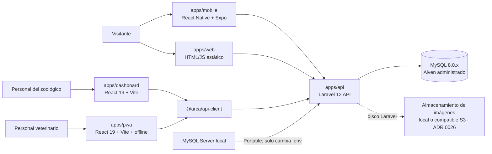

# ARCA-NB

Sistema multiplataforma para el Zoológico Municipal Nicolás Bravo, de la Presidencia Municipal de Tulancingo. El zoológico es un centro de rescate, conservación y rehabilitación de fauna silvestre, incluidos ejemplares decomisados por maltrato o tráfico ilegal.

**Estado actual: funcionalidad completa para pruebas reales.** Las cinco aplicaciones están implementadas bajo Spec-Driven Development, con pruebas automatizadas por criterio de aceptación y CI. En V1 la venta de boletos es solo en efectivo. Payments queda FUTURO/INACTIVO: no hay código, tablas, endpoints, SDK ni feature flag de pagos.

## Necesidades que atiende
1. **Administración y finanzas:** venta de boletos en taquilla, cancelaciones con motivo, reportes de cancelaciones con semáforo de revisión, y administración de cuentas y contenidos.
2. **Atención médico-veterinaria:** registro de ejemplares y evaluaciones clínicas (diagnóstico rápido e intenso, con exportación a PDF) que funciona sin conexión y se sincroniza al volver la red.
3. **Experiencia del visitante:** portal público con noticias, eventos, Zoopedia y memorias; app móvil con mapa del zoológico, escaneo QR de recintos, recorrido con realidad aumentada, progreso, logros, especies favoritas, memorias y avisos push.

## Componentes
| App | Público | Tecnología | Funciones principales |
|---|---|---|---|
| `apps/api` | Todas las apps | Laravel 12, PHP 8.4+ | Única autoridad de negocio y datos: autenticación, permisos, taquilla, expediente clínico, catálogo, contenidos, sincronización offline, avisos push |
| `apps/dashboard` | Personal administrativo | React 19 + TS + Vite | Taquilla, reportes de cancelaciones, consola de cuentas, noticias, eventos, especies, recintos y QR, moderación de memorias, búsqueda global |
| `apps/pwa` | Personal veterinario | React 19 + TS + Vite, offline | Registro y lista de ejemplares, diagnósticos, seguimiento, borradores offline sincronizados |
| `apps/web` | Público | HTML/CSS/JS estático (ADR 0024, 0028, 0031) | Portal institucional: noticias, eventos, Zoopedia, memorias, mapa, asistente de accesibilidad |
| `apps/mobile` | Visitantes | React Native 0.86 + Expo SDK 57 (Android) | Mapa del zoológico, QR, realidad aumentada, cuenta, progreso, favoritos, memorias, avisos push |
| `packages/` | Clientes | TypeScript | `@arca/api-client` (cliente tipado), `@arca/tokens` (tokens de diseño), `@arca/ui` (componentes); `config` y `assets` solo documentados |
| `tools/zoo-mapper` | Equipo | Web estática | Herramienta para levantar coordenadas del mapa |

El videojuego educativo Zoopedia quedó fuera de alcance de esta entrega (ADR 0005).

## Roles de negocio
`admin` (Administrador General), `zoo-admin` (administración del zoológico), `executive` (directivos, métricas de solo lectura), `communications` (contenidos públicos), `cashier` (taquilla) y `veterinarian` (expediente clínico). Los visitantes usan cuentas propias en la app móvil. Los roles con acceso al panel usan 2FA. Las definiciones completas están en [roles y permisos](docs/03-roles-y-permisos.md).

## Arquitectura



La API centraliza autenticación, permisos y lógica de negocio (Actions). Dashboard y PWA usan Sanctum con cookie; la app móvil usa tokens guardados en `expo-secure-store`. La base de datos se configura solo por `.env` y es portable entre Aiven (ADR 0013) y MySQL Server local. Las imágenes se guardan en un disco de Laravel intercambiable (ADR 0026).

## Stack y versiones

| Área | Tecnología | Versión |
|---|---|---|
| API | PHP, Laravel | PHP 8.4+ (ADR 0018), Laravel 12 |
| Autenticación | Sanctum, Fortify headless | cookie para SPA, tokens para mobile |
| Permisos y auditoría | Spatie Permission / Activitylog | ^6.24 / ^4.12 |
| Base de datos | MySQL | MySQL 8.0.x (revisión mínima pendiente del inventario inicial); cambios solo mediante DBR aprobada y migraciones que crea y aplica el responsable de BD ([gobierno de BD](docs/database/README.md)) |
| SPAs | React, TypeScript, Vite, Tailwind CSS | 19 / 5.8 / 7 / 4 |
| Pruebas | PHPUnit, Vitest, Jest | PHPUnit ^11.5, Vitest 5, Jest 29 |
| Mobile | React Native, Expo | 0.86.3 + SDK 57, TypeScript 6 (ADR 0004) |
| PWA offline | IndexedDB propia y service worker propio | ADR 0003 |
| Runtime JS | Node.js | 22 |

No se usa Inertia ni Wayfinder: las SPAs tienen rutas propias y la API usa rutas Laravel con nombre.

## Estructura del monorepo

```text
apps/
  api/ dashboard/ pwa/ web/ mobile/
    AGENTS.md   # reglas de la app
    docs/       # documentación local
    specs/      # qué y por qué (CA-xx, RN-xx)
    plan/       # diseño técnico
    tasks/      # pasos implementables
    src/        # código de la app
packages/       # @arca/api-client, tokens, ui (config y assets: solo README)
tools/zoo-mapper/  # herramienta de coordenadas del mapa
docs/           # visión, arquitectura, permisos, SDD, convenciones, glosario
  adr/ arquitectura/ database/ propuestas/ pruebas/ templates/
infra/          # checklist de despliegue
.github/workflows/  # CI
.claude/ .agents/   # skills, subagentes y hooks de agentes de IA
```

Cada app numera sus features de forma independiente; una feature usa el mismo `NNN-slug.md` en `specs/`, `plan/` y `tasks/` ([flujo SDD](docs/05-flujo-sdd.md)).

## Puesta en marcha local

Requisitos: Node.js 22 y npm; PHP 8.4+, Composer y las extensiones `pdo_mysql`, `mbstring`, `openssl`, `xml`, `ctype`, `fileinfo`, `tokenizer` y `bcmath`. Instala las dependencias JS con `npm ci` desde la raíz.

| App | Comando | Detalle |
|---|---|---|
| API | `cd apps/api/src && composer install && php artisan serve` | [requisitos y conexión](apps/api/docs/requisitos-entorno.md) |
| Dashboard | `npm run dev --workspace=@arca/dashboard` | |
| PWA | `npm run dev --workspace=apps/pwa` | |
| Web | `php -S localhost:8080 -t apps/web/src apps/web/src/router.php` | [README de web](apps/web/README.md) |
| Mobile | `npm run start --workspace=apps/mobile` | [guía móvil](apps/mobile/README.md) |

La guía completa, con puertos y variables, está en [guía de ejecución local](docs/09-guia-ejecucion-local.md).

## Comandos de base de datos (API)

Se ejecutan desde `apps/api/src` con `.env` configurado para `arca_pruebas`. Son de solo lectura y sirven para revisar el esquema antes de proponer una DBR:

| Comando | Qué muestra |
|---|---|
| `php artisan db:show` | Resumen del servidor y de la base conectada |
| `php artisan db:show --counts` | Lo anterior, con conteo de filas por tabla |
| `php artisan db:table <tabla>` | Columnas, tipos e índices de una tabla (por ejemplo, `users`) |
| `php artisan migrate:status` | Estado de las migraciones |

- Cuentas demo: configurar `DEMO_STAFF_PASSWORD` y ejecutar `php artisan db:seed` en `arca_pruebas` ([credenciales de desarrollo](apps/api/docs/credenciales-desarrollo.md)). El seeder demo se bloquea en producción.
- Cuentas de personal: `php artisan arca:create-staff`. Cuentas de administrador: comandos `php artisan arca:admin:*` (`arca:admin:help` lista todos).
- Respaldos y restauración: [docs/database/backups](docs/database/backups/README.md). Los scripts se niegan a correr contra `arca_zoo` o producción.

**Avisos:**

- `arca_pruebas` es la base de trabajo y de PHPUnit; no se borra ni reconstruye. Los tests usan `DatabaseTransactions`, activan `DB::prohibitDestructiveCommands()` y verifican que su base sea `arca_pruebas`; no ejecutar `RefreshDatabase`, `migrate:fresh` ni migraciones desde tests.
- `arca_zoo` es producción: ningún comando de desarrollo ni agente la usa.
- Los cambios de esquema los crea y aplica solo el responsable de BD, tras una DBR aprobada ([gobierno de BD](docs/database/README.md)).

## Calidad y CI

`.github/workflows/ci.yml` ejecuta en cada push y PR a `main` y `DevOps`: pruebas unitarias de la API, pruebas con cobertura de mobile, tipos, pruebas y build del dashboard, y pruebas y build de la PWA. Localmente, `php artisan test` (API), `npm test --workspace=<app>` y la skill `/verify`. El resultado de la revisión final de seguridad y rendimiento está en [auditoría final](docs/auditoria-final-entrega.md); el plan, los casos y la bitácora de pruebas están en `docs/pruebas/`.

## Flujo SDD

Antes de cambiar código se aprueba una spec; después se redactan el plan (con revisión de los seis principios de la [Constitución](CONSTITUTION.md)) y las tareas T-xx ligadas a criterios CA-xx. Se implementa en `src/` con al menos una prueba por CA-xx y se verifica antes del PR. Commits en Conventional Commits en inglés; las ramas de cambio siguen `feat|fix/<app>-<NNN>-<slug>`.

## Índice de documentación

- [Visión y alcance](docs/01-vision-y-alcance.md) · [Arquitectura](docs/02-arquitectura.md) · [Vistas de arquitectura](docs/arquitectura/README.md)
- [Roles y permisos](docs/03-roles-y-permisos.md) · [Sistema de diseño](docs/04-sistema-de-diseno.md)
- [Flujo SDD](docs/05-flujo-sdd.md) · [Convenciones](docs/06-convenciones.md) · [Glosario](docs/07-glosario.md) · [Patrones arquitectónicos](docs/08-patrones-arquitectonicos.md)
- [Guía de ejecución local](docs/09-guia-ejecucion-local.md) · [Índice de docs](docs/README.md)
- [Gobierno de base de datos](docs/database/README.md) · [ADRs](docs/adr/README.md) · [Propuestas opcionales](docs/propuestas/)
- [Infraestructura y checklist de despliegue](infra/README.md)
- Plantillas: [spec](docs/templates/spec.md) · [arquitectura por app](docs/templates/arquitectura-app.md)

## Agentes de IA

- `AGENTS.md`, `apps/<app>/AGENTS.md` y `CONSTITUTION.md` fijan las reglas; `CLAUDE.md` las enlaza para Claude Code.
- Skills del flujo (`sdd-spec`, `sdd-plan`, `sdd-tasks`, `sdd-implement`, `constitution-check`, `api-endpoint`, `spa-page`, `ui-component`, `theme-colors`, `verify`) en `.claude/skills/`, con fuentes en `.agents/skills/`. Subagentes por rol en `.claude/agents/`.
- Los hooks de `.agents/hooks/` (Node ESM sin dependencias) no sustituyen el SDD ni la revisión del equipo.
