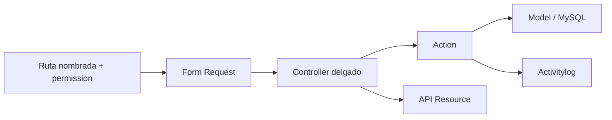
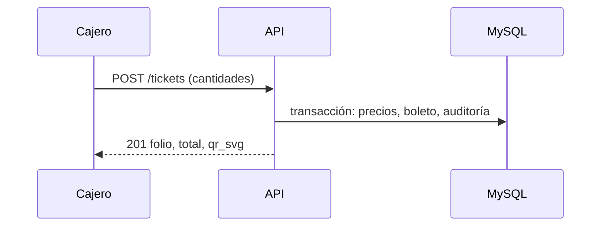

# Arquitectura de `apps/api`

## 1. Control

- **Estado:** Borrador (generado a partir de la implementación de `api-009`; pendiente de revisión del equipo).
- **Responsable:** Jonathan (backend); Víctor Adrián (BD).
- **PR de aprobación:** pendiente.
- **Capacidades descritas:** `actual` salvo indicación. Cubre lo verificable en `apps/api/src` hasta `api-009`; las demás features se enlazan a su spec sin repetirlas.

## 2. Propósito, alcance y exclusiones

- Problema y propósito: la API es la única dueña de datos y reglas de negocio de ARCA-NB (Constitución III y V).
- Incluye (`actual`): autenticación del personal y de visitantes, catálogo, administración (`api-007`), imágenes de noticias y eventos (`api-008`), venta, cancelación e historial de boletos y precios (`api-009`).
- No incluye: pagos electrónicos (Payments no se implementa sin spec, ADR y aprobación), arqueo y cierres de caja, validación del QR en torniquete, avisos y correo de cambios de precio.
- Capacidades futuras (no implementadas): avisos de cambio de precio y correo (`api-009` diferido, ADR 0020 Propuesto), arqueo, validación en torniquete (ADR 0021, diferidos).

## 3. Actores

| Actor | Necesidad | Permiso o confianza |
|---|---|---|
| `cashier` | Vender, cancelar sus boletos del día, ver su historial, leer precios | `tickets.create`, `tickets.cancel`, `tickets.view` |
| `admin` | Cambiar precios, administrar contenido y cuentas, ver historial | `ticket-prices.manage`, `tickets.view`, 2FA obligatorio |
| `zoo-admin` | Historial en lectura, administración operativa | `tickets.view`, 2FA obligatorio |
| `executive` | Panel y reportes de solo lectura | `dashboard.view`, `reports.view` |
| `veterinarian` | Sin acceso a `/admin` | — |
| Visitante | Cuenta y progreso en la app móvil | Token de visitante |

## 4. Módulos internos

| Módulo/feature | Estado | Responsabilidad | Dueño de datos |
|---|---|---|---|
| Autenticación del personal y visitantes | actual | Sesión, 2FA, tokens | API |
| Administración (`api-007`) | actual | Cuentas, noticias, eventos, recintos, panel, reportes | API |
| Imágenes de contenido (`api-008`) | actual | Imágenes de noticias y eventos | API |
| Venta de boletos (`api-009`) | actual | Venta, QR, cancelación, historial, precios | API (`tickets`, `ticket_prices`) |
| Avisos de precio y correo | futura | Diferido (`api-009`, ADR 0020) | — |

## 5. Estructura en `src/`

```text
app/Actions/Admin/{Content,Enclosures,Reports,Tickets,Users}/   lógica de negocio
app/Http/{Controllers,Requests,Resources}/Admin/                 límite HTTP
app/Models/                                                      datos
routes/api.php                                                   rutas nombradas /api/v1
tests/Feature/                                                   un test por CA, sobre arca_pruebas
```

Organización por feature dentro de `Actions`; los controladores solo dependen de Requests, Actions y Resources.

## 6. Patrón MVC

Laravel en su límite HTTP: Models para datos, Controllers delgados, Views sustituidas por API Resources JSON. Flujo: Form Request (valida y, cuando el alcance debe ser 404, resuelve el recurso) → Action (regla de negocio y transacción) → Resource. Las Actions escriben la auditoría con `LogAdminActivityAction`.

Excepciones aprobadas (ADR 0021): (a) `Ticket` y `TicketPrice` no extienden `BaseModel` (no existe en el repositorio) y usan SoftDeletes y auditoría propia; (b) `staff_notifications` sin SoftDeletes (sin uso en esta iteración); (c) el alcance de boletos por cajero se hace por consulta acotada con 404, sin Policy por registro.

## 7. Componentes

| Componente | Estado | Entrada/salida | Responsabilidad |
|---|---|---|---|
| `RegisterTicketSaleAction` | actual | cajero, cantidades → `IssuedTicketSale` | Resuelve precios, total, token, SVG y auditoría en una transacción |
| `CalculateTicketTotalAction` | actual | cantidades y precios → cadena | Total en céntimos enteros |
| `ResolveCurrentTicketPriceAction` | actual | tipo, instante → `TicketPrice` | Precio vigente y próximo |
| `ScheduleTicketPriceChangeAction` | actual | admin, montos, modo, fecha → filas | Cambio inmediato o programado |
| `IssueTicketQrTokenAction` / `RenderTicketQrSvgAction` | actual | → token / SVG | Token aleatorio y SVG en memoria (ADR 0019) |
| `IsTicketCancellableAction` / `CancelTicketAction` | actual | usuario, boleto, zona | Regla única de cancelación (mismo día, propio) |
| `ListTicketHistoryAction` | actual | usuario, filtros → paginador | Alcance por rol, filtros y `cancellable` |

## 8. Dependencias

- Internas: Spatie Permission y Activitylog, Sanctum, Fortify.
- Externas nuevas de `api-009`: `bacon/bacon-qr-code` ^3.1 (ADR 0019, instalada v3.1.1, requiere `ext-iconv`).
- Sin SDK de proveedor de nube ni de pagos (Constitución I).

## 9. Endpoints expuestos

Ver `apps/api/docs/administracion.md` (`api-007`) y `apps/api/docs/tickets.md` (`api-009`). Rutas de `notifications`: futuras, no existen.

## 10. Datos y flujo

MySQL 8.0.x es la fuente de verdad; el esquema cambia solo por migraciones del responsable de BD tras una DBR (DBR-006 para ventas). Boletos y precios nunca se borran físicamente. Flujo feliz de venta: validación → precios vigentes → total → token → boleto → SVG en memoria → auditoría, todo en una transacción. Fallo en cualquier paso: no queda boleto ni auditoría. Offline: no aplica a ventas.

## 11. Seguridad, errores y privacidad

Autorización en servidor con permisos Spatie por ruta. `qr_code` y `qr_svg` nunca salen en listados ni en la auditoría. Errores 401/403/404/422 con mensajes en español. Configuración solo por `.env`.

## 12. Pruebas

PHPUnit con `DatabaseTransactions` sobre `arca_pruebas`, un test por CA vigente; la cobertura se verifica con `TicketSalesCoverageTest` y `AdminCoverageTest`.

## 13. Diagrama de componentes



## 14. Secuencias críticas



## 15. Riesgos, pendientes y ADRs

| Riesgo/pregunta | Mitigación o decisión requerida | ADR/spec | Responsable |
|---|---|---|---|
| Sin `BaseModel` | Auditoría propia por modelo; decidir si se crea | ADR 0021 | Equipo |
| Doble envío de venta | Sin idempotencia; el cliente bloquea el botón | `api-009` plan | Jonathan |
| Evidencia de DBR-006 en otros ambientes | Aportarla antes de desplegar | DBR-006 | Víctor Adrián |
| Avisos y correo diferidos | Reactivar con revisión de la spec | ADR 0020 | Jonathan |

## 16. Validación

- [ ] Respeta la línea base de `docs/02-arquitectura.md` y `CONSTITUTION.md`.
- [x] Estados actual/futuro son inequívocos.
- [x] MVC explícito.
- [x] No inventa entidades, contratos ni integraciones.
- [x] Revisión del equipo pendiente.
- [x] Excepciones enlazan un ADR aprobado (0021).

## Participación futura en Payments

**FUTURA/INACTIVA.** V1 usa solo efectivo (`payment_method` `cash`). No hay código, tablas, endpoints, SDK ni feature flag de pagos.
