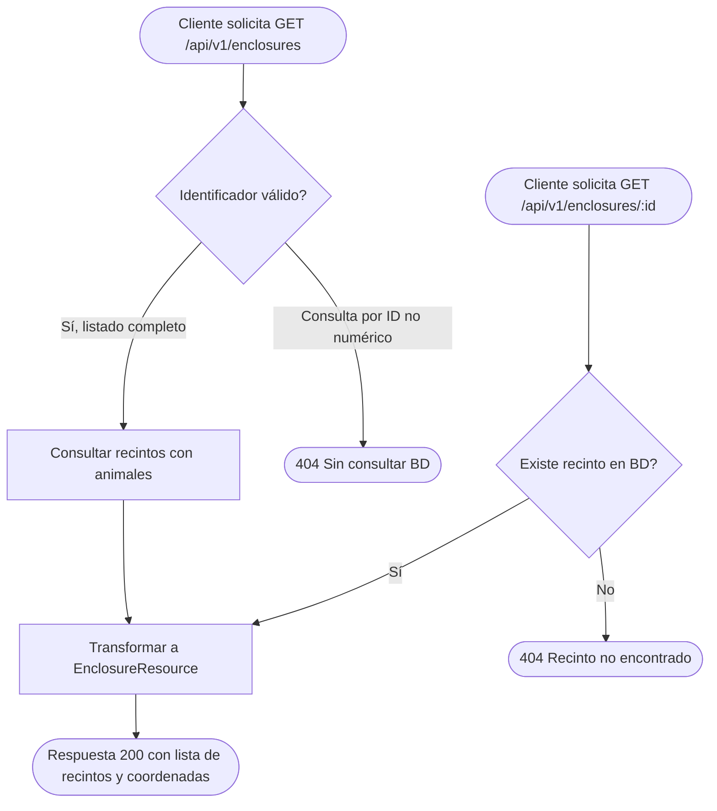

# 010 · public-enclosures-read

- App dueña: `api`
- Apps/paquetes afectados: `api`, `mobile` (consumidor), `@arca/api-client`
- Estado: Aprobada
- Solicitante / responsable funcional: Víctor Adrián
- Aprobación funcional: Víctor Adrián (2026-11-07)
- DBR asociada: `docs/database/requests/DBR-008-enclosure-gps-coordinates.md` (Aprobada)

---

## Problema y contexto

La app móvil (`mobile-007` y `mobile-009`) cuenta con mapa 2D interactivo, cálculo de rutas peatonales, detección de llegada geodésica (Haversine ≤ 10 m) y recorrido guiado con cámara de realidad aumentada. Sin embargo, actualmente todos los recintos, puntos de interés y coordenadas provienen de un fixture sintético en memoria (`MOCK_MAP_PLACES`).

Para que la app muestre los recintos reales del Zoológico Municipal Nicolás Bravo, ubique a los animales en sus hábitats físicos y guíe al visitante con precisión, la API central debe exponer un catálogo público de recintos que entregue las coordenadas geográficas (`gps_lat`, `gps_lon`) y las coordenadas en el plano SVG (`map_x`, `map_y`) que fueron normalizadas en la base de datos mediante la migración `DBR-008`.

---

## Objetivos

- Exponer dos endpoints públicos de solo lectura bajo el prefijo `/api/v1`:
  - `GET /api/v1/enclosures` (nombre de ruta: `enclosures.index`).
  - `GET /api/v1/enclosures/{enclosure}` (nombre de ruta: `enclosures.show`).
- Entregar un contrato JSON limpio en `snake_case` con los datos de ubicación de cada recinto: `id`, `name`, `gps_lat`, `gps_lon`, `map_x`, `map_y`, el conteo de animales (`animals_count`) y el listado de animales y especies que habitan en él.
- Permitir acceso público anónimo (sin requerir sesión, token Sanctum ni cookies), garantizando la misma accesibilidad que `/species` y `/events` (`api-006`).
- Prevenir problemas de rendimiento N+1 cargando anticipadamente las relaciones de animales y especies.
- Cubrir cada criterio de aceptación con al menos una prueba Feature en PHPUnit utilizando `DatabaseTransactions` contra `arca_pruebas`.

---

## Fuera de alcance

- Creación, edición, cambio de estatus o borrado de recintos (estos pertenecen al dashboard administrativo cubierto en `api-007`).
- Modificaciones al esquema de base de datos (el esquema ya está resuelto y aprobado en `DBR-008`).
- Cálculo de distancias geodésicas en el servidor (el cálculo Haversine se ejecuta en el dispositivo cliente en memoria para no saturar la API).
- Subida o procesamiento de archivos multimedia de recintos.
- Autenticación obligatoria de visitantes para ver el mapa.

---

## Actores y permisos

| Actor/rol | Necesidad | Permisos requeridos |
|---|---|---|
| Visitante anónimo (App móvil / Web) | Consultar los recintos y sus ubicaciones para orientarse en el mapa del zoológico | Ninguno; endpoint público de solo lectura |
| App móvil (`mobile-007`) | Consumir el catálogo para posicionar los marcadores y alimentar el recorrido 3D/AR | Ninguno |
| Responsable de BD | Asegurar que el contrato consuma fielmente las columnas de `DBR-008` | No aplica; esquema ya aprobado |

---

## Historias de usuario

- **HU-01 (Consulta pública de recintos):** Como visitante del zoológico, quiero consultar la lista de recintos con su ubicación geográfica y en el mapa para ubicar dónde se encuentran los animales.
- **HU-02 (Detalle del recinto y fauna):** Como visitante, quiero ver el detalle de un recinto específico para saber qué animales y especies habitan en él antes de dirigirme hacia allá.
- **HU-03 (Uso sin conexión en la app):** Como visitante con señal intermitente, quiero que los recintos obtenidos de la API se puedan almacenar en la app móvil para no perder el mapa durante mi recorrido.

---

## Criterios de aceptación

- **CA-01 (Listado público de recintos):** Dado que existen recintos registrados en la base de datos, cuando un cliente anónimo envía `GET /api/v1/enclosures`, entonces la API responde con código HTTP `200` y un cuerpo JSON `{"data": [...]}` ordenado por `id` ascendente; cada elemento incluye:
  - `id` (entero positivo)
  - `name` (cadena de texto)
  - `gps_lat` (número flotante decimal o `null` si no está medido)
  - `gps_lon` (número flotante decimal o `null` si no está medido)
  - `map_x` (número flotante decimal o `null` si no está posicionado)
  - `map_y` (número flotante decimal o `null` si no está posicionado)
  - `animals_count` (entero $\ge 0$)
  - `animals` (arreglo de animales con `id`, `name`, `species_id`, `species_name`).
- **CA-02 (Detalle de recinto existente):** Dado un identificador numérico de recinto existente en la base de datos, cuando se envía `GET /api/v1/enclosures/{id}`, entonces la API responde con código HTTP `200` y el objeto del recinto con la misma estructura descrita en CA-01.
- **CA-03 (Recinto inexistente o no numérico):** Dado un identificador numérico que no corresponde a ningún recinto registrado, cuando se envía `GET /api/v1/enclosures/{id}`, entonces la API responde con código HTTP `404` y un mensaje JSON `{"message": "Recinto no encontrado."}`. Si el identificador no es numérico (por ejemplo `/enclosures/abc`), responde `404` sin consultar la base de datos.
- **CA-04 (Acceso público sin credenciales):** Dado cualquier cliente que envíe peticiones a los endpoints sin cabeceras `Authorization`, sin cookies y sin tokens de sesión, entonces la API responde exitosamente `200` sin rechazar la solicitud ni requerir autenticación.
- **CA-05 (Pruebas automatizadas en PHPUnit):** Dada la suite de pruebas del backend en `apps/api`, cuando se ejecuta `php artisan test`, entonces todos los tests corren contra la base de datos `arca_pruebas` con `DatabaseTransactions` y existe al menos un test que valida explícitamente cada uno de los criterios CA-01 a CA-04.

---

## Reglas de negocio

- **RN-01 (Contrato inmutable de coordenadas):** `gps_lat`, `gps_lon`, `map_x` y `map_y` deben devolverse como números flotantes (`float`) en la salida JSON cuando tengan valor numérico en la base de datos, nunca como strings formateados, para facilitar los cálculos matemáticos en la app móvil.
- **RN-02 (Optimización de consultas sin N+1):** La consulta debe usar carga ansiosa (`eager loading`) con `with(['animals.species'])` o `withCount('animals')` para resolver todos los recintos en una cantidad fija y mínima de consultas a la base de datos.
- **RN-03 (Protección de auditoría interna):** La respuesta pública de recintos no debe exponer campos de control administrativo interno como `created_by`, `updated_by` o metadatos de sesión.

---

## Datos, privacidad y auditoría

- **Entidades consultadas:** `enclosures`, `animals`, `species`.
- **Naturaleza de los datos:** Datos geográficos y taxonómicos públicos del zoológico. No contiene datos personales, de contacto ni datos clínicos/financieros sensibles.
- **Esquema:** Las columnas `gps_lat`, `gps_lon`, `map_x`, `map_y` fueron incorporadas en la tabla `enclosures` mediante la migración `2026_11_03_000008_enclosure_gps_coordinates.php` (`DBR-008`). Esta spec no modifica el esquema.

---

## Flujos y errores

---

## Dependencias, riesgos y preguntas

- **Dependencias:**
  - Migración `DBR-008` (`2026_11_03_000008_enclosure_gps_coordinates.php`) aplicada en `arca_pruebas`.
  - Modelo `App\Models\Enclosure` actualizado.
- **Riesgos:**
  - Si un recinto no tiene aún coordenadas GPS (`null`), la app móvil debe degradar graciosamente usando `map_x`/`map_y` o manteniendo el marcador en el catálogo sin fallar. Esto ya está contemplado en `CA-01`.
- **Preguntas resueltas:**
  - *¿Los recintos requieren autenticación?* No, el mapa es de libre acceso para cualquier visitante.

---

## Revisión

- **Aprobadores:** Víctor Adrián (Responsable funcional).
- **Evidencia/enlaces:**
  - `docs/database/requests/DBR-008-enclosure-gps-coordinates.md`
  - `apps/mobile/specs/007-map-location.md`
