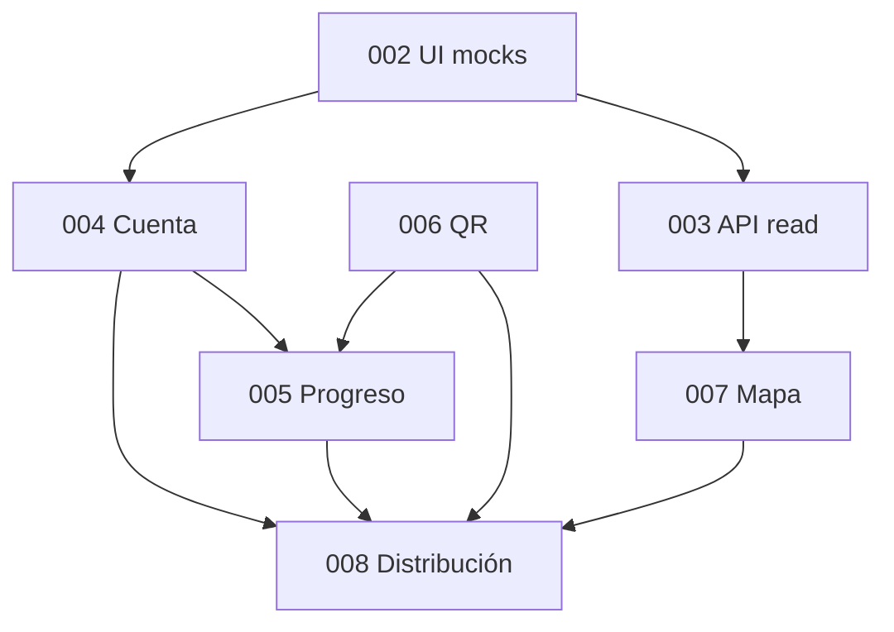

# Roadmap móvil 003–008 · estado y asignación

Documento de referencia para el equipo de `apps/mobile`. Resume el cumplimiento de las reglas en `AGENTS.md` (raíz y app), el estado de las ocho specs numeradas y quién redacta cada spec hasta su **aprobación funcional** (SDD: `/sdd-spec` → plan → tasks → implementación).

**Última revisión:** 2026-10-16.

## Reglas que aplican a todo el trabajo móvil

- Leer `CONSTITUTION.md`, `../../AGENTS.md` y `apps/mobile/AGENTS.md` antes de codificar.
- Solo implementar con spec **Aprobada**; borradores se refinan con `/sdd-spec` y esperan aprobación explícita.
- Código únicamente en `apps/mobile/src/`; MVVM: rutas/pantallas → ViewModels → Repositories → `@arca/api-client` o mocks.
- UI y documentación en español; commits y código en inglés.
- Cámara, QR real, mapa/GPS, almacenamiento seguro y builds de distribución exigen spec aprobada y, cuando corresponda, ADR (p. ej. 0011, 0012, dependencias de cámara).
- No inventar endpoints ni migraciones: la API es dueña del contrato (`api-003`, `api-004`, `api-005`, etc.).

## Estado de las specs 001–008

| NNN | Slug | Estado spec | Plan / tasks | Implementación | Notas |
|-----|------|-------------|--------------|----------------|-------|
| 001 | mobile-setup | **Implementada** | Sí | Completa | Base Expo, Router, Jest, workspaces. T-08 cerrada con entrega en rama principal (2026-10-14). |
| 002 | mobile-ui-base-visitor-journey | **Implementada** | Sí | Completa (+ enmienda acceso visual) | Prototipo con mocks: sin API, cámara, GPS ni 3D real. **Enmienda 2026-10-15:** CA-11–CA-15 (Login, registro, recuperación, Ajustes, Privacidad demo); T-48–T-53; **no sustituye** spec `004`. Verificación automatizada 2026-10-16: 11 suites Jest, 70 tests, `tsc --noEmit` OK. |
| 003 | api-read-integration | Borrador | No | No iniciada | Catálogo animales/eventos + caché; **bloqueada** hasta spec API catálogo público y política de caché. |
| 004 | visitor-account | Borrador | **Plan borrador** (`plan/004-visitor-account.md`) | No iniciada | Cuenta visitante adulto, tokens, refresh; F1 mock + F2 HTTP cuando `api-004` / DBR; depende ADR 0011. La UI `(auth)` y `visitorAccessRepository` de la enmienda **002** son demostración en memoria, no implementación de 004. |
| 005 | visitor-progress | Borrador | No | No iniciada | Progreso, colección por especie, cola offline; depende `api-005`, `mobile-004`, `mobile-006`. |
| 006 | qr-scan | Borrador | No | No iniciada | Cámara y lectura QR → entrega código a cola de 005. |
| 007 | map-location | Borrador | No | No iniciada | Mapa real, recintos API, GPS; proveedor de mapa por decidir. |
| 008 | build-distribution | Borrador | No | No iniciada | Play Store pruebas + APK; ADR 0012. Redacción provisional: **Aksel**. |

### Evidencia specs 001 y 002

- **001:** Tareas T-01–T-08 completas; entorno validado en cadena con 002.
- **002:** CA-01–CA-15 cubiertos (tasks T-01–T-53; enmienda acceso/ajustes 2026-10-15). Pruebas `test-ca-11`–`test-ca-15` en `__tests__/access.test.tsx`. Guías: [002-mobile-ui-visitor-journey](./002-mobile-ui-visitor-journey.md), [arquitectura](./arquitectura.md), [README](../README.md). Validación visual Android de acceso/ajustes: ver ítems 12–15 de la guía 002.

## Asignación: redacción y ownership de specs

Acuerdo del equipo (2026-10-14): **Aksel** y **Víctor** redactan y llevan cada spec hasta aprobación funcional; la implementación sigue el SDD una vez aprobada (plan/tasks pueden repartirse aparte).

| Spec | Tema | Redactor / responsable de spec |
|------|------|--------------------------------|
| 003 | Integración lectura API (animales, eventos, caché) | **Víctor** |
| 004 | Cuenta visitante (registro, sesión, perfil) | **Aksel** |
| 005 | Progreso visitante (colección, logros, cola escaneos) | **Aksel** |
| 006 | Escaneo QR con cámara | **Aksel** |
| 007 | Mapa y ubicación | **Víctor** |
| 008 | Build y distribución Android | **Aksel** (provisional hasta acuerdo del equipo) |

Orden lógico de dependencias (no obligatorio de paralelismo humano):

## Documentación reciente en `apps/mobile`

| Archivo | Propósito |
|---------|-----------|
| [README.md](../README.md) | Instalación, Expo Go, pruebas, límites del prototipo 002 |
| [docs/arquitectura.md](./arquitectura.md) | MVVM, módulos, mocks, riesgos |
| [docs/002-mobile-ui-visitor-journey.md](./002-mobile-ui-visitor-journey.md) | Validación manual y rutas del prototipo |
| [specs/003-api-read-integration.md](../specs/003-api-read-integration.md) … [008](../specs/008-build-distribution.md) | Borradores 003–008 (CA preliminares, preguntas abiertas) |

## Límite entre enmienda 002 (demo) y spec 004 (cuenta real)

Hasta que la spec **004** tenga **aprobación funcional**, plan y tasks aprobados, y el ADR **0011** quede aceptado, **no** se debe añadir al código de producción móvil:

- Dependencias `expo-secure-store`, `@react-native-async-storage/async-storage` ni otros almacenamientos para sesión o cola (salvo ADR/spec explícitos).
- Llamadas HTTP de cuenta (`register`, `auth/login`, `auth/refresh`, `me`, etc.) ni uso productivo de `@arca/api-client` en repositorios de autenticación.
- Pantallas o flujos de spec 004 aún no aprobados: `welcome`, verificación de correo con API, selector de avatar, mayoría de edad, aviso legal desde `legal/privacy-notice`, borrado de cuenta, refresh single-flight ante 401.

La carpeta `(auth)` actual cumple **CA-11–CA-15** de **002** (compuerta `signedOut` / `entered` en memoria). Evolucionar hacia 004 solo tras el SDD completo de esa spec.

## Preguntas abiertas (para cerrar en spec o con arquitectura/API)

1. **003:** Endpoints del catálogo público y política de caché (TTL, invalidación) — bloquean aprobación de 003.
2. **004–005:** Ilustraciones finales de avatares; aviso de privacidad desde API; DBR/`api-004` y `api-005` en estado «Lista para backend».
3. **006:** Dependencia concreta de cámara/QR (ADR); captura manual como alternativa; operación física de QR en recintos.
4. **007:** Proveedor de mapa, claves/costos y posible salida de Expo Go (development build).
5. **008:** Confirmación final de quién redacta/implementa distribución (Aksel provisional).

Cuando una pregunta se resuelva, actualizar la spec correspondiente y, si aplica, un ADR en `docs/adr/`.
