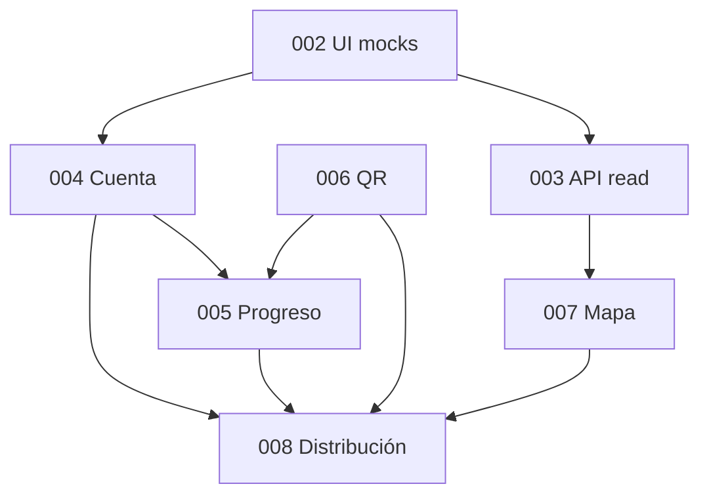

# Roadmap móvil 003–008 · estado y asignación

Documento de referencia para el equipo de `apps/mobile`. Resume el cumplimiento de las reglas en `AGENTS.md` (raíz y app), el estado de las specs numeradas y quién redacta cada spec hasta su **aprobación funcional** (SDD: `/sdd-spec` → plan → tasks → implementación).

**Estado del documento:** alineado con el código vigente de la app: avatares PNG, toque de un aviso de memoria e icono. No cierra pull requests, no da por entregado el aviso con la app cerrada y no da por terminado el recorrido 3D.

## Reglas que aplican a todo el trabajo móvil

- Leer `CONSTITUTION.md`, `../../AGENTS.md` y `apps/mobile/AGENTS.md` antes de codificar.
- Solo implementar con spec **Aprobada**; borradores se refinan con `/sdd-spec` y esperan aprobación explícita.
- Código únicamente en `apps/mobile/src/`; MVVM: rutas/pantallas → ViewModels → Repositories → `@arca/api-client` o mocks.
- UI y documentación en español; commits y código en inglés.
- Cámara, QR real, GPS, almacenamiento seguro y builds de distribución exigen spec aprobada y, cuando corresponda, ADR (p. ej. 0011, 0012, dependencias de cámara).
- No inventar endpoints ni migraciones: la API es dueña del contrato (`api-003`, `api-004`, `api-005`, etc.).

## Estado de las specs 001–008

| NNN | Slug | Estado spec | Plan / tasks | Implementación | Notas |
|-----|------|-------------|--------------|----------------|-------|
| 001 | mobile-setup | **Implementada** | Sí | Completa | Base Expo, Router, Jest, workspaces. T-08 cerrada con entrega en rama principal. |
| 002 | mobile-ui-base-visitor-journey | **Implementada** | Sí | Completa (+ enmienda acceso visual) | Prototipo con mocks: sin API, cámara, GPS ni 3D real. **Enmienda:** CA-11–CA-15 (Login, registro, recuperación, Ajustes, Privacidad demo); T-48–T-53; **no sustituye** spec `004`. Verificación automatizada: 11 suites Jest, 70 tests, `tsc --noEmit` OK. T-56 (revisión manual en dispositivo) fuera de alcance de esta entrega. |
| 003 | api-read-integration | **Implementada** | Sí | Completa | Catálogo de animales y eventos consumiendo API mediante `@arca/api-client`, mapeo snake_case a camelCase, caché SWR de 5 minutos en `AsyncStorage` y detección de conectividad con `expo-network` (ADR 0014), fallback de imágenes y vistas para 5 estados UI (loading, empty, error, offline, success). Tareas T-01 a T-30 completadas. Verificación tras el merge con 004: 23 suites Jest, 111 tests y `tsc --noEmit` OK. |
| 004 | visitor-account | **Implementada** | Plan aprobado. T-01 a T-57 hechas | Cuenta real con `EXPO_PUBLIC_API_URL`, `expo-secure-store` y el cliente visitante. Sin esa variable, y en Jest, sigue el mock | ADR 0011 aceptado. `api-004` Implementada en el mismo corte. Sin URL de API no hay cuentas ni código de prueba en la app. Enmienda: el avatar vigente es `src/assets/avatars/<código>.png`. |
| 005 | visitor-progress | **Implementada** | Plan aprobado. T-01 a T-14 hechas | Progreso, colección, salón de logros, misiones y cola de escaneos | Enmienda: el listado se llama «Salón de logros». «Misión cumplida» y «Maestro de misiones» no se muestran. |
| 006 | qr-scan | **Implementada** | Plan aprobado. T-01 a T-14 hechas | Cámara `expo-camera`, entrada manual, `submitScan` → `scan-result` | ADR 0022. API sin cambios (`api-005`). |
| 007 | map-location | **Implementada** | Plan y tasks | Mapa 2D con SVG canónico (`mobile-017`), GPS con punto azul, ruta por senderos, controles de zoom y centrado, y API de recintos con caché offline (enmienda V4) | Enmienda V4 sin tareas propias registradas en su archivo de tasks. La validación visual de la primera entrega para visitantes se exige en `mobile-008` CA-06. |
| 008 | build-distribution | **Implementada** (alcance parcial) | No hay plan ni tasks | `eas.json` con perfiles `development` y `preview`. El perfil `production` lo completa [`mobile-018`](../specs/018-production-build-hardening.md) | Canal Play Store en pruebas + APK; ADR 0012. Responsable de firma y build: fuera de alcance de esta entrega. |
| 009 | ar-3d-map-guide | **Implementada** (con excepciones pendientes de verificación) | Plan y tasks | Matemática de rumbo y bifurcaciones, planificador de recorrido y HUD «Iniciar Recorrido 3D» | `ThreeTourScene.tsx` no existe; la escena la renderiza `LocationArScene` (`mobile-015`). Tareas T-04, T-08 y T-09 sin verificar en `tasks/009-ar-3d-map-guide.md`. |
| 009 | expo-sdk57-dependency-alignment | En progreso | Plan y tasks | Alineación de SDK 57 | No cambia el alcance del mapa ni del recorrido 3D. |
| 010 | visitor-memory-requests | En progreso | Plan y tasks aprobados | «Mis momentos» en Perfil | Enmienda: el título pasa de «Mis recuerdos» a «Mis momentos» y el límite semanal dice «otro momento». Un aviso abre `/memory-form` y espera la lista antes de decir que falta. Sin foto devuelta por la API. La verificación y el pull quedaron confirmados. No pasa a Implementada: el zoológico aún no redacta el texto de la casilla (RN-07). |
| 011 | mobile-service-coverage-ci | **Implementada** | Plan y tasks | Jest con umbral en servicios, repositorios y viewmodels | El informe no cubre pantallas ni rutas. |
| 012 | monorepo-ci-validation | **Implementada** | Plan y tasks | Validación de CI del monorepo | No sustituye la revisión visual del teléfono. |
| 013 | visitor-push-notifications | En progreso | Plan y tasks | Interruptores, token Android y toque del aviso | Enmienda: el toque de un momento espera la lista. El icono del aviso es `notification.png` y el nombre visible es ARCA-NB. La barra con la app cerrada se comprueba en el APK `preview`. La verificación y el pull quedaron confirmados. |
| 014 | visitor-favorite-species | En progreso | Plan y tasks aprobados | Corazón y «Animales favoritos» contra la cuenta | La verificación y el pull quedaron confirmados. Colección no filtra favoritos. |

### Evidencia specs 001 y 002

- **001:** Tareas T-01–T-08 completas; entorno validado en cadena con 002.
- **002:** CA-01–CA-15 cubiertos (tasks T-01–T-60; enmienda acceso/ajustes). Pruebas `test-ca-11`–`test-ca-15` en `__tests__/access.test.tsx`. Guías: [002-mobile-ui-visitor-journey](./002-mobile-ui-visitor-journey.md), [arquitectura](./arquitectura.md), [README](../README.md). Validación visual Android de acceso/ajustes: ver ítems 12–15 de la guía 002.

## Asignación: redacción y ownership de specs

Acuerdo del equipo: el equipo móvil redacta y lleva cada spec hasta aprobación funcional; la implementación sigue el SDD una vez aprobada (plan y tasks pueden repartirse aparte).

| Spec | Tema | Redactor / responsable de spec |
|------|------|--------------------------------|
| 003 | Integración lectura API (animales, eventos, caché) | Frontend (con Backend para el contrato de API) |
| 004 | Cuenta visitante (registro, sesión, perfil) | Frontend |
| 005 | Progreso visitante (colección, logros, cola escaneos) | Frontend |
| 006 | Escaneo QR con cámara | Frontend |
| 007 | Mapa y ubicación | Frontend |
| 008 | Build y distribución Android | Frontend |

Orden lógico de dependencias (no obligatorio de paralelismo humano):

## Documentación reciente en `apps/mobile`

| Archivo | Propósito |
|---------|-----------|
| [README.md](../README.md) | Instalación, Expo Go, pruebas, límites del prototipo 002 |
| [docs/arquitectura.md](./arquitectura.md) | MVVM, módulos, mocks, riesgos |
| [docs/002-mobile-ui-visitor-journey.md](./002-mobile-ui-visitor-journey.md) | Validación manual y rutas del prototipo |
| [docs/007-svg-brief.md](./007-svg-brief.md) | Brief del SVG esquemático y coordenadas de la V1 |
| [docs/007-map-v1-draft.svg](./007-map-v1-draft.svg) | Borrador visual del mapa 2D |
| [specs/003-api-read-integration.md](../specs/003-api-read-integration.md) … [008](../specs/008-build-distribution.md) | Estado de las specs 003–008 (CA, planes y decisiones) |

## Límite entre enmienda 002 (demo) y specs 003/004

Las specs **003** y **004** quedaron implementadas. La carpeta `(auth)` cumple la cuenta de **004** sobre las pantallas de **002**; sin `EXPO_PUBLIC_API_URL` esa cuenta sigue simulada.

- `expo-secure-store` (ADR 0011) guarda solo el par de tokens de la cuenta.
- `@react-native-async-storage/async-storage` y `expo-network` (ADR 0014) sirven para la caché de lectura, la conectividad del catálogo público y, desde `mobile-005`, la cola de escaneos. No se vuelve a instalar AsyncStorage.
- `HttpAuthRepository` y el módulo visitante de `@arca/api-client` se usan cuando `EXPO_PUBLIC_API_URL` tiene valor.
- El QR con cámara está en la spec 006. La distribución sigue en la 008. Los avisos push (013) siguen en progreso.

## Decisiones

1. **007:** Se optó por marcar la spec 007 como Implementada, porque su código y sus pruebas existen para V1 a V4 y las enmiendas; la validación visual de la primera entrega para visitantes queda en `mobile-008` CA-06.
2. **008:** Se optó por registrar solo el alcance implementado (perfiles `development` y `preview`), porque el perfil `production` pertenece a `mobile-018`. El responsable de firma y build queda fuera de alcance de esta entrega y se define antes del primer build público.
3. **Contenido transversal:** Se optó por no bloquear las specs implementadas por las ilustraciones finales de avatares ni por el texto definitivo del aviso de privacidad, porque el zoológico los entrega después.
4. **Operación QR en recintos:** Se optó por dejar la impresión y colocación de los códigos fuera del software, porque es operación del zoológico; la generación usa `arca:generate-qr-codes` (`api-005`).

Cuando una decisión cambie, actualizar la spec correspondiente y, si aplica, un ADR en `docs/adr/`.
