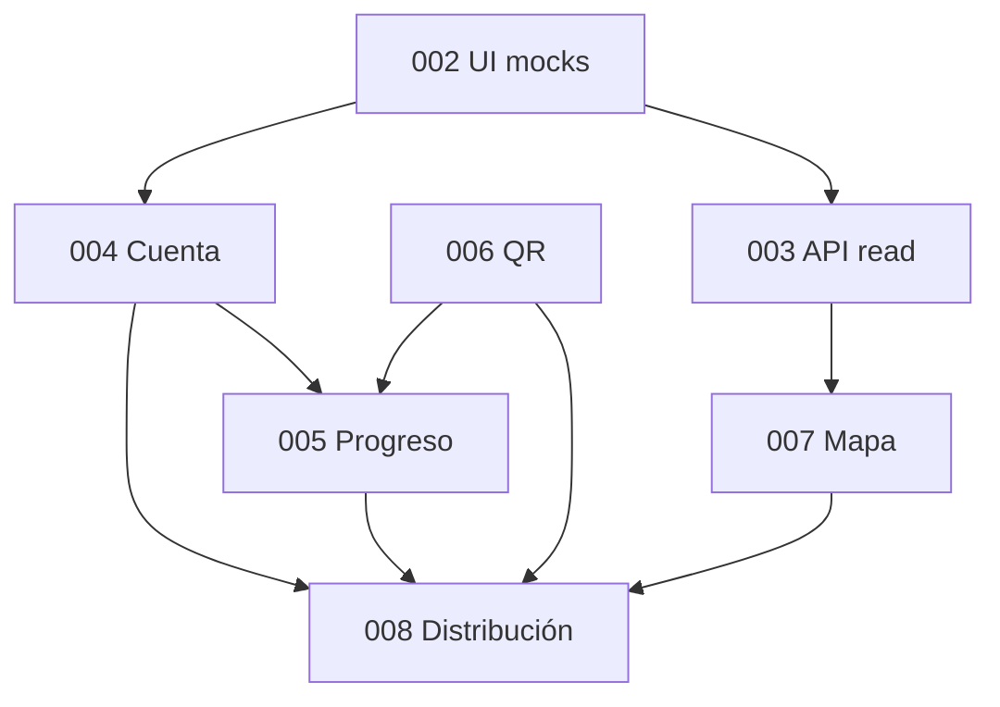

# Roadmap móvil 003–008 · estado y asignación

Documento de referencia para el equipo de `apps/mobile`. Resume el cumplimiento de las reglas en `AGENTS.md` (raíz y app), el estado de las ocho specs numeradas y quién redacta cada spec hasta su **aprobación funcional** (SDD: `/sdd-spec` → plan → tasks → implementación).

**Última revisión:** 2026-10-22.

## Reglas que aplican a todo el trabajo móvil

- Leer `CONSTITUTION.md`, `../../AGENTS.md` y `apps/mobile/AGENTS.md` antes de codificar.
- Solo implementar con spec **Aprobada**; borradores se refinan con `/sdd-spec` y esperan aprobación explícita.
- Código únicamente en `apps/mobile/src/`; MVVM: rutas/pantallas → ViewModels → Repositories → `@arca/api-client` o mocks.
- UI y documentación en español; commits y código en inglés.
- Cámara, QR real, mapa/GPS, almacenamiento seguro y builds de distribución exigen spec aprobada y, cuando corresponda, ADR (p. ej. 0011, 0012, dependencias de cámara).
- No inventar endpoints ni migraciones: la API es dueña del contrato (`api-003`, `api-004`, `api-005`, etc.).

## Estado de las specs 001–008

| NNN | Slug | Estado spec | Plan / tasks | Implementación | Notas |
|-----|------|-------------|--------------|----------------|-------|
| 001 | mobile-setup | **Implementada** | Sí | Completa | Base Expo, Router, Jest, workspaces. T-08 cerrada con entrega en rama principal (2026-10-14). |
| 002 | mobile-ui-base-visitor-journey | **Implementada** | Sí | Completa (+ enmienda acceso visual) | Prototipo con mocks: sin API, cámara, GPS ni 3D real. **Enmienda 2026-10-15:** CA-11–CA-15 (Login, registro, recuperación, Ajustes, Privacidad demo); T-48–T-53; **no sustituye** spec `004`. Verificación automatizada 2026-10-16: 11 suites Jest, 70 tests, `tsc --noEmit` OK. |
| 003 | api-read-integration | **Aprobada** | Sí | Completa | Catálogo de animales y eventos consumiendo API mediante `@arca/api-client`, mapeo snake_case a camelCase, caché SWR de 5 minutos en `AsyncStorage` y detección de conectividad con `expo-network` (ADR 0014), fallback de imágenes y vistas para 5 estados UI (loading, empty, error, offline, success). Tareas T-01 a T-22 completadas. Verificación tras el merge con 004: 23 suites Jest, 111 tests y `tsc --noEmit` OK. |
| 004 | visitor-account | **Implementada** (2026-10-21; aprobación de Aksel, 2026-10-20) | Plan aprobado. T-01 a T-44 hechas. La fase HTTP la firmó Aksel el 2026-10-21 | Cuenta real con `EXPO_PUBLIC_API_URL`, `expo-secure-store` y el cliente visitante. Sin esa variable, y en Jest, sigue el mock | ADR 0011 aceptado el 2026-10-21. `api-004` Implementada el mismo día. La demo `123456` sigue en Jest y cuando no hay URL. |
| 005 | visitor-progress | **En progreso** (Aksel, 2026-10-22) | Plan y tareas aprobados. La implementación consume `api-005`; no está Implementada hasta el PR | Progreso, colección por especie, logros, misiones y cola de escaneos | AsyncStorage ya estaba por el ADR 0014. No se instala otra dependencia. La cámara sigue en `mobile-006`. |
| 006 | qr-scan | Borrador | No | No iniciada | Cámara y lectura QR → entrega código a cola de 005. |
| 007 | map-location | Borrador | No | No iniciada | Mapa real, recintos API, GPS; proveedor de mapa por decidir. |
| 008 | build-distribution | Borrador | No | No iniciada | Play Store pruebas + APK; ADR 0012. Redacción provisional: **Aksel**. |

### Evidencia specs 001 y 002

- **001:** Tareas T-01–T-08 completas; entorno validado en cadena con 002.
- **002:** CA-01–CA-15 cubiertos (tasks T-01–T-53; enmienda acceso/ajustes 2026-10-15). Pruebas `test-ca-11`–`test-ca-15` en `__tests__/access.test.tsx`. Guías: [002-mobile-ui-visitor-journey](./002-mobile-ui-visitor-journey.md), [arquitectura](./arquitectura.md), [README](../README.md). Validación visual Android de acceso/ajustes: ver ítems 12–15 de la guía 002.

## Asignación: redacción y ownership de specs

Acuerdo del equipo (2026-10-14): **Aksel** y **Víctor** redactan y llevan cada spec hasta aprobación funcional; la implementación sigue el SDD una vez aprobada (plan/tasks pueden repartirse aparte).

| Spec | Tema | Redactor / responsable de spec |
|------|------|--------------------------------|
| 003 | Integración lectura API (animales, eventos, caché) | **Víctor** |
| 004 | Cuenta visitante (registro, sesión, perfil) | **Aksel** |
| 005 | Progreso visitante (colección, logros, cola escaneos) | **Aksel** |
| 006 | Escaneo QR con cámara | **Aksel** |
| 007 | Mapa y ubicación | **Víctor** |
| 008 | Build y distribución Android | **Aksel** (provisional hasta acuerdo del equipo) |

Orden lógico de dependencias (no obligatorio de paralelismo humano):

## Documentación reciente en `apps/mobile`

| Archivo | Propósito |
|---------|-----------|
| [README.md](../README.md) | Instalación, Expo Go, pruebas, límites del prototipo 002 |
| [docs/arquitectura.md](./arquitectura.md) | MVVM, módulos, mocks, riesgos |
| [docs/002-mobile-ui-visitor-journey.md](./002-mobile-ui-visitor-journey.md) | Validación manual y rutas del prototipo |
| [specs/003-api-read-integration.md](../specs/003-api-read-integration.md) … [008](../specs/008-build-distribution.md) | Estado de las specs 003–008 (CA, planes y preguntas abiertas) |

## Límite entre enmienda 002 (demo) y specs 003/004

Las specs **003** (2026-10-22) y **004** (2026-10-21) quedaron implementadas. La carpeta `(auth)` cumple la cuenta de **004** sobre las pantallas de **002**; sin `EXPO_PUBLIC_API_URL` esa cuenta sigue simulada.

- `expo-secure-store` (ADR 0011) guarda solo el par de tokens de la cuenta.
- `@react-native-async-storage/async-storage` y `expo-network` (ADR 0014) sirven para la caché de lectura, la conectividad del catálogo público y, desde `mobile-005`, la cola de escaneos. No se vuelve a instalar AsyncStorage.
- `HttpAuthRepository` y el módulo visitante de `@arca/api-client` se usan cuando `EXPO_PUBLIC_API_URL` tiene valor.
- Cámara, QR real, mapa/GPS y builds de distribución siguen sujetos a sus specs 006–008.

## Preguntas abiertas (para cerrar en spec o con arquitectura/API)

1. **005:** en progreso desde el 2026-10-22. Las ilustraciones finales de avatares y el texto definitivo del aviso los entrega el zoológico. `api-005` ya tiene spec y plan aprobados; esta fila no marca la spec como Implementada.
2. **006:** Dependencia concreta de cámara/QR (ADR); captura manual como alternativa; operación física de QR en recintos.
3. **007:** Proveedor de mapa, claves/costos y posible salida de Expo Go (development build).
4. **008:** Confirmación final de quién redacta/implementa distribución (Aksel provisional).

Cuando una pregunta se resuelva, actualizar la spec correspondiente y, si aplica, un ADR en `docs/adr/`.
