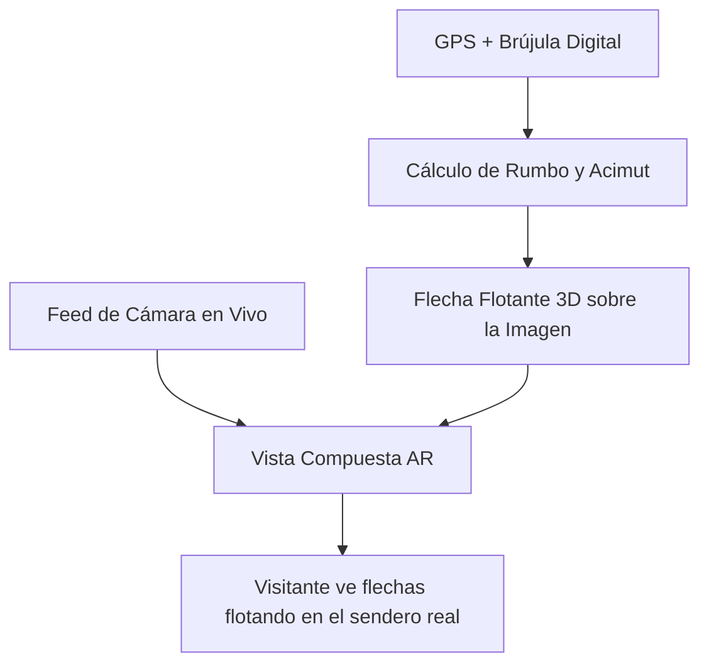

# Evolución Técnica · Mapa Móvil: GPS, Rutas por Senderos y Guía AR

- **Documento:** Referencia de evolución técnica para `mobile-007` y futuras fases
- **Fecha:** 2026-11-01
- **Autor / Responsable:** Víctor Adrián
- **Estado actual:** V1, V2 y V2.1 implementadas y probadas (40 suites Jest, 186 tests en verde)

---

## 1. Fase V1 — Mapa 2D Esquemático de Consulta (Completada)

- **Plano 2D esquemático:** Renderizado mediante `ZooMapSvg` con primitivas de `react-native-svg` (ADR 0015).
- **Puntos de interés (POI):** Marcadores desacoplados del SVG, posicionados mediante coordenadas normalizadas `mapX`/`mapY` (de 0.0 a 1.0) desde `MapRepository`.
- **Filtros interactivos:** Selección rápida por "Todo", "Animales" y "Servicios".
- **Detalle de punto:** Tarjeta flotante con nombre, sección y descripción.
- **Enfoque desde Búsqueda:** Redirección desde la búsqueda de animales hacia el mapa resaltando la zona y el marcador correspondiente.
- **Modo offline:** 100% operativo sin conexión a internet ni dependencia de servicios externos.

---

## 2. Fase V2 y V2.1 — GPS, Punto Azul, Línea de Destino y Llegada (Completada)

Implementada y probada al 100% en commits `42a2707` y subsiguientes:
- **Ubicación GPS real:** `expo-location ~57.0.22` (ADR 0016) con permisos de primer plano (`ACCESS_FINE_LOCATION`).
- **Punto Azul pulsante (`UserLocationMarker`):** Posición dinámica con fallback visual en la entrada principal si la señal GPS es débil (> 20 m).
- **Modo degradado:** Si el permiso es denegado, el mapa funciona normalmente en modo consulta (V1) sin bloquear la experiencia.
- **Línea de ruta directa (`DestinationRouteLine` / CA-14):** Trazado discontinuo sobre el plano entre el visitante y el recinto elegido como destino.
- **Geocerca de llegada (`haversine.ts` / CA-12):** Al situarse a $\le 10\text{ m}$ del recinto destino, se despliega el `ArrivalBanner` (*"¡Llegaste a [Recinto]!"*), se limpia el destino y se evita repetición en la misma sesión si se descarta.

---

## 3. Fase V3 — Navegación Guiada por Senderos y Tiempo a Pie (Planificada)

- **Condición previa:** Recepción de fotos/videos con dron del Zoológico Nicolás Bravo y digitalización del plano SVG definitivo con caminos reales.
- **Justificación:** Se evitó trazar senderos milimétricos en la V2.1 sobre el SVG provisional para no duplicar trabajo cuando llegue la cartografía aérea definitiva.

### Arquitectura de V3:
1. **Grafo de andadores peatonales (`src/constants/zooPaths.ts`):**
   - Nodos en cada bifurcación, curva y acceso a recinto.
   - Aristas ponderadas con distancias físicas reales.
2. **Pathfinding en memoria (`src/utils/pathfinding.ts`):**
   - Algoritmo Dijkstra / A* que conecta la posición del visitante con el acceso del recinto a través de los pasillos peatonales, sin atravesar muros ni lagos.
3. **Polilínea de sendero (`PathRoutePolyline`):**
   - Sustituye la línea recta de V2.1 por una polilínea continua que dobla exactamente en las esquinas de los caminos.
4. **Métricas de caminata:**
   - Suma de longitudes de los andadores (metros reales).
   - Tiempo estimado considerando ritmo de paseo familiar ($1.1\text{ m/s}$ / $4\text{ km/h}$).
   - Indicador en tarjeta: *"A 140 m • 2 min a pie"*.

---

## 4. Fase V4 — Guía con Cámara y Realidad Aumentada (Futura)

Sustituye la idea de un "recorrido 3D tipo videojuego" por una **guía interactiva en el mundo real a través de la cámara** (estilo Live View):

- **Mecánica:** Al levantar el teléfono, la pantalla muestra la cámara con flechas 3D flotando en el suelo señalando hacia el recinto destino.
- **Privacidad y ligereza:** No graba video ni sube imágenes al servidor; todo el procesamiento se realiza en el dispositivo.
