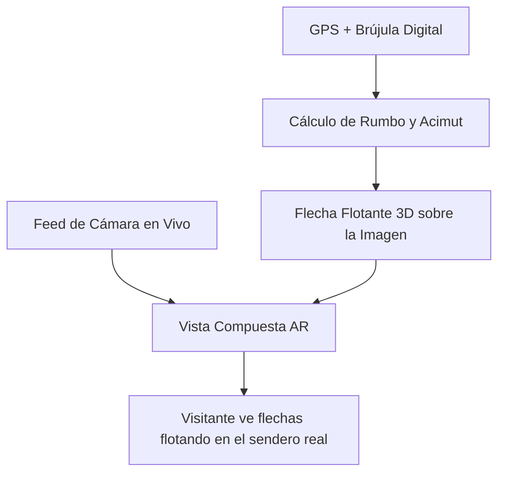

# Evolución Técnica · Mapa Móvil: GPS, Rutas por Senderos y Guía AR

- **Documento:** Referencia de evolución técnica para `mobile-007` y futuras fases
- **Fecha:** 2026-11-04
- **Autor / Responsable:** Víctor Adrián
- **Estado actual:** V1, V2, V2.1 y V2.2 implementadas y probadas en Jest

---

## 1. Fase V1 — Mapa 2D Esquemático de Consulta (Completada)

- **Plano 2D esquemático:** Renderizado mediante `ZooMapSvg` con primitivas de `react-native-svg` (ADR 0015).
- **Puntos de interés (POI):** Marcadores desacoplados del SVG, posicionados mediante coordenadas normalizadas `mapX`/`mapY` (de 0.0 a 1.0) desde `MapRepository`.
- **Filtros interactivos:** Selección rápida por "Todo", "Animales" y "Servicios".
- **Detalle de punto:** Tarjeta flotante con nombre, sección y descripción.
- **Enfoque desde Búsqueda:** Redirección desde la búsqueda de animales hacia el mapa resaltando la zona y el marcador correspondiente.
- **Modo offline:** 100% operativo sin conexión a internet ni dependencia de servicios externos.

---

## 2. Fase V2, V2.1 y V2.2 — GPS, Punto Azul, Ruta, Llegada y Controles de Visor (Completada)

Implementada y probada al 100%:
- **Ubicación GPS real:** `expo-location ~57.0.22` (ADR 0016) con permisos de primer plano (`ACCESS_FINE_LOCATION`).
- **Punto Azul pulsante (`UserLocationMarker`):** Posición dinámica con fallback visual en la entrada principal si la señal GPS es débil (> 20 m).
- **Modo degradado:** Si el permiso es denegado, el mapa funciona normalmente en modo consulta (V1) sin bloquear la experiencia.
- **Línea de ruta directa (`DestinationRouteLine` / CA-14):** Trazado discontinuo sobre el plano entre el visitante y el recinto elegido como destino.
- **Geocerca de llegada (`haversine.ts` / CA-12):** Al situarse a $\le 10\text{ m}$ del recinto destino, se despliega el `ArrivalBanner` (*"¡Llegaste a [Recinto]!"*), se limpia el destino y se evita repetición en la misma sesión si se descarta.
- **Controles interactivos de Zoom, Pan y Centrado (`MapViewportControls` + `mapViewport.ts` / CA-15, CA-16, CA-17):** Acercar/alejar (`1.0x`–`2.5x`), restablecer vista (`1x`), desplazamiento acotado por bordes y botón *"Centrar en mi ubicación"*.

---

## 3. Líneas de Evolución y Frentes de Trabajo del Mapa 2D

Para la evolución continua del Mapa 2D se han consolidado cuatro frentes estratégicos:

### Frente 1: Conexión con Datos Reales y Backend (DBR-008 & API)
- **Objetivo:** Superar el fixture local en memoria (`src/mocks/zoo.ts`) y centralizar las coordenadas en la base de datos MySQL 8.0 (`enclosures`).
- **Acciones:**
  - Solicitud [DBR-008](file:///c:/Users/vic22/OneDrive/Escritorio/ARCA-NB/docs/database/requests/DBR-008-enclosure-gps-coordinates.md) aprobada y migración Laravel `2026_11_03_000008_enclosure_gps_coordinates.php` creada.
  - Exposición de endpoint `GET /api/v1/map/enclosures` en `apps/api`.
  - Integración en `apps/mobile` mediante `HttpMapRepository` con persistencia/caché offline en `AsyncStorage`.

### Frente 2: Controles Interactivos de Mapa (Zoom, Pan y Centrado) — ✅ Completado (V2.2)
- **Objetivo:** Permitir una exploración táctil y accesible completa en dispositivos móviles.
- **Implementado:**
  - Controles accesibles de escala (`+`, `−`, `1x`) y desplazamiento con `PanResponder` y `clampPan` sobre el lienzo SVG manteniendo marcadores, ruta y punto azul sincronizados.
  - Botón flotante *"Centrar en mi ubicación"* que reubica el visor en el punto azul del visitante.

### Frente 3: Fase V3 — Navegación Guiada por Senderos y Tiempo a Pie — ✅ Completado (V3)
- **Implementado:**
  1. **Grafo de andadores peatonales (`src/constants/zooPaths.ts`):** Nodos en cada bifurcación, glorieta de la Plaza central y acceso a recinto con aristas ponderadas, listo para recalibrar coordenadas con el SVG definitivo de dron.
  2. **Pathfinding en memoria (`src/utils/pathfinding.ts`):** Algoritmo Dijkstra (`findShortestPath`, `computeWalkRoute`) que conecta la posición del visitante con el recinto destino siguiendo los pasillos peatonales sin cruzar jaulas ni cuerpos de agua (`CA-18`).
  3. **Polilínea de sendero (`DestinationRouteLine`):** Traza `<Polyline testID="destination-route-polyline">` sobre la red de andadores (`CA-20`).
  4. **Métricas de caminata (`WalkEstimateBadge`):** Muestra distancia estimada en metros y tiempo a pie ($1.1\text{ m/s}$) tipo *"Ruta a [Recinto]: ~140 m • 2 min a pie"* (`CA-19`, `CA-20`).

### Frente 4: Calibración Geográfica Fina y Coordenadas Reales
- **Objetivo:** Garantizar la precisión métrica del punto azul sobre el plano del zoológico.
- **Acciones:**
  - Ajuste de precisión en `src/utils/geoTransform.ts` (posible transformación proyectiva/afín completa con rotación si el plano no coincide con el norte magnético).
  - Medición en campo de las 4 esquinas del zoológico y de los accesos principales.

---

## 4. Fase V4 — Guía con Cámara y Realidad Aumentada (Futura)

Sustituye la idea de un "recorrido 3D tipo videojuego" por una **guía interactiva en el mundo real a través de la cámara** (estilo Live View):

- **Mecánica:** Al levantar el teléfono, la pantalla muestra la cámara con flechas 3D flotando en el suelo señalando hacia el recinto destino.
- **Privacidad y ligereza:** No graba video ni sube imágenes al servidor; todo el procesamiento se realiza en el dispositivo.
