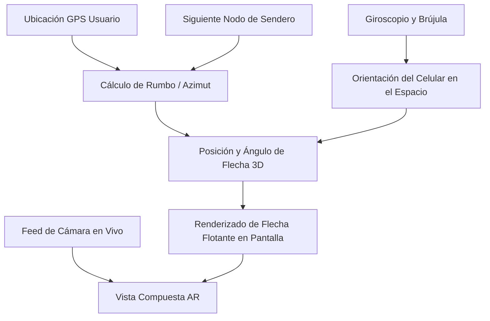
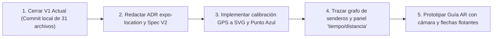

# Evolución Técnica · Mapa Móvil: GPS, Rutas y Guía AR por Cámara

- **Documento:** Referencia de evolución técnica para `mobile-007` y futuras fases
- **Fecha:** 2026-10-25
- **Autor / Responsable:** Víctor Adrián
- **Estado de V1:** Implementada y validada en dispositivo (Expo Go SDK 57)

---

## 1. Estado de la V1 (Cerrada y Validada)

La primera versión funcional del mapa está completa:
- **Plano 2D esquemático:** Renderizado mediante `ZooMapSvg` con primitivas de `react-native-svg` (ADR 0015).
- **Puntos de interés (POI):** Marcadores desacoplados del SVG, posicionados mediante coordenadas normalizadas `mapX`/`mapY` (de 0.0 a 1.0) desde `MapRepository`.
- **Filtros interactivos:** Selección rápida por "Todo", "Animales" y "Servicios" con gestión de estados vacíos y de error.
- **Detalle de punto:** Tarjeta flotante con nombre, sección y descripción.
- **Enfoque desde Búsqueda:** Redirección desde la búsqueda de animales hacia el mapa resaltando la zona y el marcador correspondiente.
- **Modo offline:** 100% operativo sin conexión a internet ni dependencia de servicios externos.

---

## 2. Fase V2 — GPS, Punto Azul y Navegación por Senderos (Estilo Google Maps)

El objetivo de la V2 es pasar de un mapa estático de consulta a un mapa con posicionamiento en vivo y cálculo de distancias reales.

### 2.1 Obtención de ubicación real
- **Dependencia requerida:** `expo-location` (requiere nuevo ADR antes de su instalación).
- **Permisos:** Únicamente permiso de primer plano (`ACCESS_FINE_LOCATION` en Android / `whenInUse` en iOS). No se requiere ubicación en segundo plano.
- **Manejo de estados:**
  - Si el usuario rechaza el permiso, el mapa sigue funcionando en modo V1 (consulta manual) sin bloquear la app.
  - Indicador de precisión si la señal GPS es débil.

### 2.2 Calibración Geográfica (Geo-referenciación del SVG)
El SVG tiene coordenadas relativas (`viewBox="0 0 1000 1400"`). Para que el punto azul del usuario se mueva sobre el dibujo conforme camina:
1. Se toman las coordenadas GPS reales (latitud y longitud) de los cuatro vértices del polígono del Zoológico Municipal Nicolás Bravo.
2. Se implementa una función de transformación matemática afín (bounding-box) en `src/utils/geoTransform.ts`:
   $$\text{GPS}(\text{lat}, \text{lon}) \longrightarrow (mapX, mapY)$$
3. El componente `UserLocationMarker` se renderiza sobre el SVG en la posición calculada.

### 2.3 Orientación del usuario (Flecha de rumbo)
- Usando el magnetómetro/brújula de `expo-sensors`, la flecha del punto azul rota en tiempo real según la dirección física hacia donde apunta la persona.

### 2.4 Grafo de Senderos y Cálculo de Llegada
- **Nodos de caminos:** Se definen ~15 a 25 nodos (intersecciones de senderos sobre los caminos grises ya dibujados en el SVG).
- **Cálculo de ruta más corta:** Algoritmo A* o Dijkstra ligero que une:
  $$\text{Posición actual del usuario} \longrightarrow \text{Nodo de sendero más cercano} \longrightarrow \dots \longrightarrow \text{Recinto destino}$$
- **Tiempo y distancia:**
  - Distancia total en metros sumando los segmentos de los caminos.
  - Tiempo estimado a velocidad de caminata promedio ($1.1\text{ m/s}$ o $\approx 4\text{ km/h}$).
  - Panel inferior flotante: *"A 140 metros • 2 min a pie"*.

---

## 3. Fase V3 — Guía 3D y Flechas Flotantes con la Cámara (Realidad Aumentada)

Esta fase sustituye la idea de un "recorrido 3D estático tipo videojuego" por una **guía interactiva en el mundo real a través de la cámara** (similar a Live View de Google Maps).

### 3.1 Componentes de la Guía AR
1. **Feed de video:**
   - La pantalla muestra la vista en vivo de la cámara trasera mediante `expo-camera`.
2. **Cálculo de rumbo (Bearing):**
   - Dada la posición GPS del visitante y la posición del siguiente punto de giro en el sendero, se calcula el ángulo relativo:
     $$\theta = \text{atan2}(\sin(\Delta \text{lon})\cos(\text{lat}_2), \cos(\text{lat}_1)\sin(\text{lat}_2) - \sin(\text{lat}_1)\cos(\text{lat}_2)\cos(\Delta \text{lon}))$$
3. **Sensores de orientación (Compás + Giroscopio):**
   - Permite determinar si el teléfono está apuntando hacia adelante, hacia el suelo, o hacia los lados.
4. **Flechas en perspectiva:**
   - **Al frente:** Si el usuario apunta hacia el camino correcto, la flecha aparece en perspectiva sobre el suelo marcando el avance.
   - **Giro:** Si el usuario se desvía, la flecha se ancla al borde izquierdo o derecho de la pantalla indicando *"Gira 45° a tu derecha"*.
   - **Llegada:** Al estar a menos de 5 metros del recinto, se despliega un pin flotante con el nombre del animal.

### 3.2 Estrategia de Implementación Técnica
- **Enfoque liviano (Recomendado):** No requiere instalar motores de videojuegos pesados como Unity o Unreal. Se logra mediante componentes React Native combinados con transformaciones 3D de estilos (`perspective`, `rotateX`, `rotateZ`) guiadas por los eventos de `expo-sensors`, o un canvas WebGL / Three.js ligero sobre la cámara.
- **Sin necesidad de Street View:** Al ser un parque municipal sin cobertura de Google Street View, la Realidad Aumentada basada en sensores y GPS es la solución adecuada y autónoma.

---

## 4. Hoja de Ruta de Pasos a Seguir

1. **Paso 1 (Inmediato):** Conservar y commitear localmente los 31 archivos de la V1 actual en la rama `victor`.
2. **Paso 2:** Crear el ADR para `expo-location` y actualizar la spec para la V2 de navegación GPS.
3. **Paso 3:** Realizar la calibración en terreno de las esquinas del zoológico Nicolás Bravo para que el punto azul sea preciso.
4. **Paso 4:** Implementar el cálculo de rutas por los senderos existentes.
5. **Paso 5:** Prototipar la vista de cámara con flechas flotantes en una spec dedicada.
