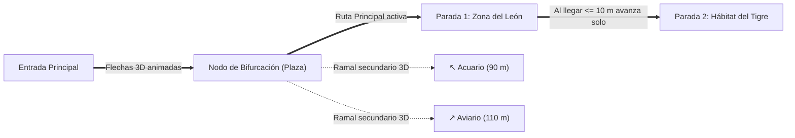

# Guía de Arquitectura y Diseño · Recorrido 3D con Cámara, Bifurcaciones y Modo Offline (`mobile-009`)

- **Spec:** [009-ar-3d-map-guide.md](../specs/009-ar-3d-map-guide.md)
- **ADR:** [0025-mobile-ar-3d-camera-threejs.md](../../../docs/adr/0025-mobile-ar-3d-camera-threejs.md)
- **Responsable:** Víctor Adrián
- **Fecha:** 2026-11-05

---

## 1. Concepto Visual: Recorrido Dinámico 3D con Conexiones y Bifurcaciones

En lugar de mostrar una única flecha estática, la escena **Three.js** transforma el grafo peatonal (`src/constants/zooPaths.ts`) en un **corredor tridimensional vivo** superpuesto sobre la cámara trasera del teléfono:

### Elementos 3D que genera Three.js en tiempo real:
1. **Línea 3D de Conexión del Recorrido (`Primary Path Ribbon`):**
   - Una cinta/tubo 3D sobre el nivel del suelo (`y = -1.2` en coordenadas de cámara) que une la posición del visitante con los nodos del camino hacia el recinto actual.
2. **Corriente de Flechas 3D en Movimiento (`Animated Chevron Stream`):**
   - Una serie de 5 a 8 flechas/chevrons 3D distribuidas a lo largo de la línea de conexión que se desplazan continuamente hacia adelante (`offset = (time * speed) % spacing`), dando sensación de flujo y movimiento hacia el recinto.
3. **Bifurcaciones 3D en Intersecciones (`3D Path Forks`):**
   - Cuando el siguiente nodo del grafo tiene más de una salida en `ZOO_PATH_EDGES` (por ejemplo, al llegar a la glorieta de la Plaza central):
     - El **ramal hacia tu siguiente recinto** se dibuja con la corriente de flechas brillantes.
     - Los **ramales hacia otros pasillos** se dibujan en el suelo 3D abriéndose en su ángulo real ($\Delta \theta_{\text{ramal}}$) con líneas punteadas 3D y una **baliza/cartel flotante** indicando hacia qué recinto o sección conectan.
4. **Progresión de Recinto en Recinto (`Tour Sequencer`):**
   - El recorrido inicia en la **Entrada Principal → Recinto 1**.
   - Al llegar a $\le 10\text{ m}$ del Recinto 1 (o al tocar *«Siguiente recinto»*), el sistema marca el Recinto 1 como visitado y **anima la conexión hacia el Recinto 2**, guiando al visitante por todo el zoológico.

---

## 2. ¿Cómo funciona 100 % Offline (Sin Internet)?

El diseño garantiza que un visitante **sin datos móviles ni Wi-Fi** tenga exactamente la misma experiencia 3D:

1. **Geometría 3D generada por código (0 descargas de red):**
   - Las flechas, cintas de camino, nodos de bifurcación y balizas se crean en memoria con primitivas matemáticas de `Three.js` (`ConeGeometry`, `CylinderGeometry`, `BoxGeometry`, `BufferGeometry`). No se descargan archivos externos `.glb` ni texturas remotas.
2. **Sensores y Cámara 100 % locales:**
   - `expo-camera` (video local en pantalla), `expo-location` (recepción satelital directa del chip GPS) y `expo-sensors` (magnetómetro físico del dispositivo) operan a nivel de hardware en el teléfono sin usar internet.
3. **Datos de Recintos y Senderos en Caché Local:**
   - Los nodos y conexiones de los pasillos viven en `src/constants/zooPaths.ts`.
   - Los recintos y sus coordenadas GPS se leen primero de la caché local en `AsyncStorage` (ADR 0014, guardada cuando el usuario abrió la app con conexión) y, si nunca tuvo internet, hace fallback inmediato al catálogo base integrado en la app.

---

## 3. Estructura de Módulos (MVVM) para `mobile-009`

| Módulo | Archivo | Responsabilidad |
|---|---|---|
| **Planificador de Recorrido y Bifurcaciones** | `src/utils/tourPlanner.ts` | `buildSequentialTour(places, startSvg)`: ordena los recintos desde la entrada formando un circuito continuo. `computeTourForks(currentNodeId, nextNodeId, places)`: detecta las bifurcaciones en `ZOO_PATH_EDGES` y calcula el ángulo de cada ramal secundario y a qué recinto conecta. |
| **Matemática de Orientación 3D/AR** | `src/utils/arMath.ts` | `computeBearingDegrees`, `computeRelativeAngleDegrees`, `smoothHeadingDegrees` y `computeArGuidance` (instrucción en español y coordenadas $(x, z)$ en el espacio 3D de Three.js para cada nodo y bifurcación). |
| **ViewModel del Recorrido 3D** | `src/viewmodels/useArTourViewModel.ts` | Controla el estado del recorrido (`isActive`, `currentStopIndex`, `currentStop`, `visitedStopIds`, `nextStop()`, `prevStop()`, `selectForkStop(id)`), integrando `userPosition`, rumbo de brújula y detección de llegada Haversine. |
| **Lienzo 3D Three.js** | `src/components/map/ThreeTourScene.tsx` | Monta `<GLView>`, renderiza el sendero conectado, la corriente de flechas 3D animadas y los ramales de bifurcación a 60 fps, limpiando recursos al desmontar. |
| **Visor Superpuesto en Mapa** | `src/components/map/ArTourOverlay.tsx` | Combina `CameraView` (o fondo 3D sin cámara) + `ThreeTourScene` + HUD en español (progreso *"Parada 1 de 7"*, chips de bifurcaciones detectadas, controles accesibles de giro y botón *"Volver al mapa 2D"*). |
