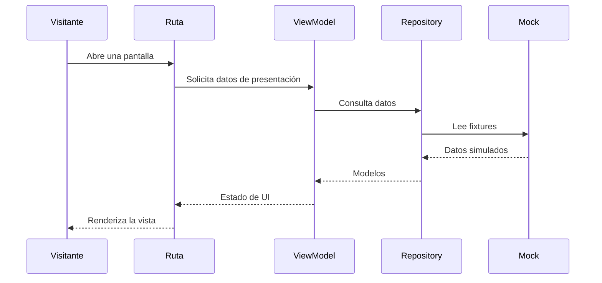

# Arquitectura de `apps/mobile`

## 1. Control

- **Estado:** Vigente. Cubre el prototipo de la spec **002**, la integración de lectura API y caché de la spec **003** y la cuenta visitante de la spec **004** (Implementada, 2026-10-21).
- **Capacidades descritas:** rutas, interfaz, mocks, catálogo/eventos con caché SWR y conectividad, pruebas y cuenta visitante: actual. Cámara, GPS, mapa y 3D: futuros.
- **Specs de referencia:** [002 · mobile-ui-base-visitor-journey](../specs/002-mobile-ui-base-visitor-journey.md), [003 · api-read-integration](../specs/003-api-read-integration.md) y [004 · visitor-account](../specs/004-visitor-account.md).
- **Decisiones tecnológicas:** [ADR 0004 · Mobile React Native](../../../docs/adr/0004-mobile-react-native.md), [ADR 0011 · Visitor identity and mobile session](../../../docs/adr/0011-visitor-identity-and-mobile-session.md) y [ADR 0014 · Mobile offline cache and connectivity](../../../docs/adr/0014-mobile-offline-cache-and-connectivity.md).

## 2. Propósito, alcance y exclusiones

La aplicación presenta al visitante una experiencia móvil de exploración del zoológico y permite validar sus flujos y diseño.

- **Actual:** cinco pestañas, búsqueda y detalle de animales, colección, perfil, eventos, misiones, logros, resultados QR simulados, consumo real/mock de catálogo y eventos con caché SWR, y la cuenta visitante (bienvenida, registro, verificación, sesión, recuperación, edición, cambio de contraseña y borrado). Con `EXPO_PUBLIC_API_URL` el catálogo y la cuenta hablan con la API; sin ella, y en Jest, siguen los mocks.
- **Fuera del alcance actual:** cámara/lectura QR real, GPS, mapa interactivo, renderizado 3D y sincronización de progreso/colecciones.
- **Futuro:** capacidades de dispositivo o persistencia de progreso se implementan con alcance aprobado en una spec correspondiente (005 a 008). Roadmap y responsables de specs 003–008: [003-008-roadmap-y-asignacion.md](./003-008-roadmap-y-asignacion.md).

## 3. Actores

| Actor | Necesidad | Confianza |
|---|---|---|
| Visitante | Explorar el contenido educativo y probar los flujos de visitante | Cliente público; no contiene credenciales ni autoridad de negocio |
| Equipo de desarrollo | Ejecutar Expo Go, validar la UI y mantener los contratos del cliente | Acceso al código del monorepo |

## 4. Módulos internos

| Módulo | Estado | Responsabilidad | Fuente de datos |
|---|---|---|---|
| `src/app/` | Actual | Rutas Expo Router y composición de dependencias de presentación | ViewModels |
| `src/screens/` | Actual | Vistas props-driven de cada pantalla | Props y callbacks de rutas |
| `src/viewmodels/` | Actual | Estado y operaciones de presentación | Repositories |
| `src/repositories/` | Actual | Acceso desacoplado. La cuenta usa el mock si no hay `EXPO_PUBLIC_API_URL`; con esa variable usa `HttpAuthRepository` | Mocks o `@arca/api-client` |
| `src/mocks/`, `src/models/` | Actual | Fixtures y tipos de dominio de UI | Código fuente de Mobile |
| `src/components/`, `src/theme/` | Actual | Componentes compartidos, símbolos y adaptación de tokens | `@arca/tokens`, `expo-symbols` |

## 5. Estructura de `src/`

```text
src/
  app/          # Expo Router y rutas
  components/   # UI y componentes de dominio
  mocks/        # Fixtures
  models/       # Tipos de la UI
  repositories/ # Contratos, mock de cuenta y HttpAuthRepository
  screens/      # Vistas
  services/     # Almacenamiento del par de tokens
  session/      # Sesión de la cuenta visitante
  theme/        # Adaptador de tokens
  viewmodels/   # Hooks/estado de presentación
```

`apps/mobile/src` es el único árbol de código de la app. No se debe crear otro `apps/src`.

## 6. Patrón MVVM

El flujo es `Route → Screen/View → ViewModel hook → Repository`. Las rutas coordinan navegación y datos de presentación; las pantallas reciben props y callbacks. La cuenta usa el mock o `HttpAuthRepository`; el resto de repositorios sigue en mocks hasta su spec.

## 7. Componentes

Las pantallas en `src/screens/` componen controles de `src/components/ui/` y componentes de dominio. `BackButton`, `ScreenContainer`, textos, cards, chips, iconos y placeholders de imagen forman parte del kit compartido móvil.

## 8. Dependencias

- **Internas:** `@arca/tokens` y `@arca/api-client`, desde los workspaces `packages/`.
- **Runtime móvil:** Expo SDK 57, Expo Router, React Native 0.86, `expo-symbols`, `expo-secure-store` (ADR 0011, solo el par de tokens de la cuenta), `@react-native-async-storage/async-storage` y `expo-network` (ADR 0014, caché y conectividad del catálogo).
- **Pruebas/desarrollo:** Jest, `jest-expo`, React Native Testing Library y TypeScript.
- Metro resuelve workspaces desde la raíz del monorepo mediante `metro.config.js`.
- No hay dependencias de cámara, geolocalización, mapas ni motor 3D en el alcance actual.

## 9. Contratos y endpoints

La etapa 003 implementa la integración de lectura para el catálogo público y eventos (`GET /species`, `GET /species/{id}`, `GET /events`, `GET /events/{id}`) utilizando `@arca/api-client` (`createHttpClient`) a través de `ApiAnimalRepository` y `ApiZooRepository`.
Los datos de la API en `snake_case` se normalizan a modelos de dominio en `camelCase` mediante `src/repositories/mappers.ts`.
Si la variable `EXPO_PUBLIC_USE_MOCKS` está activa o el entorno no cuenta con API disponible, la fábrica `createAnimalRepository()` y `createZooRepository()` recurre limpiamente a las implementaciones mock de `src/mocks/`.
La arquitectura de conexión, contratos y manejo de errores para las etapas 005–008 continúa regulada en [estandares-integracion-api.md](./estandares-integracion-api.md).

La cuenta de la spec 004 elige el origen al arrancar: sin `EXPO_PUBLIC_API_URL` usa el mock y el almacenamiento en memoria; con esa variable usa `HttpAuthRepository`, `expo-secure-store` y `createVisitorApi` de `@arca/api-client` contra la API de pruebas. Jest no toma esa variable y sigue en el mock, salvo las pruebas que configuran un cliente simulado. No se importa el cliente de personal (`auth.ts`).

## 10. Datos y flujo

La etapa 003 incorpora una estrategia de caché local *Stale-While-Revalidate* (SWR) con un tiempo de vida (TTL) de 5 minutos (300,000 ms) a través de una abstracción `KeyValueStorage` (`src/repositories/storage.ts`), persistida con `@react-native-async-storage/async-storage` (ADR 0014).
Cuando hay datos en caché válidos se retornan inmediatamente; si la red falla se conserva el caché disponible. El banner `OfflineBanner` se muestra cuando `expo-network` reporta falta de conexión mediante `useNetworkStatus` (`isConnected === false` o `isInternetReachable === false`), no por un fallo HTTP aislado.
Las pantallas manejan 5 estados de presentación: carga (`loading`), éxito (`success`), error con reintento accesible (`error`), datos vacíos (`empty`) y modo sin conexión (`offline`).
La autoridad de datos de negocio reside en el servidor/API Laravel.

Los recorridos de exploración que aún no tienen sesión siguen en fixtures de `src/mocks/`. Con sesión, el progreso, la colección por especie, los logros y las misiones salen de `api-005`. Esas pantallas comparten una sola lectura: no la repiten al guardar el perfil ni al abrir Ajustes si la sesión ya está activa, y la descartan al cerrar sesión. El perfil de la cuenta (`GET /me`) también se guarda una sola vez en la sesión: perfil, ajustes y edición leen esa copia, y un `PATCH` la actualiza sin otra lectura. La cola de escaneos vive en AsyncStorage. La cámara sigue en la spec 006. Las pestañas no acumulan historial entre sí; una ruta secundaria vuelve a la pantalla que la abrió.

## 11. Seguridad y privacidad

El prototipo no solicita permisos de cámara ni ubicación y no debe contener secretos de servicio. El QR y el mapa son simulaciones visuales, no flujos de captura de datos. La cuenta de la spec 004 guarda solo el par de tokens, en almacenamiento seguro cuando hay API y en memoria cuando no la hay. No escribe contraseñas ni códigos.

## 12. Pruebas

Las pruebas Jest cubren arquitectura/imports, rutas, UI, ViewModels y Repositories; `npx tsc --noEmit` comprueba tipos. La revisión visual Android/Expo Go es una validación manual complementaria y se registra en la tarea T-28 de la spec 002.

## 13. Componentes y flujo

```mermaid
flowchart LR
  Route[Expo Router] --> Screen[Screen / View]
  Route --> VM[ViewModel hook]
  Screen -->|acciones/callbacks| Route
  VM --> Repo[Repository]
  Repo --> Mock[Mocks]
  Theme[Theme adapter] --> Tokens[@arca/tokens]
```

## 14. Secuencia de consulta visual



## 15. Riesgos y pendientes

| Pendiente | Tratamiento |
|---|---|
| Iconos de launcher Android/iOS | Agregar recursos PNG finales antes de builds distribuibles |
| Persistencia y favoritos | Definir en una spec futura; no inferir estado persistente de UI temporal |
| Cámara/QR real, GPS/mapa y 3D | Requieren alcance aprobado, permisos, dependencias y validación de dispositivos |
| Retirar referencia visual temporal | `arca-ui-reference` no es una dependencia y se mantiene fuera de Git |
| Confundir enmienda 002 con spec 004 | La cuenta de 004 vive en `src/session`. Sin `EXPO_PUBLIC_API_URL` sigue el mock. Con esa variable, el teléfono usa la API de pruebas y `expo-secure-store`. |

## 16. Validación

- La estructura de código queda limitada a `apps/mobile/src`.
- Las capacidades mock y las futuras se identifican explícitamente.
- Expo está aprobado por ADR 0004; las integraciones de hardware no se asumen aprobadas por ese ADR.
