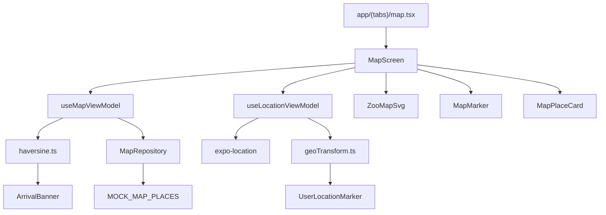

# Plan técnico · 007 · map-location

- Spec: `apps/mobile/specs/007-map-location.md`
- Estado de spec: Aprobada (2026-10-22)
- Estado del plan: Aprobado (2026-10-22)
- Responsable técnico: Víctor Adrián
- Revisión móvil: Aksel
- ADR de renderizado: `docs/adr/0015-mobile-svg-map-rendering.md` (Aceptado 2026-10-22)
- Brief del SVG: `apps/mobile/docs/007-svg-brief.md`
- Borrador visual: `apps/mobile/docs/007-map-v1-draft.svg`

## Resumen

La V1 implementa un mapa 2D esquemático del zoológico con un SVG propio, secciones fijas y marcadores obtenidos de un fixture local. No usa GPS, API, proveedor de mapas ni DBR. El objetivo es que el visitante pueda orientarse, consultar puntos de interés, filtrar y encontrar un destino desde la búsqueda.

El mapa no representa calles ni geografía real. El SVG es el fondo; los puntos se superponen como datos.

## Arquitectura

```mermaid
flowchart TD
    Route[app/(tabs)/map.tsx] --> Screen[MapScreen]
    Screen --> VM[useMapViewModel]
    VM --> Repo[MapRepository]
    Repo --> Fixture[MOCK_MAP_PLACES]
    Screen --> SVG[ZooMapSvg]
    Screen --> Marker[MapMarker]
    Screen --> Detail[MapPlaceCard]
    Search[app/(tabs)/search.tsx] -->|focus=placeId| Route
```

- `MapScreen` es una vista de presentación; no importa repositorios ni mocks.
- `useMapViewModel` concentra carga, filtros, selección, error y reintento.
- `MapRepository` abstrae la fuente; en V1 devuelve el fixture y en V1.1 podrá devolver la API.
- `ZooMapSvg` contiene solo el fondo y las secciones.
- `MapMarker` y `MapPlaceCard` son componentes de presentación.

## Cambios por área

| Área | Archivos previstos | Propósito |
|---|---|---|
| Modelos | `apps/mobile/src/models/index.ts` | Sustituir `MapLocation` por `MapPlace`/`MapSection`; posiciones `mapX`/`mapY`; filtros tipados. |
| Fixture | `apps/mobile/src/mocks/zoo.ts` | Crear 8–10 puntos de prueba visibles y secciones; retirar la ruta simulada del mapa. |
| Repositorio | `apps/mobile/src/repositories/index.ts` | Cambiar `MapRepository` a `getPlaces()`; devolver fixture; conservar la interfaz para V1.1. |
| ViewModel | `apps/mobile/src/viewmodels/useMapViewModel.ts` | Exponer `places`, `filteredPlaces`, `selectedPlace`, `isLoading`, `error`, `retry`, `selectPlace`, `setFilter` y `focusPlace`. |
| SVG | `apps/mobile/src/components/map/ZooMapSvg.tsx` | Renderizar el plano esquemático, secciones y resaltado con `react-native-svg`. |
| Marcadores | `apps/mobile/src/components/map/MapMarker.tsx` | Pin accesible posicionado con `mapX`/`mapY`. |
| Detalle | `apps/mobile/src/components/map/MapPlaceCard.tsx` | Tarjeta inferior con nombre, tipo, sección y descripción. |
| Pantalla | `apps/mobile/src/screens/MapScreen.tsx` | Integrar SVG, marcadores, filtros, detalle, estados y búsqueda. |
| Ruta del mapa | `apps/mobile/src/app/(tabs)/map.tsx` | Leer `focus` de la URL y conectar el ViewModel. |
| Búsqueda | `apps/mobile/src/app/(tabs)/search.tsx` | Si `returnTo=map`, volver al mapa con `focus=<animalId>` en lugar de abrir el 3D. |
| Pruebas | `apps/mobile/__tests__/map*.test.ts(x)` | Cobertura de CA-01 a CA-08. |
| Configuración de pruebas | `apps/mobile/jest.setup.js` | Mock de `react-native-svg` si Jest lo requiere. |
| Documentación | `apps/mobile/docs/003-008-roadmap-y-asignacion.md` | Registrar el estado de 007 y el alcance V1. |

## Contrato de datos V1

```ts
export type MapPlaceKind = 'animal' | 'service' | 'entrance';

export interface MapSection {
  id: string;
  name: string;
  svgZoneId: string;
}

export interface MapPlace {
  id: string;
  name: string;
  kind: MapPlaceKind;
  sectionId: string;
  description?: string;
  mapX: number; // 0..1
  mapY: number; // 0..1
  visible: boolean;
}

export type MapFilter = 'all' | 'animal' | 'service';
```

- `sectionId` coincide con el `id` de la zona del SVG en V1 (`zone-felines`, `zone-birds`, etc.).
- `mapX`/`mapY` son relativos al contenedor del mapa, no píxeles del dispositivo.
- `visible` filtra lo que se muestra; la web del encargado será la fuente en V1.1.
- No se incluyen `latitude`, `longitude` ni `radius` en V1.

## Fixture inicial

Se usarán 8–10 puntos de prueba, por ejemplo:

| id | Nombre | Tipo | Sección | mapX | mapY |
|---|---|---|---|---|---|
| `tiger-habitat` | Hábitat del Tigre | animal | `zone-felines` | 0.23 | 0.25 |
| `bird-aviary` | Aviario | animal | `zone-birds` | 0.77 | 0.25 |
| `penguin-cove` | Cala de Pingüinos | animal | `zone-aquatic` | 0.23 | 0.55 |
| `reptile-house` | Herpetario | animal | `zone-reptiles` | 0.77 | 0.55 |
| `giraffe-area` | Zona de Jirafas | animal | `zone-herbivores` | 0.23 | 0.76 |
| `restrooms` | Baños | service | `zone-services` | 0.77 | 0.76 |
| `food-court` | Comida | service | `zone-services` | 0.70 | 0.82 |
| `main-entrance` | Entrada principal | entrance | `zone-entrance` | 0.50 | 0.90 |

Los valores exactos se ajustan al SVG final. Los IDs de animales pueden coincidir con los del catálogo para que la búsqueda pueda enfocar un punto.

## SVG y marcadores

- `ZooMapSvg` usa `Svg` con `viewBox="0 0 1000 1400"` y `preserveAspectRatio="xMidYMid meet"`.
- Cada sección es una forma cerrada con `id` (`zone-felines`, `zone-birds`, `zone-aquatic`, `zone-reptiles`, `zone-herbivores`, `zone-services`, `zone-entrance`, `zone-plaza`).
- Los colores se toman de `@arca/tokens`; no se fijan colores de marca en el componente.
- La sección enfocada cambia de relleno o borde y recibe un indicador textual/visual, no solo color.
- Los marcadores se renderizan fuera del SVG, en un contenedor con la misma relación de aspecto.
- Cada marcador es un `Pressable` con `accessibilityRole="button"`, `accessibilityLabel` en español y estado seleccionado.
- El SVG no incluye pines, animales, botones ni textos de interfaz.

## Estados de UI

| Estado | Comportamiento |
|---|---|
| `loading` | Indicador de carga mientras el repositorio resuelve. |
| `success` | SVG + marcadores + filtros + búsqueda. |
| `empty` | Sin puntos visibles o filtro sin resultados; mensaje en español y mapa visible. |
| `error` | Error del repositorio; mensaje en español y botón “Reintentar”. |
| `offline` | No aplica una lógica de red en V1; el SVG y el fixture son locales. Si el repositorio falla, se usa `error`. |

No se muestra un estado “sin conexión” artificial porque la V1 no consume red.

## Búsqueda y destino

- El botón “Buscar animales” del mapa abre `/search` con `selectForTour=true` y `returnTo=map`.
- `search.tsx` distingue:
  - `returnTo=map`: al elegir un animal, `router.replace({ pathname: '/map', params: { focus: animal.id } })`.
  - `returnTo=tour-3d`: conserva el flujo actual del recorrido 3D.
- `map.tsx` lee `focus` y llama a `focusPlace(focus)`.
- Si el `focus` no coincide con un punto visible, se muestra un aviso en español y no se resalta nada.
- No se muestran duración, distancia ni pasos de ruta.

## Dependencia y pruebas

- `react-native-svg` está instalado con `npx expo install react-native-svg` (versión `15.15.4`).
- Las dependencias transitivas de Expo se alinearon con `expo/bundledNativeModules.json`: `react-native-worklets@0.10.1` y `react-native-reanimated@4.5.1`, mediante `overrides` en el `package.json` raíz. Esto evita que Expo Go cargue versiones nativas incompatibles.
- `expo@57.0.31` y `expo-router@57.0.29` se actualizaron con `npx expo install --fix`; `npx expo install --check` reporta dependencias al día.
- Jest renderiza `react-native-svg` con `jest-expo`; no fue necesario agregar un mock en `jest.setup.js`.
- No se agrega `expo-location`, `expo-camera` ni SDK de mapas.

## Mapeo de criterios a pruebas

| Criterio | Prueba prevista | Ubicación |
|---|---|---|
| **CA-01** Mapa esquemático | Renderiza SVG, secciones y acceso sin red | `apps/mobile/__tests__/mapScreen.test.tsx` |
| **CA-02** Puntos desde datos | Repositorio devuelve visibles; marcador usa `mapX`/`mapY` | `apps/mobile/__tests__/mapRepository.test.ts` y `mapScreen.test.tsx` |
| **CA-03** Detalle del punto | Tocar marcador abre y cierra detalle accesible | `apps/mobile/__tests__/mapScreen.test.tsx` |
| **CA-04** Filtros | “Todo”, “Animales” y “Servicios”; estado vacío | `apps/mobile/__tests__/mapScreen.test.tsx` |
| **CA-05** Destino desde búsqueda | `focus` resalta sección/marcador; no hay ruta simulada | `apps/mobile/__tests__/mapScreen.test.tsx` |
| **CA-06** Offline y errores | Fixture local; error con reintento; vacío | `apps/mobile/__tests__/mapViewModel.test.ts` |
| **CA-07** MVVM, tokens y accesibilidad | Sin imports de repositorio en vistas; etiquetas y contraste | `apps/mobile/__tests__/mapAccessibility.test.tsx` |
| **CA-08** Pruebas por criterio | La suite nombra CA-01 a CA-08 y pasa | Todos los archivos de mapa |

## Constitution Check

| Principio | Cumplimiento |
|---|---|
| **I. Stack mínimo y portable** | Se agrega `react-native-svg`, dependencia compatible con Expo; requiere ADR 0015 aprobado. No hay servicios propietarios ni claves. |
| **II. La spec manda** | Spec aprobada, plan y tasks con el mismo NNN; no se implementa alcance fuera de V1. |
| **III. Lógica separada de la interfaz** | `MapScreen` solo presenta; `useMapViewModel` orquesta; `MapRepository` entrega datos. Sin `fetch` ni lógica de negocio en componentes. |
| **IV. Un test por criterio** | Tabla CA → prueba; se ejecuta Jest con `--runInBand`. |
| **V. Una sola fuente de verdad** | V1 no modifica la BD ni crea DBR; el fixture es datos de presentación temporal. La API/DBR se abrirán en V1.1. |
| **VI. Código en inglés, personas en español** | IDs, tipos y archivos en inglés; UI, mensajes y docs en español. |

## Riesgos y mitigaciones

- **ADR 0015 aceptado:** `react-native-svg` quedó aprobado e instalado; no se agregan SDK de mapas.
- **Desalineación SVG/marcadores:** usar coordenadas normalizadas y un contenedor con relación de aspecto fija.
- **Mapa ambiguo:** etiquetas legibles, leyenda y resaltado con más de un indicador además del color.
- **Búsqueda sin coincidencia:** mostrar aviso claro; no inventar una ubicación.
- **Pruebas de SVG en Jest:** `jest-expo` renderiza `react-native-svg`; no se requirió mock.
- **Alcance:** no agregar GPS, API, DBR, rutas ni 3D durante la implementación.

## Verificación

- `npx jest --runInBand` en `apps/mobile`: 27 suites y 132 pruebas aprobadas (2026-10-22).
- `npx tsc --noEmit` en `apps/mobile`: sin errores.
- Revisión visual en Expo Go/Android con el SVG final: pendiente.
- `/verify` para las apps tocadas.
- Actualizar `apps/mobile/docs/003-008-roadmap-y-asignacion.md` al cerrar.

## Aprobación

- Plan aprobado funcional y técnicamente el 2026-10-22.
- ADR 0015 aceptado el 2026-10-22.
- Implementación V1 ejecutada; revisión técnica de Aksel y validación visual en Android/Expo Go pendientes.

---

## Enmienda V2 — GPS, Punto Azul y Detección de Llegada

- Spec: `apps/mobile/specs/007-map-location.md` (enmienda V2, Aprobada 2026-10-29)
- Estado del plan: **Aprobado** (Víctor Adrián, 2026-10-29)
- ADR habilitador: `docs/adr/0016-expo-location-gps-blue-dot.md` — Aceptado
- `expo-location ~57.0.22` instalada en `package.json` ✓
- `app.json` con permiso `ACCESS_FINE_LOCATION` y plugin `expo-location` ✓

---

### Diseño de solución (V2)

La V2 añade tres capacidades sobre la arquitectura MVVM existente sin romper ninguna pieza de V1:

1. **`geoTransform`** — utilidad pura que convierte coordenadas GPS reales a coordenadas SVG normalizadas mediante transformación afín de bounding-box.
2. **`useLocationViewModel`** — hook separado del ViewModel del mapa; gestiona el ciclo de vida del permiso GPS, la suscripción a `expo-location` y el estado del punto azul. Se inyecta como dependencia a `MapScreen`.
3. **`UserLocationMarker`** — componente visual que renderiza el punto azul (o el indicador "buscando") sobre el SVG, en la misma capa que `MapMarker`.
4. **Geocerca Haversine en `useMapViewModel`** — al tener un `destinationPlaceId` activo y coordenadas GPS válidas, calcula la distancia y emite el evento `arrived` cuando ≤ 10 m.
5. **`ArrivalBanner`** — componente visual que muestra "¡Llegaste a [recinto]!" y permite cerrarse.



---

### Cambios por área

| Área | Archivos nuevos / modificados | Propósito |
|---|---|---|
| Utilidades | `src/utils/geoTransform.ts` (**nuevo**) | Transformación GPS → SVG (función pura, testeable sin GPS) |
| Utilidades | `src/utils/haversine.ts` (**nuevo**) | Distancia en metros entre dos puntos GPS (función pura) |
| Constantes | `src/constants/zoo.ts` (**nuevo**) | `ZOO_BOUNDS`, `ZOO_ENTRANCE_SVG`, `ARRIVAL_RADIUS_METERS = 10` |
| ViewModel | `src/viewmodels/useLocationViewModel.ts` (**nuevo**) | Permiso, suscripción GPS, posición del usuario, estado "buscando" |
| ViewModel | `src/viewmodels/useMapViewModel.ts` (**modificado**) | Añade `destinationPlaceId`, `arrivedAtPlace`, `dismissArrival()` |
| Componentes | `src/components/map/UserLocationMarker.tsx` (**nuevo**) | Punto azul con anillo pulsante de "buscando" |
| Componentes | `src/components/map/ArrivalBanner.tsx` (**nuevo**) | Banner "¡Llegaste a [recinto]!" con botón cerrar |
| Componentes | `src/components/map/index.ts` (**modificado**) | Exporta los dos nuevos componentes |
| Pantalla | `src/screens/MapScreen.tsx` (**modificado**) | Integra `useLocationViewModel`, `UserLocationMarker` y `ArrivalBanner` |
| Tests | `__tests__/geoTransform.test.ts` (**nuevo**) | CA-11: transformación con coords sintéticas |
| Tests | `__tests__/haversine.test.ts` (**nuevo**) | Distancia correcta entre puntos conocidos |
| Tests | `__tests__/mapViewModel.test.ts` (**modificado**) | CA-12: detección de llegada; CA-13: modo degradado |
| Tests | `__tests__/mapScreen.test.tsx` (**modificado**) | CA-08, CA-09, CA-10, CA-13: permiso, punto azul, posición inicial |
| Test support | `test-support/locationMocks.ts` (**nuevo**) | Mock de `expo-location` para Jest |
| Docs | `apps/mobile/docs/007-map-v2-coords.md` (**nuevo**) | Tabla de coordenadas sintéticas y espacio para las reales cuando lleguen |

---

### Contrato y datos

- **Sin API ni DBR.** Los POIs siguen siendo el fixture local. La posición GPS nunca sale del dispositivo.
- **Permiso:** `requestForegroundPermissionsAsync()` de `expo-location`; si el resultado es `'denied'` o `'undetermined'` después de pedir, el mapa carga sin punto azul.
- **Modelo de posición interno (solo memoria):**
  ```ts
  interface UserPosition {
    svgX: number;   // coordenada en el viewBox SVG
    svgY: number;
    lat: number;    // GPS real (para cálculo Haversine)
    lon: number;
    accuracy: number; // metros; < 20 = señal buena
    searching: boolean; // true mientras accuracy >= 20
  }
  ```
- **`ZOO_BOUNDS`** (sintético hasta medición real):
  ```ts
  const ZOO_BOUNDS = {
    latMin: 20.0800, latMax: 20.0850,
    lonMin: -98.7250, lonMax: -98.7190,
  };
  const SVG_WIDTH = 1000;
  const SVG_HEIGHT = 1400;
  const ZOO_ENTRANCE_SVG = { svgX: 500, svgY: 1320 }; // entrada principal (prueba)
  ```
  Estas constantes se actualizan en `zoo.ts` sin tocar ningún otro archivo cuando lleguen los datos reales.

---

### Diseño técnico detallado

#### `geoTransform.ts`
```ts
// Transformación afín bounding-box
export function geoTransform(lat: number, lon: number): { svgX: number; svgY: number }
// Si lat/lon están fuera de ZOO_BOUNDS → devuelve ZOO_ENTRANCE_SVG
```

#### `haversine.ts`
```ts
// Distancia en metros entre dos puntos GPS
export function haversineMeters(
  lat1: number, lon1: number,
  lat2: number, lon2: number
): number
```

#### `useLocationViewModel.ts`
```ts
export function useLocationViewModel(): {
  userPosition: UserPosition | null; // null = permiso denegado / no pedido aún
  permissionGranted: boolean;
  requestPermission: () => Promise<void>;
}
```
- Al montar: llama `requestForegroundPermissionsAsync`. Si concedido, abre suscripción con `watchPositionAsync` (accuracy: `BestForNavigation`, distanceInterval: 3 m).
- Al desmontar: cancela la suscripción.
- Si accuracy ≥ 20 m → `searching: true`, posición en `ZOO_ENTRANCE_SVG`.

#### Cambios en `useMapViewModel`
```ts
// Nuevos campos en el return:
destinationPlaceId: string | null;
arrivedAtPlace: MapPlace | null;   // no null cuando distancia ≤ 10 m
setDestination: (id: string | null) => void;
dismissArrival: () => void;
```
- Cuando `destinationPlaceId` y `userPosition` son no-nulos, calcula `haversineMeters` entre la posición del usuario y las coordenadas GPS del POI.
- POIs en el fixture necesitan campos `gpsLat` y `gpsLon` opcionales (sintéticos por ahora).
- Si distancia ≤ `ARRIVAL_RADIUS_METERS` → `arrivedAtPlace = place`, `destinationPlaceId = null`.

#### `UserLocationMarker`
- Círculo azul (`color.brand.primary` o token equivalente) de 16 px.
- Anillo pulsante exterior cuando `searching: true` (Animated.loop).
- Se posiciona con `position: 'absolute'` sobre el SVG usando `svgX`/`svgY` → porcentaje del contenedor (igual que `MapMarker`).

#### `ArrivalBanner`
- Banner en la parte inferior de `MapScreen`.
- Texto: `"¡Llegaste a {place.name}!"`.
- Botón "Cerrar" que llama `dismissArrival()`.
- Solo visible cuando `arrivedAtPlace !== null`.

---

### Seguridad, offline y operación

- Las coordenadas GPS nunca se almacenan (`AsyncStorage`, `SecureStore` ni red).
- El permiso solo se pide una vez por sesión (RN-14). Si denegado, no se vuelve a pedir hasta que el usuario reinicia la app.
- En modo offline: GPS sigue funcionando; solo requiere señal de satélite, no de red.
- `ZOO_BOUNDS` y `ZOO_ENTRANCE_SVG` son constantes en código — fáciles de actualizar sin DBR cuando lleguen las coordenadas reales.

---

### Mapeo de criterios a pruebas

| Criterio | Prueba automatizada | Ubicación |
|---|---|---|
| CA-08 (permiso GPS) | `mapScreen.test.tsx` — mock de `expo-location` retorna `'denied'`; verifica que el mapa carga y no hay punto azul | `__tests__/mapScreen.test.tsx` |
| CA-09 (punto azul) | `mapScreen.test.tsx` — mock retorna posición con accuracy 5 m; verifica `UserLocationMarker` en DOM | `__tests__/mapScreen.test.tsx` |
| CA-10 (posición entrada) | `mapScreen.test.tsx` — mock retorna accuracy 50 m; verifica `testID="location-searching"` | `__tests__/mapScreen.test.tsx` |
| CA-11 (geoTransform) | `geoTransform.test.ts` — esquinas del bounding-box sintético → extremos SVG; fuera de bounds → entrada | `__tests__/geoTransform.test.ts` |
| CA-12 (llegada) | `mapViewModel.test.ts` — posición a 5 m del POI → `arrivedAtPlace` no nulo; a 15 m → nulo | `__tests__/mapViewModel.test.ts` |
| CA-13 (modo degradado) | `mapViewModel.test.ts` — sin posición GPS: CA-01…CA-07 siguen pasando sin errores | `__tests__/mapViewModel.test.ts` |
| Haversine | `haversine.test.ts` — distancia Equateur-Meridiano conocida ≈ 111 km; misma coord → 0 | `__tests__/haversine.test.ts` |

---

### Constitution Check

| Principio | Cumple | Evidencia |
|---|---|---|
| I. Stack mínimo y portable | ✅ | `expo-location` SDK 57, ADR 0016 Aceptado. Sin proveedores externos de mapas. Funciona sin red. |
| II. La spec manda | ✅ | Todos los CA de la enmienda V2 cubiertos. Sin features extra. |
| III. Lógica separada de UI | ✅ | `geoTransform` y `haversine` son funciones puras. `useLocationViewModel` y `useMapViewModel` son ViewModels. `UserLocationMarker` y `ArrivalBanner` son Views puras sin lógica de negocio. |
| IV. Un test por criterio | ✅ | 6 CA → 6 pruebas + 1 para Haversine. Ver tabla de mapeo. |
| V. Una sola fuente de verdad | ✅ | `ZOO_BOUNDS`, `ARRIVAL_RADIUS_METERS` y `ZOO_ENTRANCE_SVG` en `zoo.ts`. El fixture de POIs es la única fuente de datos. Posición GPS solo en `useLocationViewModel`. |
| VI. Inglés código / español UI | ✅ | Identificadores y rutas en inglés. Mensajes ("¡Llegaste a…", "buscando ubicación…", diálogo de permiso) en español. |

---

### Riesgos y decisiones

- **ADR 0016** — Aceptado (2026-10-29). `expo-location ~57.0.22` instalada.
- **SVG de prueba:** el punto azul no será preciso visualmente hasta tener el SVG real y las coordenadas medidas en campo. No bloquea el desarrollo; sí bloquea la demo real en el zoológico.
- **Coordenadas sintéticas en POIs:** los campos `gpsLat`/`gpsLon` del fixture serán `null` o valores aproximados hasta la medición. La geocerca funcionará en Jest con coords sintéticas.
- **`watchPositionAsync` en Jest:** se mockea completamente en `test-support/locationMocks.ts`; no hay llamadas reales al GPS en tests.

---

### Orden de implementación (tareas)

| Paso | Tarea | Depende de |
|---|---|---|
| 1 | Crear `src/utils/haversine.ts` + test | — |
| 2 | Crear `src/constants/zoo.ts` con bounds sintéticos | — |
| 3 | Crear `src/utils/geoTransform.ts` + test | Paso 2 |
| 4 | Crear `test-support/locationMocks.ts` (mock expo-location) | — |
| 5 | Crear `src/viewmodels/useLocationViewModel.ts` | Pasos 2, 3, 4 |
| 6 | Actualizar `MapPlace` en modelos: añadir `gpsLat?`, `gpsLon?` | — |
| 7 | Actualizar fixture `MOCK_MAP_PLACES` con coords sintéticas | Paso 6 |
| 8 | Actualizar `useMapViewModel`: añadir `destinationPlaceId`, `arrivedAtPlace`, geocerca | Pasos 1, 5, 6 |
| 9 | Crear `UserLocationMarker.tsx` | Paso 5 |
| 10 | Crear `ArrivalBanner.tsx` | Paso 8 |
| 11 | Actualizar `MapScreen.tsx` | Pasos 5, 9, 10 |
| 12 | Tests de `mapScreen.test.tsx` y `mapViewModel.test.ts` | Pasos 4, 8, 11 |
| 13 | Crear `docs/007-map-v2-coords.md` | — |

### Aprobación

- **Plan aprobado por:** Víctor Adrián (2026-10-29)
- **Revisión técnica:** Aksel (pendiente — no bloquea inicio de tareas para Víctor como responsable de 007)
- **Alcance V2 (este plan):** CA-08, CA-09, CA-10, CA-11 — punto azul, permiso GPS, posición inicial en entrada, transformación geoTransform. Sin línea al destino ni detección de llegada.
- **Alcance V2.1 (plan futuro):** CA-12 — selección de recinto destino, línea SVG hacia el destino, detección de llegada (haversine), `ArrivalBanner`. Requiere su propia enmienda de plan y tasks cuando se inicie.
