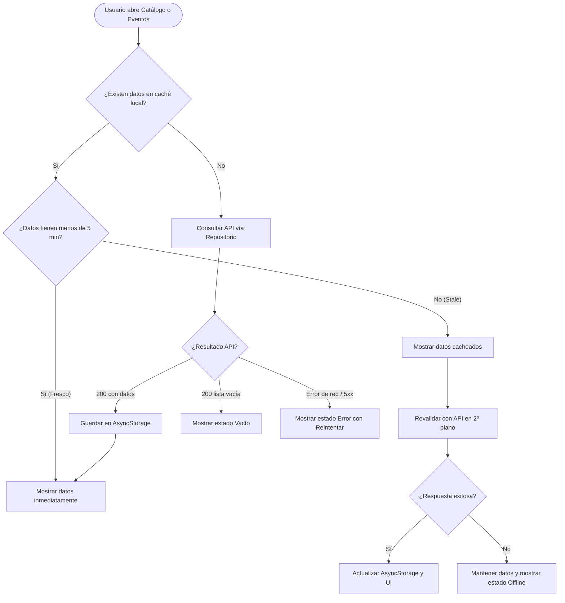

# 003 · api-read-integration

- App dueña: `mobile`
- Apps/paquetes afectados: `mobile`, `packages/api-client`
- Estado: Aprobada
- Solicitante / responsable funcional: Víctor Adrián (redacción spec / responsable BD); Aksel (revisión móvil)
- Aprobación funcional: Víctor Adrián (2026-10-20)
- Equivalencia en el documento de decisiones previas: 003

## Problema y contexto

Actualmente, la aplicación móvil (`apps/mobile`) muestra el catálogo de animales, especies y eventos del zoológico utilizando datos estáticos simulados (mocks provenientes de `mobile-002`). Esto impide que los visitantes reciban información verídica, fotos actualizadas del catálogo del zoológico, avisos sobre nuevos eventos o detalles de recintos en tiempo real.

Esta especificación define la integración de lectura entre las pantallas de catálogo/eventos de la aplicación móvil y la API central Laravel (`apps/api`) mediante el paquete cliente tipado `@arca/api-client`. Se implementa una estrategia de caché *Stale-While-Revalidate* para permitir la visualización fluida y la continuidad operativa sin conexión (offline) ante la irregularidad de la señal móvil en el parque, con imágenes de respaldo y gestión estricta de estados visuales.

## Objetivos

- Conectar las pantallas de catálogo de animales y eventos con los endpoints públicos de la API mediante Repositorios desacoplados que consumen `@arca/api-client` (usando `createHttpClient`).
- Implementar estrategia de caché local persistente (*Stale-While-Revalidate*) con `AsyncStorage` y un tiempo de frescura (TTL) de 5 minutos para garantizar disponibilidad offline y carga instantánea.
- Proporcionar imágenes de respaldo (fallback/placeholder) mientras cargan los recursos remotos o cuando una imagen falle o no esté disponible.
- Mapear de forma transparente los identificadores de la API (`snake_case`) a los modelos de dominio de la app móvil (`camelCase`).
- Cubrir de forma completa los 5 estados de visualización en la UI: carga (`loading`), éxito (`success`), sin datos (`empty`), error de servicio/red (`error`) y modo sin conexión (`offline`).
- Garantizar que la arquitectura respete estrictamente MVVM sin llamadas directas a red en vistas o componentes, respaldado con pruebas automatizadas unitarias en Jest por cada criterio de aceptación.

## Fuera de alcance

- Registro, autenticación y sesión de visitantes (corresponde a `mobile-004` / `api-004`).
- Estado de descubrimiento y colección del visitante (`isDiscovered`, puntos, escaneo QR y progreso; corresponde a `mobile-005` y `mobile-006`). La UI de catálogo en esta spec trata los datos como catálogo zoológico general sin estado de progreso individual.
- Operaciones de escritura, mutaciones o sincronización de cola de eventos/escaneos (reservado para `mobile-005` y `mobile-006`).
- Mapa interactivo, rutas guiadas y geolocalización (reservado para `mobile-007`).
- Renderizado 3D de modelos animales o realidad aumentada (requiere ADR y spec específica).
- Implementación del backend Laravel o creación de sus controladores/migraciones (esta spec es de consumo del lado cliente móvil; la definición contractual de backend se asume como se especifica en dependencias).

## Actores y permisos

| Actor/rol | Necesidad | Permisos requeridos |
|---|---|---|
| **Visitante (Anónimo / Sin autenticar)** | Explorar la lista de especies y animales, ver fotos, consultar detalles biológicos y ver la agenda de eventos del zoológico. | Ninguno (endpoints públicos de solo lectura). |
| **Visitante (Autenticado)** | Consultar el mismo catálogo público y eventos mientras navega por el parque. | Ninguno adicional para esta spec (usa las mismas rutas públicas). |

## Historias de usuario

- **HU-01 (Catálogo de animales):** Como visitante del zoológico, quiero ver el listado de especies y animales con sus fotos y nombres comunes para identificar los animales que puedo conocer durante mi recorrido.
- **HU-02 (Detalle del animal):** Como visitante, quiero abrir la ficha individual de un animal o especie para conocer su nombre científico, categoría, zona, dieta, curiosidades y datos de interés.
- **HU-03 (Agenda de eventos):** Como visitante, quiero ver la lista de eventos y actividades programadas (con fecha, horario y ubicación) para organizar mi itinerario en el zoológico.
- **HU-04 (Detalle de evento):** Como visitante, quiero tocar un evento para ver su descripción extendida, horario exacto y fotografías del evento.
- **HU-05 (Consulta sin conexión):** Como visitante en una zona del zoológico sin cobertura móvil, quiero que la app siga mostrándome el catálogo y los eventos previamente consultados para no perder acceso a la guía del parque.

## Criterios de aceptación

- **CA-01 (Listado de animales desde API):** Dado que la app móvil cuenta con conexión a red, cuando el visitante accede a la pantalla de catálogo de animales, entonces la app consulta `GET /species` mediante `AnimalRepository` y `@arca/api-client`, mapea los datos de `snake_case` a `camelCase` y muestra las especies con sus fotografías por URL y nombres correspondientes.
- **CA-02 (Detalle de animal desde API):** Dado un animal o especie seleccionado con identificador válido, cuando el visitante entra a su vista de detalle, entonces la app consulta `GET /species/{id}` mostrando la ficha completa (nombre común, nombre científico, zona, categoría, estadísticas, dieta y curiosidades) o un estado de recurso no encontrado si el ID no existe.
- **CA-03 (Listado y detalle de eventos desde API):** Dado que el visitante accede a la sección de eventos, cuando la pantalla carga, entonces consulta `GET /events` mostrando las actividades programadas; y al pulsar sobre un evento, se consulta `GET /events/{id}` para mostrar su detalle completo (título, descripción, fecha, horario, ubicación e imágenes).
- **CA-04 (Gestión de los 5 estados de UI):** Dada cualquier pantalla de catálogo o eventos, cuando se realiza la consulta de datos:
  - Mientras la promesa esté pendiente, muestra esqueletos o indicadores de carga (`loading`).
  - Si la API responde con una lista vacía, muestra el mensaje amigable en español correspondiente (`empty`).
  - Si ocurre un error de red o de servidor (códigos HTTP 4xx/5xx o timeout) sin datos previos en caché, muestra el mensaje de error en español y un botón accesible para reintentar (`error`).
  - Si la petición es exitosa, presenta el contenido en pantalla (`success`).
  - Si no hay red pero existen datos cacheados, muestra los datos y un indicador visible de "Modo sin conexión" (`offline`).
- **CA-05 (Caché Stale-While-Revalidate y TTL de 5 minutos):** Dado que existen datos previamente guardados en `AsyncStorage`:
  - Si la última sincronización ocurrió hace menos de 5 minutos (TTL fresco), la app sirve inmediatamente los datos locales sin bloquear la interfaz.
  - Si han transcurrido más de 5 minutos (datos *stale*), la app muestra los datos locales de inmediato y lanza en segundo plano una revalidación contra la API para actualizar la caché local y refrescar la vista al completarse.
  - Si la revalidación en segundo plano falla por desconexión, los datos cacheados permanecen visibles sin interrumpir al usuario.
- **CA-06 (Imágenes con respaldo y tolerancia a fallos):** Dada una imagen de animal o evento cargada por URL remota, cuando la imagen está descargando o si la URL es inválida/inaccesible, entonces el componente visual muestra un placeholder accesible o tinte de respaldo predeterminado sin romper el layout.
- **CA-07 (Arquitectura MVVM y cobertura de pruebas Jest):** Dado el repositorio de pruebas en `apps/mobile`, cuando se ejecute la suite de Jest (`npm test -- --runInBand`), entonces:
  - Ninguna vista (`screens/`) ni componente (`components/`) importa directamente `fetch`, `axios` o `@arca/api-client`.
  - Existe al menos una prueba unitaria automatizada que cita explícitamente cada criterio (`CA-01`, `CA-02`, `CA-03`, `CA-04`, `CA-05`, `CA-06`).

## Reglas de negocio

- **RN-01 (Patrón arquitectónico estricto):** Toda interacción con la API se realiza a través de `AnimalRepository` y `ZooRepository` utilizando instancias configuradas con `createHttpClient` de `@arca/api-client`. Está prohibido el uso directo de APIs de red en componentes visuales.
- **RN-02 (Transformación de atributos):** Los datos devueltos por la API en formato `snake_case` (ej. `scientific_name`, `image_url`, `fun_fact`) deben ser transformados en la capa del repositorio a `camelCase` (ej. `scientificName`, `imageUrl`, `funFact`) antes de exponerse a los ViewModels.
- **RN-03 (Política de frescura de caché):** La caché en `AsyncStorage` tiene una ventana de frescura de 5 minutos (300 segundos). El almacenamiento guarda la estampa de tiempo (`timestamp`) junto al payload. Pasado este tiempo, se aplica revalidación en segundo plano.
- **RN-04 (Degradación elegante ante fallos):** Si la API no está disponible o el dispositivo no tiene red:
  - Con caché existente: Se muestran los datos locales acompañados del estado `offline`.
  - Sin caché existente: Se muestra el estado `error` con acción de reintento. Bajo ninguna circunstancia la aplicación debe quedar en pantalla blanca o crashear.
- **RN-05 (Exclusión de progreso de visitante):** Las propiedades asociadas al progreso personal (tales como `isDiscovered` o puntos) no se consultan ni se alteran en esta spec. El modelo de UI de catálogo presenta los datos puramente zoológicos y educativos de la especie.
- **RN-06 (Textos y localización):** Todos los mensajes informativos, estados vacíos, alertas de error y etiquetas de accesibilidad deben estar redactados en español claro.

## Datos, privacidad y auditoría

- **Datos consultados:**
  - Especies / Animales: identificador (`id`), nombre común (`name`), nombre científico (`scientific_name`), categoría (`category`), zona de recinto (`zone`), URL de imagen (`image_url`), estadísticas (`stats`), dieta (`diet`), curiosidades (`curiosities`), dato curioso (`fun_fact`).
  - Eventos: identificador (`id`), título (`title`), descripción (`description`), fecha (`date`), horario (`time`), ubicación (`location`), arreglo de URLs de fotos (`image_urls`).
- **Privacidad y datos personales:** Esta spec maneja exclusivamente información pública institucional del zoológico. No recopila, almacena ni transmite identificadores de dispositivo, cookies de rastreo ni datos personales de los visitantes.
- **Seguridad y tokens:** Los endpoints consumidos son de acceso público; no se envían tokens de autenticación Bearer para estas consultas.
- **Impacto en base de datos:** Ninguno del lado del cliente móvil. No requiere solicitud DBR en esta spec (las tablas `species`, `animals`, `enclosures` y `events` ya existen y fueron estandarizadas en DBR-001 y DBR-004).

## Flujos y errores

### Casos de error y contingencias:
1. **Dispositivo sin red y sin caché previa:** La vista entra en estado `error`, mostrando el mensaje: *"No fue posible conectar con el zoológico. Revisa tu conexión a internet e intenta nuevamente"* con botón `Reintentar`.
2. **Dispositivo sin red pero con datos en caché:** La vista entra en estado `offline`, mostrando el catálogo guardado y una pastilla informativa: *"Modo sin conexión. Mostrando información guardada"*.
3. **Fallo en carga de imagen individual:** La imagen muestra el componente de fallback con el color temático asignado (`placeholderTint`) y no bloquea el resto del catálogo.
4. **Recurso no encontrado (`404` en detalle):** Si se consulta un animal o evento inexistente, se muestra el estado de error: *"El elemento solicitado no fue encontrado"* y un botón para volver al catálogo.

## Dependencias, riesgos y preguntas

- **Dependencias:**
  - `packages/api-client`: exportación y funcionamiento de `createHttpClient` y tipos `HttpClient`.
  - Contrato de API pública asumido según `apps/mobile/docs/estandares-integracion-api.md`:
    - `GET /api/v1/species`
    - `GET /api/v1/species/{id}`
    - `GET /api/v1/events`
    - `GET /api/v1/events/{id}`
  - Persistencia local: `@react-native-async-storage/async-storage`.
  - Pantallas base de UI de la spec `mobile-002`.
- **Riesgos:**
  - Si el backend de Laravel demora en desplegar formalmente los endpoints públicos (`/species`, `/events`), la implementación móvil dependerá temporalmente de mocks o interceptores de prueba. No obstante, al respetar la interfaz del repositorio, el cambio es instantáneo vía variable de entorno (`EXPO_PUBLIC_USE_MOCKS=false`).
  - Imágenes pesadas servidas por el catálogo web podrían saturar la memoria o tardar en redes celulares 3G/4G del parque. Se mitigará usando componentes optimizados con fallback.
- **Preguntas resueltas:**
  - *¿Cómo se aborda la falta de spec previa en API?* Se redacta la spec cliente asumiendo las rutas estándar documentadas en `estandares-integracion-api.md`.
  - *¿Política de caché?* Stale-While-Revalidate con TTL de 5 minutos en `AsyncStorage`.
  - *¿Alcance de `isDiscovered`?* Excluido; pertenece al progreso del visitante (`mobile-005`).
  - *¿Detalle de eventos?* Incluido formalmente junto con el listado.

## Revisión

- **Aprobadores y fecha:** Aprobada por Víctor Adrián (2026-10-20). Revisión móvil técnica coordinada con Aksel.
- **Evidencia/enlaces:**
  - `apps/mobile/docs/estandares-integracion-api.md`
  - `apps/mobile/specs/002-mobile-ui-base-visitor-journey.md`
  - `docs/adr/0004-mobile-react-native.md`
  - `docs/adr/0011-visitor-identity-and-mobile-session.md`
