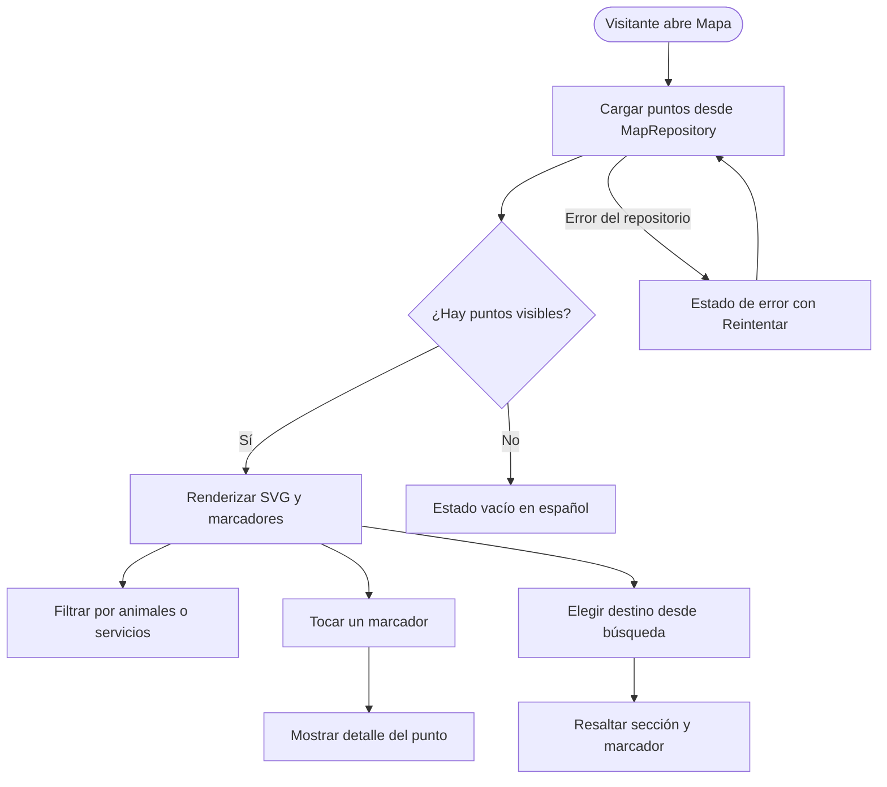

# 007 · map-location

- App dueña: `mobile`
- Apps/paquetes afectados: `mobile`; `packages/api-client` solo para el contrato futuro de V1.1
- Estado: Aprobada
- Solicitante / responsable funcional: Víctor Adrián
- Aprobación funcional: Víctor Adrián (2026-10-22)
- Revisión técnica: Aksel (equipo móvil), pendiente de firma
- Equivalencia en el documento de decisiones previas: 006

## Problema y contexto

El mapa actual de `mobile-002` es una composición de `View`s con posiciones porcentuales y datos simulados (`MOCK_MAP_LOCATIONS`, `MOCK_MAP_ROUTE`). No existe un plano real, ni un contrato de recintos, ni una fuente de datos para la web del encargado. Tampoco hay imágenes aéreas ni coordenadas reales del zoológico.

Esta especificación define la primera versión funcional de `mobile-007`: un mapa **2D esquemático**, sin GPS y sin proveedor de mapas externo, que permita al visitante ubicar las secciones y puntos del zoológico, consultar su información y encontrar un destino. El SVG es un plano de referencia, no una representación geográfica exacta.

La versión con GPS y geocercas queda para una fase posterior y requerirá coordenadas reales, permiso de ubicación, `expo-location`, API y DBR. El recorrido 3D queda fuera de alcance y depende del ADR 0005.

## Objetivos

- Mostrar un mapa 2D esquemático del zoológico mediante un SVG propio, sin calles, satélite ni imágenes aéreas.
- Representar las secciones del zoológico y los puntos de interés visibles con marcadores obtenidos de un repositorio.
- Permitir consultar el detalle de un recinto, animal o servicio desde el mapa.
- Permitir filtrar por animales y servicios, y resaltar un destino elegido desde la búsqueda.
- Mantener el mapa usable sin conexión y con estados de carga, vacío y error.
- Respetar MVVM, tokens semánticos, accesibilidad, textos en español y pruebas Jest por cada CA.
- Dejar preparado el contrato de datos para la integración futura con la API y la web del encargado, sin implementarla en esta versión.

## Fuera de alcance

- GPS, permisos de ubicación, geocercas, punto azul de “tu ubicación” y detección de llegada.
- Consumo de una API de recintos o mapa; la V1 usa un fixture detrás del repositorio.
- DBR, migraciones, cambios de esquema o edición del mapa desde la web del encargado.
- Rutas guiadas paso a paso, tiempos y distancias reales.
- Imágenes aéreas, satélite, calles, Google Maps, Mapbox, MapLibre u otro proveedor de mapas.
- Recorrido 3D real; depende del ADR 0005 y de una spec propia.
- Alta dinámica de secciones nuevas desde la web. En V1 las secciones son fijas en el SVG; los puntos sí pueden agregarse como datos.
- iOS.

## Actores y permisos

| Actor/rol | Necesidad | Permisos requeridos |
|---|---|---|
| Visitante | Ubicar secciones y puntos del zoológico, consultar información y encontrar un destino | Ninguno; no se solicita ubicación ni cámara |

## Historias de usuario

- **HU-01 (Mapa del zoológico):** Como visitante, quiero ver un plano claro de las secciones del zoológico para orientarme durante mi recorrido.
- **HU-02 (Puntos de interés):** Como visitante, quiero ver los recintos, animales y servicios disponibles para saber qué puedo visitar.
- **HU-03 (Detalle de un punto):** Como visitante, quiero tocar un punto del mapa para conocer su nombre, sección y descripción.
- **HU-04 (Destino):** Como visitante, quiero buscar un animal y verlo resaltado en el mapa para dirigirme a su sección.
- **HU-05 (Consulta sin conexión):** Como visitante en una zona sin cobertura, quiero seguir viendo el plano y la información disponible para no perder la orientación.

## Criterios de aceptación

- **CA-01 (Mapa esquemático):** Dado que el visitante abre la pestaña Mapa, cuando la pantalla carga, entonces se muestra un SVG 2D esquemático con las secciones del zoológico, el acceso y los senderos principales, sin calles, satélite, imágenes aéreas ni dependencia de red.
- **CA-02 (Puntos desde datos):** Dado el mapa, cuando se cargan los puntos visibles desde `MapRepository`, entonces cada marcador se posiciona con `mapX`/`mapY` normalizados y solo se muestran los puntos con `visible = true`; los marcadores no están dibujados a mano dentro del SVG.
- **CA-03 (Detalle del punto):** Dado un marcador visible, cuando el visitante lo toca, entonces se muestra una tarjeta o panel con nombre, tipo, sección y descripción, y puede cerrarlo sin perder el mapa.
- **CA-04 (Filtros):** Dado el mapa, cuando el visitante elige “Todo”, “Animales” o “Servicios”, entonces se muestran solo los puntos del tipo correspondiente y, si no hay resultados, se muestra un estado vacío en español sin romper el mapa.
- **CA-05 (Destino desde búsqueda):** Dado un animal seleccionado en la búsqueda, cuando el visitante elige “Ver en mapa”, entonces se resalta su sección y su marcador; no se muestran tiempos, distancias ni indicaciones paso a paso inventadas.
- **CA-06 (Offline y errores):** Dado que el SVG está incluido en la app, cuando no hay conexión, entonces el mapa sigue visible con el fixture disponible; si el repositorio falla, se muestra un estado de error en español con opción de reintentar, y si no hay puntos, un estado vacío.
- **CA-07 (MVVM, tokens y accesibilidad):** Dado el código de la feature, cuando se revisa, entonces las vistas no importan repositorios ni mocks, los colores provienen de tokens semánticos, los marcadores tienen etiquetas accesibles en español y el mapa no depende de gestos obligatorios para funcionar.
- **CA-08 (Pruebas por criterio):** Dada la suite de Jest, cuando se ejecuta, entonces existe al menos una prueba automatizada que nombra cada CA-xx de esta spec y se registran las limitaciones de la validación visual en dispositivo.

## Reglas de negocio

- **RN-01 (SVG base y datos separados):** El SVG contiene únicamente el fondo, las secciones, los senderos, el agua y las etiquetas. Los puntos se superponen como datos; agregar un punto no requiere editar el SVG.
- **RN-02 (Coordenadas normalizadas):** Las posiciones de los puntos se expresan como `mapX`/`mapY` entre 0 y 1 y se renderizan dentro de un contenedor con la misma relación de aspecto del SVG. No se usan píxeles absolutos dependientes de un dispositivo.
- **RN-03 (Sin GPS en V1):** La V1 no solicita permiso de ubicación ni muestra una ubicación simulada como si fuera real. Si se necesita una demostración, debe estar claramente marcada como modo de desarrollo y no formar parte de la aceptación.
- **RN-04 (Sin rutas inventadas):** La búsqueda solo resalta el destino. No se muestran duración, distancia ni pasos de navegación hasta que exista un contrato de rutas.
- **RN-05 (Visibilidad):** Solo se muestran puntos con `visible = true`. La web del encargado será la fuente de ese valor en V1.1.
- **RN-06 (Idioma y nombres):** La UI, los mensajes y la documentación están en español; los identificadores de código, SVG y rutas están en inglés.
- **RN-07 (Dependencia de renderizado):** Se usa `react-native-svg` para renderizar el SVG. No se agrega un proveedor de mapas ni otra dependencia de mapas en V1. La dependencia requiere ADR según las reglas del proyecto.
- **RN-08 (Secciones fijas, puntos dinámicos):** En V1 las secciones se definen en el SVG. Si el zoológico agrega una sección nueva, se actualiza el SVG; si agrega un punto dentro de una sección existente, basta con actualizar los datos.
- **RN-09 (Sin DBR en V1):** La V1 no modifica el esquema de base de datos. El fixture vive en la app. La API, la DBR y la web del encargado se abordan en V1.1.
- **RN-10 (3D fuera de alcance):** El botón o acceso al recorrido 3D no forma parte de esta spec y permanece como placeholder o se oculta; no se implementa un visor 3D real.

## Datos, privacidad y auditoría

- **Datos de V1:** secciones del SVG y un fixture de 8 a 10 puntos con `id`, `name`, `kind`, `sectionId`, `mapX`, `mapY`, `visible` y `description` opcional.
- **Datos personales:** ninguno. No se solicita ubicación, cámara, contactos ni identificadores del dispositivo.
- **Privacidad:** el mapa es información pública del zoológico; no se envía telemetría en esta versión.
- **Impacto en base de datos:** ninguno. Esta spec no requiere DBR porque no crea ni modifica tablas.
- **Contrato futuro (V1.1, no implementado aquí):** la API y la web del encargado deberán definir al menos `name`, `kind`, `section_id` o `svg_zone_id`, `visible`, `map_x`, `map_y` y `description`. La DBR correspondiente se abrirá cuando se implemente esa fase.

## Flujos y errores

### Casos de error y contingencias

1. **Sin conexión:** el SVG y el fixture siguen disponibles; se muestra el mapa y, si aplica, una indicación de que la información es de referencia.
2. **Error del repositorio:** se muestra un mensaje en español con acción de reintentar; no se deja la pantalla en blanco.
3. **Sin puntos visibles o filtro sin resultados:** se muestra un estado vacío y se conserva el mapa visible.
4. **SVG no disponible:** se muestra un estado de error controlado; no se rompe la navegación.

## Dependencias, riesgos y preguntas

- **Dependencias:**
  - `react-native-svg` para renderizar el SVG; no está instalado actualmente.
  - `@arca/tokens` para colores semánticos.
  - Pantallas y navegación de `mobile-002`.
  - Brief del SVG: `apps/mobile/docs/007-svg-brief.md`.
- **Riesgos:**
  - Un plano esquemático puede quedar ambiguo si no tiene buenas etiquetas y contraste; se mitiga con secciones nombradas y una leyenda visual.
  - Cambiar el SVG o la distribución puede desalinear los `mapX`/`mapY`; se mitiga manteniendo posiciones normalizadas y un brief estable.
  - `react-native-svg` requiere verificación en Expo Go y en el build de Android.
  - La V1 no resuelve la ubicación real del visitante; eso debe comunicarse claramente en la UI.
- **Preguntas abiertas:**
  - Nombres y distribución definitivos de las secciones del zoológico.
  - Confirmación de si Aksel hará revisión técnica o aprobación adicional de esta spec.
  - Validación del estilo visual final con los tokens de marca.
  - Momento de apertura de la spec de API/DBR para V1.1.
- **Preguntas resueltas:**
  - ¿Habrá GPS en la primera versión? No.
  - ¿Se usarán imágenes aéreas? No; el SVG es esquemático.
  - ¿El mapa será 3D? No; el 3D queda fuera y depende del ADR 0005.
  - ¿Se usará un proveedor de mapas? No; SVG propio con `react-native-svg`.
  - ¿Habrá DBR en V1? No; se usa fixture.
  - ¿Los puntos se dibujan en el SVG? No; se cargan como datos y se superponen.

## Revisión

- **Aprobadores y fecha:** aprobación funcional de Víctor Adrián (2026-10-22). Revisión técnica de Aksel pendiente de firma. El plan y las tareas quedan sujetos a esa revisión antes de implementar.
- **Evidencia/enlaces:**
  - `apps/mobile/docs/007-svg-brief.md`
  - `apps/mobile/docs/007-map-v1-draft.svg`
  - `apps/mobile/docs/003-008-roadmap-y-asignacion.md`
  - `apps/mobile/specs/002-mobile-ui-base-visitor-journey.md`
  - `docs/adr/0004-mobile-react-native.md`
  - `docs/adr/0005-videojuego-pendiente.md`
  - `docs/adr/0015-mobile-svg-map-rendering.md`
