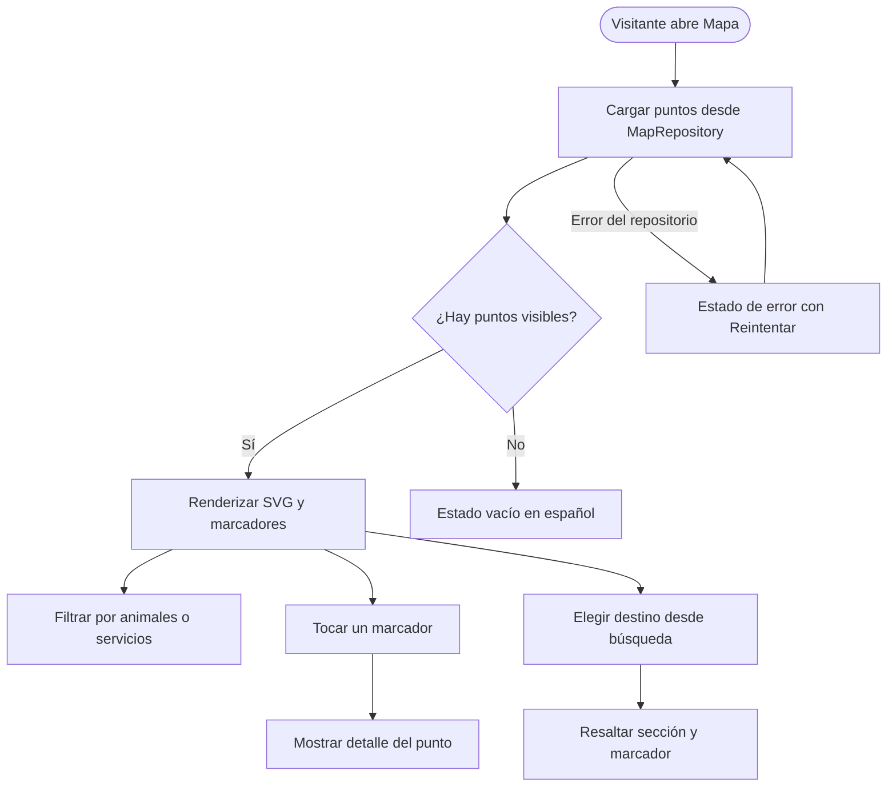
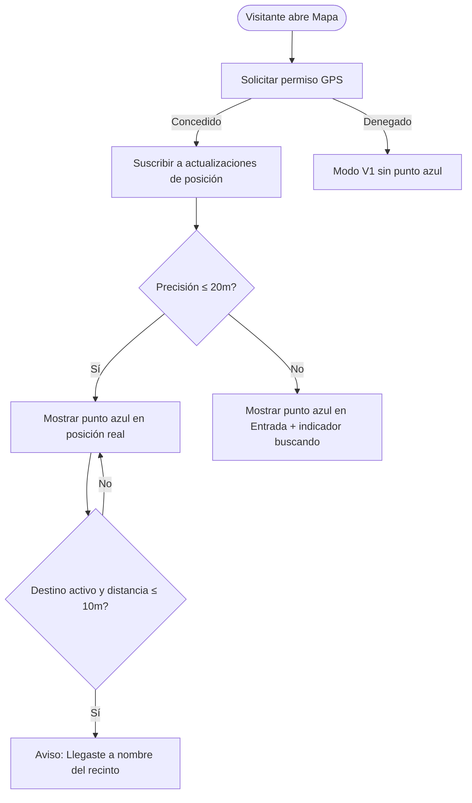

# 007 · map-location

- App dueña: `mobile`
- Apps/paquetes afectados: `mobile`; `packages/api-client` solo para el contrato futuro de V1.1
- Estado: Aprobada
- Solicitante / responsable funcional: Víctor Adrián
- Aprobación funcional: Víctor Adrián (2026-10-22)
- Revisión técnica: Aksel (equipo móvil), pendiente de firma
- Equivalencia en el documento de decisiones previas: 006

## Problema y contexto

El mapa actual de `mobile-002` es una composición de `View`s con posiciones porcentuales y datos simulados (`MOCK_MAP_LOCATIONS`, `MOCK_MAP_ROUTE`). No existe un plano real, ni un contrato de recintos, ni una fuente de datos para la web del encargado. Tampoco hay imágenes aéreas ni coordenadas reales del zoológico.

Esta especificación define la primera versión funcional de `mobile-007`: un mapa **2D esquemático**, sin GPS y sin proveedor de mapas externo, que permita al visitante ubicar las secciones y puntos del zoológico, consultar su información y encontrar un destino. El SVG es un plano de referencia, no una representación geográfica exacta.

La versión con GPS y geocercas queda para una fase posterior y requerirá coordenadas reales, permiso de ubicación, `expo-location`, API y DBR. El recorrido 3D queda fuera de alcance y depende del ADR 0005.

## Objetivos

- Mostrar un mapa 2D esquemático del zoológico mediante un SVG propio, sin calles, satélite ni imágenes aéreas.
- Representar las secciones del zoológico y los puntos de interés visibles con marcadores obtenidos de un repositorio.
- Permitir consultar el detalle de un recinto, animal o servicio desde el mapa.
- Permitir filtrar por animales y servicios, y resaltar un destino elegido desde la búsqueda.
- Mantener el mapa usable sin conexión y con estados de carga, vacío y error.
- Respetar MVVM, tokens semánticos, accesibilidad, textos en español y pruebas Jest por cada CA.
- Dejar preparado el contrato de datos para la integración futura con la API y la web del encargado, sin implementarla en esta versión.

## Fuera de alcance

- GPS, permisos de ubicación, geocercas, punto azul de “tu ubicación” y detección de llegada.
- Consumo de una API de recintos o mapa; la V1 usa un fixture detrás del repositorio.
- DBR, migraciones, cambios de esquema o edición del mapa desde la web del encargado.
- Rutas guiadas paso a paso, tiempos y distancias reales.
- Imágenes aéreas, satélite, calles, Google Maps, Mapbox, MapLibre u otro proveedor de mapas.
- Recorrido 3D real; depende del ADR 0005 y de una spec propia.
- Alta dinámica de secciones nuevas desde la web. En V1 las secciones son fijas en el SVG; los puntos sí pueden agregarse como datos.
- iOS.

## Actores y permisos

| Actor/rol | Necesidad | Permisos requeridos |
|---|---|---|
| Visitante | Ubicar secciones y puntos del zoológico, consultar información y encontrar un destino | Ninguno; no se solicita ubicación ni cámara |

## Historias de usuario

- **HU-01 (Mapa del zoológico):** Como visitante, quiero ver un plano claro de las secciones del zoológico para orientarme durante mi recorrido.
- **HU-02 (Puntos de interés):** Como visitante, quiero ver los recintos, animales y servicios disponibles para saber qué puedo visitar.
- **HU-03 (Detalle de un punto):** Como visitante, quiero tocar un punto del mapa para conocer su nombre, sección y descripción.
- **HU-04 (Destino):** Como visitante, quiero buscar un animal y verlo resaltado en el mapa para dirigirme a su sección.
- **HU-05 (Consulta sin conexión):** Como visitante en una zona sin cobertura, quiero seguir viendo el plano y la información disponible para no perder la orientación.

## Criterios de aceptación

- **CA-01 (Mapa esquemático):** Dado que el visitante abre la pestaña Mapa, cuando la pantalla carga, entonces se muestra un SVG 2D esquemático con las secciones del zoológico, el acceso y los senderos principales, sin calles, satélite, imágenes aéreas ni dependencia de red.
- **CA-02 (Puntos desde datos):** Dado el mapa, cuando se cargan los puntos visibles desde `MapRepository`, entonces cada marcador se posiciona con `mapX`/`mapY` normalizados y solo se muestran los puntos con `visible = true`; los marcadores no están dibujados a mano dentro del SVG.
- **CA-03 (Detalle del punto):** Dado un marcador visible, cuando el visitante lo toca, entonces se muestra una tarjeta o panel con nombre, tipo, sección y descripción, y puede cerrarlo sin perder el mapa.
- **CA-04 (Filtros):** Dado el mapa, cuando el visitante elige “Todo”, “Animales” o “Servicios”, entonces se muestran solo los puntos del tipo correspondiente y, si no hay resultados, se muestra un estado vacío en español sin romper el mapa.
- **CA-05 (Destino desde búsqueda):** Dado un animal seleccionado en la búsqueda, cuando el visitante elige “Ver en mapa”, entonces se resalta su sección y su marcador; no se muestran tiempos, distancias ni indicaciones paso a paso inventadas.
- **CA-06 (Offline y errores):** Dado que el SVG está incluido en la app, cuando no hay conexión, entonces el mapa sigue visible con el fixture disponible; si el repositorio falla, se muestra un estado de error en español con opción de reintentar, y si no hay puntos, un estado vacío.
- **CA-07 (MVVM, tokens y accesibilidad):** Dado el código de la feature, cuando se revisa, entonces las vistas no importan repositorios ni mocks, los colores provienen de tokens semánticos, los marcadores tienen etiquetas accesibles en español y el mapa no depende de gestos obligatorios para funcionar.
- **CA-08 (Pruebas por criterio):** Dada la suite de Jest, cuando se ejecuta, entonces existe al menos una prueba automatizada que nombra cada CA-xx de esta spec y se registran las limitaciones de la validación visual en dispositivo.

## Reglas de negocio

- **RN-01 (SVG base y datos separados):** El SVG contiene únicamente el fondo, las secciones, los senderos, el agua y las etiquetas. Los puntos se superponen como datos; agregar un punto no requiere editar el SVG.
- **RN-02 (Coordenadas normalizadas):** Las posiciones de los puntos se expresan como `mapX`/`mapY` entre 0 y 1 y se renderizan dentro de un contenedor con la misma relación de aspecto del SVG. No se usan píxeles absolutos dependientes de un dispositivo.
- **RN-03 (Sin GPS en V1):** La V1 no solicita permiso de ubicación ni muestra una ubicación simulada como si fuera real. Si se necesita una demostración, debe estar claramente marcada como modo de desarrollo y no formar parte de la aceptación.
- **RN-04 (Sin rutas inventadas):** La búsqueda solo resalta el destino. No se muestran duración, distancia ni pasos de navegación hasta que exista un contrato de rutas.
- **RN-05 (Visibilidad):** Solo se muestran puntos con `visible = true`. La web del encargado será la fuente de ese valor en V1.1.
- **RN-06 (Idioma y nombres):** La UI, los mensajes y la documentación están en español; los identificadores de código, SVG y rutas están en inglés.
- **RN-07 (Dependencia de renderizado):** Se usa `react-native-svg` para renderizar el SVG. No se agrega un proveedor de mapas ni otra dependencia de mapas en V1. La dependencia requiere ADR según las reglas del proyecto.
- **RN-08 (Secciones fijas, puntos dinámicos):** En V1 las secciones se definen en el SVG. Si el zoológico agrega una sección nueva, se actualiza el SVG; si agrega un punto dentro de una sección existente, basta con actualizar los datos.
- **RN-09 (Sin DBR en V1):** La V1 no modifica el esquema de base de datos. El fixture vive en la app. La API, la DBR y la web del encargado se abordan en V1.1.
- **RN-10 (3D fuera de alcance):** El botón o acceso al recorrido 3D no forma parte de esta spec y permanece como placeholder o se oculta; no se implementa un visor 3D real.

## Datos, privacidad y auditoría

- **Datos de V1:** secciones del SVG y un fixture de 8 a 10 puntos con `id`, `name`, `kind`, `sectionId`, `mapX`, `mapY`, `visible` y `description` opcional.
- **Datos personales:** ninguno. No se solicita ubicación, cámara, contactos ni identificadores del dispositivo.
- **Privacidad:** el mapa es información pública del zoológico; no se envía telemetría en esta versión.
- **Impacto en base de datos:** ninguno. Esta spec no requiere DBR porque no crea ni modifica tablas.
- **Contrato futuro (V1.1, no implementado aquí):** la API y la web del encargado deberán definir al menos `name`, `kind`, `section_id` o `svg_zone_id`, `visible`, `map_x`, `map_y` y `description`. La DBR correspondiente se abrirá cuando se implemente esa fase.

## Flujos y errores

### Casos de error y contingencias

1. **Sin conexión:** el SVG y el fixture siguen disponibles; se muestra el mapa y, si aplica, una indicación de que la información es de referencia.
2. **Error del repositorio:** se muestra un mensaje en español con acción de reintentar; no se deja la pantalla en blanco.
3. **Sin puntos visibles o filtro sin resultados:** se muestra un estado vacío y se conserva el mapa visible.
4. **SVG no disponible:** se muestra un estado de error controlado; no se rompe la navegación.

## Dependencias, riesgos y preguntas

- **Dependencias:**
  - `react-native-svg` para renderizar el SVG; no está instalado actualmente.
  - `@arca/tokens` para colores semánticos.
  - Pantallas y navegación de `mobile-002`.
  - Brief del SVG: `apps/mobile/docs/007-svg-brief.md`.
- **Riesgos:**
  - Un plano esquemático puede quedar ambiguo si no tiene buenas etiquetas y contraste; se mitiga con secciones nombradas y una leyenda visual.
  - Cambiar el SVG o la distribución puede desalinear los `mapX`/`mapY`; se mitiga manteniendo posiciones normalizadas y un brief estable.
  - `react-native-svg` requiere verificación en Expo Go y en el build de Android.
  - La V1 no resuelve la ubicación real del visitante; eso debe comunicarse claramente en la UI.
- **Preguntas abiertas:**
  - Nombres y distribución definitivos de las secciones del zoológico.
  - Confirmación de si Aksel hará revisión técnica o aprobación adicional de esta spec.
  - Validación del estilo visual final con los tokens de marca.
  - Momento de apertura de la spec de API/DBR para V1.1.
- **Preguntas resueltas:**
  - ¿Habrá GPS en la primera versión? No.
  - ¿Se usarán imágenes aéreas? No; el SVG es esquemático.
  - ¿El mapa será 3D? No; el 3D queda fuera y depende del ADR 0005.
  - ¿Se usará un proveedor de mapas? No; SVG propio con `react-native-svg`.
  - ¿Habrá DBR en V1? No; se usa fixture.
  - ¿Los puntos se dibujan en el SVG? No; se cargan como datos y se superponen.

## Revisión

- **Aprobadores y fecha:** aprobación funcional de Víctor Adrián (2026-10-22). Revisión técnica de Aksel pendiente de firma. El plan y las tareas quedan sujetos a esa revisión antes de implementar.
- **Evidencia/enlaces:**
  - `apps/mobile/docs/007-svg-brief.md`
  - `apps/mobile/docs/007-map-v1-draft.svg`
  - `apps/mobile/docs/003-008-roadmap-y-asignacion.md`
  - `apps/mobile/specs/002-mobile-ui-base-visitor-journey.md`
  - `docs/adr/0004-mobile-react-native.md`
  - `docs/adr/0005-videojuego-pendiente.md`
  - `docs/adr/0015-mobile-svg-map-rendering.md`

---

## Enmienda V2 — GPS, Punto Azul y Detección de Llegada

- Estado: **Aprobada**
- Solicitante / responsable funcional: Víctor Adrián
- Aprobación funcional: Víctor Adrián (2026-10-29)
- Fecha: 2026-10-29
- ADR habilitador: `docs/adr/0016-expo-location-gps-blue-dot.md` — Aceptado (2026-10-29)

### Problema y contexto (V2)

La V1 entregó un mapa 2D consultable pero estático: el visitante no sabe dónde está él dentro del plano. La V2 agrega posicionamiento en tiempo real mediante GPS, sin cambiar el SVG ni la arquitectura base. El SVG actual es de **prueba y no está a escala real**; la calibración geográfica definitiva depende del SVG final y de una medición en campo.

### Objetivos (V2)

- Mostrar un **punto azul** sobre el SVG con la posición aproximada del visitante.
- Mostrar la posición en la **entrada principal** como punto de partida cuando el GPS no tiene señal suficiente o el permiso acaba de ser otorgado.
- **Detectar llegada** a un recinto destino cuando el visitante está a ≤ 10 m del POI seleccionado y mostrar una notificación en pantalla.
- Degradar al modo V1 (sin punto azul) si el permiso GPS es denegado, sin bloquear la app.

### Fuera de alcance (V2)

- Geofencing nativo con tareas en segundo plano (`startGeofencingAsync`).
- Ruteo paso a paso, instrucciones de giro o cálculo de tiempo/distancia.
- Orientación por brújula / rotación del punto azul.
- Integración con API o DBR; los POIs siguen siendo el fixture local.
- iOS.
- Calibración geográfica real del SVG (depende del SVG definitivo y medición en campo; hasta entonces las coordenadas GPS de los POIs son de prueba).

### Actores y permisos (V2)

| Actor/rol | Necesidad | Permisos requeridos |
|---|---|---|
| Visitante | Saber dónde está en el zoológico | `ACCESS_FINE_LOCATION` (primer plano) — opcional; sin él el mapa funciona en modo V1 |

### Historias de usuario (V2)

- **HU-06 (Punto azul):** Como visitante, quiero ver mi posición sobre el plano del zoológico para orientarme mientras camino.
- **HU-07 (Posición inicial en entrada):** Como visitante que acaba de entrar, quiero que mi posición inicial aparezca en la entrada principal para no verme ubicado fuera del mapa.
- **HU-08 (Llegada a recinto):** Como visitante con un destino seleccionado, quiero recibir un aviso cuando llegue al recinto para saber que encontré el lugar.
- **HU-09 (Sin GPS):** Como visitante que rechazó el permiso, quiero seguir usando el mapa de consulta igual que en V1 sin mensajes repetitivos de error.

### Criterios de aceptación (V2)

- **CA-08 (Permiso GPS):** Dado que el visitante abre la pestaña Mapa por primera vez, cuando se solicita el permiso de ubicación, entonces el diálogo del sistema aparece y el mapa carga el SVG en paralelo; si el permiso es denegado el mapa funciona en modo V1 sin punto azul y sin volver a pedir el permiso en la misma sesión.

- **CA-09 (Punto azul visible):** Dado que el permiso fue concedido y el GPS tiene precisión ≤ 20 m, cuando se recibe una actualización de posición, entonces un marcador circular azul aparece sobre el SVG en la posición transformada (`geoTransform`), animándose suavemente entre actualizaciones.

- **CA-10 (Posición inicial en entrada):** Dado que el permiso fue concedido pero el GPS aún no tiene señal suficiente (precisión > 20 m o sin fix), cuando el visitante abre el mapa, entonces el punto azul se muestra en las coordenadas SVG de la entrada principal con un indicador visual de "buscando ubicación…" (anillo pulsante o texto).

- **CA-11 (Transformación GPS → SVG):** Dado las coordenadas GPS reales del visitante, cuando `geoTransform(lat, lon)` se ejecuta, entonces devuelve `{ svgX, svgY }` dentro del rango `[0, SVG_WIDTH] × [0, SVG_HEIGHT]` sin lanzar excepciones; si las coordenadas caen fuera del bounding-box del zoológico, devuelve la posición de la entrada principal.

- **CA-12 (Detección de llegada):** Dado que el visitante tiene un recinto destino seleccionado y GPS activo, cuando la distancia Haversine entre la posición del visitante y el POI destino es ≤ 10 m, entonces se muestra un **banner visual** en pantalla con el mensaje "¡Llegaste a [nombre del recinto]!" y el estado de destino se limpia; si el visitante cierra el aviso manualmente, no vuelve a aparecer para el mismo destino en la misma sesión. No se usa vibración ni sonido en V2.

- **CA-13 (Modo degradado):** Dado que el permiso GPS fue denegado o `expo-location` no está disponible, cuando el visitante usa el mapa, entonces todas las funciones de V1 (CA-01 a CA-07) siguen funcionando sin errores visibles relacionados con GPS.

- **CA-14 (Línea de ruta hacia el destino):** Dado que el visitante tiene un recinto destino seleccionado y el punto azul de ubicación está visible, cuando se muestra el mapa, entonces se traza una línea visual punteada sobre el SVG que conecta las coordenadas de la posición del usuario con las coordenadas SVG del recinto destino; si el usuario deselecciona el destino o se dispara la llegada (CA-12), la línea desaparece automáticamente.

### Reglas de negocio (V2)

- **RN-11 (Solo primer plano):** El GPS solo se activa mientras la pantalla Mapa está en primer plano (`requestForegroundPermissionsAsync`). No se usa ubicación en segundo plano.
- **RN-12 (Radio de llegada):** El umbral de llegada es 10 m, configurable como constante en el ViewModel. No se hardcodea en componentes.
- **RN-13 (Coordenadas de prueba):** Hasta contar con el SVG definitivo y la medición en campo, los valores de `ZOO_BOUNDS` y las coordenadas de los POIs son sintéticos/de prueba. Los tests usan coordenadas sintéticas; no dependen del GPS real.
- **RN-14 (Un permiso por sesión):** Si el permiso es denegado, no se vuelve a solicitar hasta que el usuario reinicie la app.
- **RN-15 (Sin geofencing nativo):** La geocerca se implementa como cálculo Haversine en el ViewModel, no con `startGeofencingAsync`.

### Datos, privacidad y auditoría (V2)

- **Dato nuevo:** coordenadas GPS del visitante — procesadas en memoria, no se persisten, no se envían a ningún servidor en esta versión.
- **Permiso Android:** `ACCESS_FINE_LOCATION` declarado en `app.json → android.permissions`.
- **Privacidad:** la posición nunca sale del dispositivo en V2. No se registra historial de movimiento.
- **DBR:** ninguna. Los POIs siguen en el fixture local.

### Flujos y errores (V2)

### Dependencias, riesgos y preguntas (V2)

- **Dependencias:**
  - `expo-location` — ADR 0016 Aceptado; instalación pendiente de confirmar versión compatible con SDK 57.
  - `src/utils/geoTransform.ts` — nueva utilidad matemática (bounding-box afín).
  - `src/constants/zoo.ts` — constantes `ZOO_BOUNDS` y coordenadas de entrada.
  - SVG y POIs de V1 sin cambios estructurales.

- **Riesgos:**
  - GPS impreciso bajo techo o en zonas arboladas; mitigado con umbral de precisión y posición de entrada como fallback.
  - El SVG de prueba hace que el punto azul no sea visualmente preciso hasta tener el SVG real y la medición en campo.
  - El radio de 10 m puede ser muy pequeño si el GPS tiene deriva; ajustable con `RN-12`.

- **Preguntas abiertas:** ninguna — todas resueltas.
- **Preguntas resueltas (V2):**
  1. ¿Cuándo se miden las 4 esquinas + entrada? El zoológico enviará foto/video; Víctor Adrián generará el SVG definitivo a partir de ese material. Hasta entonces se usan coordenadas sintéticas — no bloquea el desarrollo, sí la precisión real.
  2. ¿Aviso de llegada visual o vibración? Solo visual: banner con "¡Llegaste a [recinto]!". Sin vibración ni sonido en V2.
  3. ¿Radio de llegada 10 m? Confirmado para V2; se ajustará tras la medición en campo si hay deriva GPS.

### Revisión (V2)

- **Aprobadores y fecha:** Víctor Adrián (2026-10-29).
- **Evidencia/enlaces:**
  - `docs/adr/0016-expo-location-gps-blue-dot.md` — Aceptado
  - `apps/mobile/docs/007-roadmap-mapa-gps-ar.md`

---

## Enmienda V2.2 — Controles Interactivos del Mapa (Zoom, Desplazamiento y Centrado)

- Estado: **Aprobada** (2026-11-04)
- Solicitante / responsable funcional: Víctor Adrián
- Fecha: 2026-11-03
- Sin nuevas dependencias externas (usa primitivas de React Native + controles accesibles para cumplir `CA-07`).

### Problema y contexto (V2.2)

En las versiones V1 a V2.1 el lienzo del mapa se muestra fijo al 100 % dentro de su contenedor. En pantallas pequeñas o zonas con varios puntos cercanos, el visitante necesita acercar el plano (zoom in), desplazarse por las áreas acercadas (pan) y regresar rápidamente a la vista general o centrar el mapa sobre su ubicación GPS (punto azul) o sobre un recinto enfocado.

### Objetivos (V2.2)

- Permitir acercar (`+`) y alejar (`-`) el mapa 2D dentro de límites controlados (`1.0x` a `2.5x`, en pasos de `0.5x`) manteniendo alineados el SVG, los marcadores, el punto azul y la línea de ruta.
- Permitir desplazar el lienzo cuando el nivel de zoom sea mayor a `1.0x` (tanto mediante arrastre táctil con `PanResponder` como al centrar un punto/ubicación).
- Incluir un botón accesible de **"Restablecer vista"** para volver a escala `1.0x` centrada `(0, 0)`.
- Incluir un botón accesible de **"Centrar en mi ubicación"** cuando el punto azul (`userPosition`) esté activo, que centre el visor sobre la posición del visitante.

### Historias de usuario (V2.2)

- **HU-10 (Zoom y desplazamiento):** Como visitante, quiero acercar, alejar y desplazar el plano del zoológico para explorar con mayor claridad las zonas con varios puntos de interés.
- **HU-11 (Centrar en mi ubicación):** Como visitante con GPS activo, quiero un botón para centrar el mapa en mi punto azul para encontrarme rápidamente después de explorar otras áreas del plano.

### Criterios de aceptación (V2.2)

- **CA-15 (Controles de zoom accesibles):** Dado el mapa visible, cuando el visitante presiona el botón "Acercar mapa" (`+`) o "Alejar mapa" (`-`), entonces la escala del lienzo (`zoomScale`) aumenta o disminuye dentro del rango `[1.0, 2.5]` manteniendo sincronizados el SVG, los marcadores, el punto azul y la línea de destino; y al presionar "Restablecer vista", el mapa vuelve a escala `1.0` y desplazamiento `(0, 0)`.
- **CA-16 (Desplazamiento acotado del lienzo):** Dado que el mapa tiene un nivel de zoom mayor a `1.0`, cuando el visitante desplaza el lienzo o se enfoca un punto/ubicación, entonces el desplazamiento (`panX`, `panY`) se limita a los bordes del mapa (`clampPan`) para que el plano nunca salga del área visible; en `1.0x` el desplazamiento se mantiene en `(0, 0)`.
- **CA-17 (Centrar en mi ubicación):** Dado que el visitante tiene ubicación activa (`userPosition` no nulo), cuando presiona el botón "Centrar en mi ubicación", entonces el mapa se centra sobre las coordenadas del punto azul (aplicando zoom si estaba en `1.0x`); si no hay ubicación activa (`userPosition === null`), el botón no se muestra o permanece deshabilitado de forma accesible sin romper el mapa.

### Reglas de negocio (V2.2)

- **RN-16 (Accesibilidad y sin gestos obligatorios):** Conforme a `CA-07`, toda acción de zoom, restablecimiento y centrado debe poder ejecutarse mediante botones accesibles con etiquetas en español (`accessibilityLabel`), sin depender exclusivamente de gestos multitáctiles.
- **RN-17 (Sin dependencias nuevas):** Se implementa con APIs nativas de React Native (`View`, transformaciones de escala/traslación y `PanResponder`), sin instalar paquetes adicionales.

---

## Próxima Evolución — Fase V3: Navegación Guiada por Senderos (Pathfinding)

- **Estado:** Propuesta formal planificada
- **Responsable funcional:** Víctor Adrián
- **Dependencia bloqueante:** Recepción de fotos/videos con dron del zoológico Nicolás Bravo y generación del SVG cartográfico definitivo.

### Justificación de alcance
En la V2.1 la línea hacia el recinto destino es una recta euclidiana directa (`DestinationRouteLine`). Esta solución es óptima para la fase esquemática porque evita invertir tiempo en trazar senderos matemáticos sobre un plano provisional que cambiará cuando se digitalice la topografía real con dron.

### Objetivos funcionales V3 (cuando llegue el SVG real)
1. **Grafo de andadores peatonales:**
   - Modelar las intersecciones y curvas de los pasillos peatonales como un grafo ponderado de nodos y aristas (`src/utils/zooPaths.ts`).
2. **Cálculo de ruta más corta (Pathfinding):**
   - Algoritmo A* o Dijkstra ligero ejecutado en memoria en el cliente:
     $$\text{Posición del visitante} \longrightarrow \text{Nodo de sendero más cercano} \longrightarrow \text{Recorrido por pasillos} \longrightarrow \text{Recinto destino}$$
   - Renderizar una polilínea SVG curva/segmentada que siga los andadores físicos sin atravesar jaulas, lagos ni muros.
3. **Métricas de caminata en tiempo real:**
   - Distancia real a recorrer por los senderos (metros).
   - Tiempo estimado a pie considerando velocidad promedio de paseo familiar ($1.1\text{ m/s}$ / $4\text{ km/h}$).
   - Tarjeta informativa en pantalla: *"A 140 m • 2 min a pie"*.

### Estado de aprobación (Enmienda V3)
- **Estado:** **Aprobada** (2026-11-04) — Implementada sobre la red de andadores del SVG actual y desacoplada en `src/constants/zooPaths.ts` para recalibración directa con cartografía de dron.

### Historias de usuario (V3)
- **HU-12 (Ruta por senderos):** Como visitante con un destino activo, quiero que la línea de ruta siga los pasillos peatonales del zoológico para saber por qué camino debo avanzar sin cruzar zonas restringidas.
- **HU-13 (Distancia y tiempo a pie):** Como visitante, quiero ver cuántos metros y minutos aproximados me faltan para llegar al recinto destino caminando por los senderos.

### Criterios de aceptación (V3)
- **CA-18 (Cálculo de camino mínimo sobre grafo peatonal):** Dado un punto de origen `(svgX, svgY)` y un punto de destino `(destSvgX, destSvgY)`, cuando se ejecuta `computeWalkRoute`, entonces el algoritmo Dijkstra devuelve una secuencia ordenada de puntos que pasa por los nodos de los andadores peatonales conectando origen y destino por la ruta más corta, manejando de forma segura nodos aislados o coordenadas idénticas sin lanzar excepciones.
- **CA-19 (Estimación de distancia y tiempo a pie):** Dada una ruta calculada sobre el grafo de senderos, cuando `computeWalkRoute` retorna el resultado, entonces incluye `distanceMeters` (entero $\ge 1$) y `estimatedMinutes` (entero $\ge 1$, calculado a $1.1\text{ m/s}$), actualizándose conforme cambia la posición del visitante o el destino seleccionado.
- **CA-20 (Polilínea en senderos e insignia de caminata en UI):** Dado que el visitante tiene ubicación activa (`userPosition`) y un recinto destino seleccionado (`destinationPlace`), cuando se muestra el mapa, entonces la ruta se dibuja como una polilínea SVG (`testID="destination-route-polyline"`) siguiendo los senderos y se muestra la insignia accesible (`testID="walk-estimate-badge"`) con el nombre del destino, la distancia en metros y el tiempo estimado en minutos; al cancelar el destino o llegar al recinto, ambos elementos desaparecen.

### Reglas de negocio (V3)
- **RN-18 (Velocidad peatonal estándar):** La velocidad promedio de caminata familiar se define como constante `WALKING_SPEED_MPS = 1.1` en `src/constants/zooPaths.ts`.
- **RN-19 (Grafo desacoplado de la vista):** Los nodos y aristas del sendero residen en `src/constants/zooPaths.ts` y la lógica Dijkstra en `src/utils/pathfinding.ts`, sin cálculos de grafos dentro de componentes React.

---

## Enmienda V4 — Integración con API de Recintos (`api-010`) y Caché Offline

- **Estado:** **Aprobada** (2026-11-07)
- **Responsable funcional:** Víctor Adrián
- **Fecha:** 2026-11-07
- **Spec API vinculada:** `apps/api/specs/010-public-enclosures-read.md`
- **DBR vinculada:** `docs/database/requests/DBR-008-enclosure-gps-coordinates.md`

### Problema y contexto (V4)

En las versiones V1 a V3 del mapa móvil, los recintos y puntos de interés provienen de un fixture local estático (`MOCK_MAP_PLACES`). Con la aprobación de `DBR-008` y la especificación del endpoint `api-010` (`GET /api/v1/enclosures`), la app móvil debe poder consultar los recintos reales de la base de datos central cuando haya conexión disponible, almacenarlos en caché local (`AsyncStorage`) y seguir funcionando al 100 % cuando el visitante esté dentro del zoológico sin señal ni datos móviles.

### Criterios de aceptación (V4)

- **CA-21 (Carga remota de recintos vía API):** Dado que `EXPO_PUBLIC_API_URL` está configurado y hay conexión de red, cuando el ViewModel inicializa el mapa, entonces `ApiMapRepository` consulta `GET /api/v1/enclosures`, mapea los recintos devueltos a objetos `MapPlace` utilizando `gps_lat`, `gps_lon`, `map_x` y `map_y`, y posiciona los marcadores correspondientes sobre el plano SVG.
- **CA-22 (Persistencia y recuperación en caché offline):** Dado que se reciben recintos válidos desde la API, cuando la petición finaliza con éxito, entonces se almacenan en `AsyncStorage` bajo la clave `@arca:map_places_cache`; en arranques posteriores sin conexión a internet o con la API no disponible, el mapa carga inmediatamente los recintos desde dicha caché local permitiendo el uso normal del mapa, las rutas y el recorrido 3D sin mostrar pantalla de error.
- **CA-23 (Degradación elegante ante ausencia total de datos):** Dado que la app se ejecuta por primera vez sin conexión y sin caché previa en `AsyncStorage`, cuando falla la petición de red, entonces el repositorio degrada graciosamente al fixture local (`MOCK_MAP_PLACES`) garantizando que el mapa nunca quede vacío ni arroje excepciones no controladas.

### Reglas de negocio (V4)

- **RN-20 (Prioridad de coordenadas):** Si un recinto cuenta con `map_x` y `map_y` explícitos de la API, se utilizan directamente para posicionar el marcador en el SVG; si solo cuenta con `gps_lat` y `gps_lon`, se calcula su posición con `geoTransform(lat, lon)`.
- **RN-21 (Desacoplamiento MVVM):** El ViewModel `useMapViewModel` consume la interfaz abstracta `MapRepository`, resolviendo la instancia adecuada (`ApiMapRepository` vs `MapRepositoryImpl`) de forma transparente según la configuración del entorno.

## Corrección de regresiones — CA-07 y CA-17 (2026-11-09)

Se aplica la corrección aprobada de tokens y centrado: componentes y pantallas consumen roles semánticos compartidos en lugar de colores literales, y centrar la ubicación activa aplica `CENTER_LOCATION_ZOOM` y calcula el desplazamiento con la misma escala. No cambian criterios, dependencias ni contratos. La evidencia de las pruebas existentes se registra en plan y tasks.
