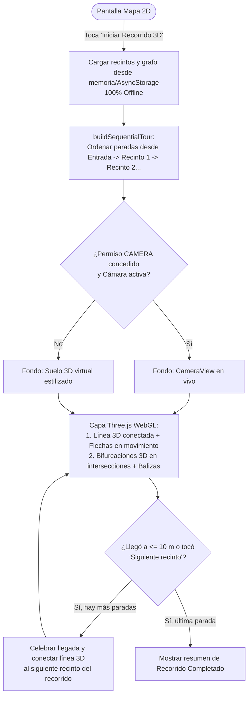

# 009 · Recorrido Guiado 3D y Cámara AR con Senderos, Bifurcaciones y Modo Offline (`ar-3d-map-guide`)

- App dueña: `mobile`
- Apps/paquetes afectados: `apps/mobile`, `@arca/tokens`
- Estado: Borrador (listo para aprobación funcional)
- Solicitante / responsable funcional: Víctor Adrián
- Aprobación funcional: Víctor Adrián (pendiente de firma final para pasar a Plan/Tasks)
- ADR relacionado: `docs/adr/0023-mobile-ar-3d-camera-threejs.md` (Propuesto)

---

## Problema y contexto

El Mapa 2D (`mobile-007` V1 a V3) permite al visitante consultar el plano del Zoológico Municipal Nicolás Bravo, ver su punto azul GPS, hacer zoom/pan y trazar una polilínea en 2D sobre los pasillos.

Sin embargo, durante la visita física al zoológico se necesita una experiencia inmersiva, dinámica y guiada paso a paso: un **Recorrido Guiado 3D sobre la Cámara con Three.js** que:
1. Permita al visitante tocar **«Iniciar Recorrido 3D»** desde la misma pantalla del Mapa 2D, arrancando en la **Entrada Principal** rumbo al **primer recinto** y avanzando secuencialmente de recinto en recinto por todo el zoológico (o hacia un recinto específico).
2. No sea una flecha estática aislada, sino una **red tridimensional viva proyectada sobre el suelo de la cámara**: con **líneas de conexión 3D**, una **corriente de flechas (chevrons 3D) en movimiento** hacia el destino y **bifurcaciones visibles en 3D** en cada cruce de pasillos (mostrando tanto el ramal principal del recorrido como las desviaciones hacia otros recintos cercanos).
3. Funcione **100 % Offline (sin internet ni datos móviles)** dentro del zoológico, apoyándose en el chip GPS satelital, los sensores internos del teléfono, geometría procedural de Three.js en memoria y el caché local (`AsyncStorage` + grafo `zooPaths.ts`).

---

## Objetivos

- Integrar en la pantalla del Mapa 2D (`mobile-007`) el acceso directo al **Recorrido 3D / Cámara AR (`mobile-009`)**, permitiendo iniciar el recorrido secuencial completo (Entrada → Recinto 1 → Recinto 2 → … → Fin) o navegar hacia un destino puntual.
- Renderizar con **Three.js** (`three`, `expo-gl`, `expo-three`) sobre el feed en vivo de la cámara trasera (`expo-camera`) una escena 3D dinámica compuesta por:
  - **Cinta de sendero y corriente de flechas 3D animadas** que fluyen desde la posición del visitante hacia el siguiente nodo del camino.
  - **Líneas de conexión y bifurcaciones 3D:** cuando el sendero llega a una intersección con múltiples salidas en `zooPaths.ts`, renderizar en 3D los ramales que se abren hacia los lados con balizas flotantes indicando a qué zona o recinto lleva cada ramal.
- Avanzar automáticamente al siguiente recinto del recorrido cuando el visitante llega a $\le 10\text{ m}$ del recinto actual (`haversineMeters`), permitiendo también avanzar/retroceder de parada manualmente o desviarse en una bifurcación.
- Garantizar operación **100 % Offline** sin conexión de red y proveer un **Modo Escena 3D sin cámara** + controles manuales de giro como alternativa accesible cuando no haya permiso de cámara o brújula.

---

## Fuera de alcance

- Captura, grabación o subida de fotos/video de la cámara (el feed de cámara es estrictamente efímero en pantalla).
- Descarga en tiempo real de modelos `.glb`/`.gltf` pesados desde internet o uso de APIs de nube de pago (Google Cloud Anchors / Mapbox AR).
- Mecánicas de videojuego de Zoopedia (sujetas a `ADR 0005`).
- Nuevas tablas o migraciones de base de datos (reutiliza `DBR-008` y `zooPaths.ts`).

---

## Actores y permisos

| Actor/rol | Necesidad | Permisos requeridos |
|---|---|---|
| Visitante en recorrido con cámara (Online u Offline) | Seguir el circuito de recintos viendo en su cámara las flechas en movimiento, líneas de conexión y bifurcaciones 3D | `CAMERA` (primer plano), `ACCESS_FINE_LOCATION` (primer plano, heredado de `007`) y magnetómetro (`expo-sensors`) |
| Visitante sin permiso de cámara o sin brújula | Seguir el mismo recorrido 3D con líneas y bifurcaciones sobre un suelo 3D virtual y controles táctiles | Sin permiso de cámara; funciona en **Modo Escena 3D** con botones accesibles de orientación |

---

## Historias de usuario

- **HU-01 (Iniciar recorrido secuencial desde la entrada):** Como visitante en el zoológico, quiero presionar **«Iniciar Recorrido 3D»** en la pantalla del mapa para que la app me guíe desde la entrada hasta el primer recinto y, al llegar, me conecte automáticamente con el siguiente recinto del circuito.
- **HU-02 (Flechas en movimiento y líneas de conexión 3D):** Como visitante caminando con la cámara activa, quiero ver sobre el suelo una línea 3D conectada entre nodos con flechas animadas fluyendo hacia adelante para sentir una guía viva y clara.
- **HU-03 (Bifurcaciones visibles en los cruces):** Como visitante que se acerca a una intersección de pasillos, quiero ver en 3D cómo se divide el camino (bifurcaciones) con carteles flotantes que me indiquen cuál ramal sigue mi recorrido y a qué otros recintos llevan los demás pasillos.
- **HU-04 (Operación 100 % Offline sin internet):** Como visitante sin datos móviles o en una zona sin cobertura dentro del zoológico, quiero que el recorrido 3D con cámara, las bifurcaciones y la detección de llegada funcionen sin conexión a internet.
- **HU-05 (Control de paradas del recorrido):** Como visitante en el recorrido 3D, quiero ver en pantalla en qué parada voy (ej. *"Parada 1 de 7: Zona de Elefantes"*), poder pasar al siguiente recinto, regresar al anterior o elegir otro ramal en una bifurcación.
- **HU-06 (Alternativa accesible sin cámara o sin brújula):** Como visitante que rechazó el permiso de cámara o cuyo teléfono no tiene magnetómetro, quiero ver la misma red de senderos, flechas y bifurcaciones sobre un suelo 3D virtual y girar la vista con botones accesibles.

---

## Criterios de aceptación

- **CA-01 (Acceso desde el Mapa 2D y secuencia del recorrido):** Dado que el visitante está en la pantalla del Mapa 2D, cuando presiona **«Iniciar Recorrido 3D»**, entonces se abre el visor 3D/AR en la misma pantalla estableciendo una secuencia ordenada de recintos (`tourStops`) que inicia desde la posición actual / Entrada Principal hacia el primer recinto; y al presionar **«Volver al mapa 2D»**, regresa al plano 2D conservando el progreso o destino activo.
- **CA-02 (Transición automática y manual entre recintos del recorrido):** Dado que el recorrido 3D está activo en la parada $k$, cuando el visitante se sitúa a $\le 10\text{ m}$ del recinto $k$ (`haversineMeters`) o presiona el botón accesible **«Siguiente recinto»**, entonces se muestra el aviso de llegada del recinto $k$ y la ruta 3D se conecta automáticamente hacia el recinto $k+1$ hasta completar el circuito.
- **CA-03 (Renderizado Three.js de sendero conectado y flechas animadas):** Dado un tramo activo entre la posición del visitante y el recinto objetivo, cuando se renderiza la escena en `GLView` (`Three.js`), entonces se generan en perspectiva 3D los segmentos de línea que conectan los nodos del sendero y una serie de flechas (chevrons 3D) con animación continua de avance sobre el camino, superpuestos sobre `CameraView` (si hay permiso `CAMERA`) o sobre el suelo 3D virtual (si no hay cámara).
- **CA-04 (Generación de bifurcaciones y ramales en intersecciones):** Dado que el nodo actual o siguiente del sendero en `zooPaths.ts` tiene grado $\ge 3$ (una bifurcación o cruce de pasillos), cuando `computeTourForks` procesa el grafo, entonces devuelve el **ramal principal** (hacia el recinto objetivo actual) y los **ramales secundarios** (con el ángulo de desviación y el nombre del recinto/zona al que conectan), renderizándose en la escena 3D como líneas bifurcadas con etiquetas accesibles.
- **CA-05 (Funcionamiento 100 % Offline):** Dado un dispositivo sin conexión a internet (`isConnected === false`), cuando el visitante inicia y recorre el Mapa 3D/AR, entonces los recintos se leen desde la caché local (`AsyncStorage`, ADR 0014) o desde el catálogo base empaquetado (`MOCK_MAP_PLACES` + `ZOO_PATH_NODES`), y el GPS, la brújula, la cámara y Three.js operan sin realizar peticiones de red ni fallar por falta de conectividad.
- **CA-06 (Orientación por brújula suavizada y controles manuales accesibles):** Dado el visor 3D/AR activo, cuando el magnetómetro emite lecturas o el visitante presiona los botones accesibles **«Girar a la izquierda»**, **«Girar a la derecha»** o **«Alinear al frente»**, entonces el rumbo de la cámara 3D de Three.js se actualiza suavemente (filtro de paso bajo) alineando los caminos y bifurcaciones 3D con la dirección del visitante.
- **CA-07 (Liberación limpia de Cámara, WebGL y Sensores):** Dado que el visor 3D/AR está montado, cuando el visitante vuelve al Mapa 2D o el componente se desmonta, entonces se cancela el ciclo `requestAnimationFrame` de Three.js, se remueve la suscripción de `expo-sensors` y se desmonta `CameraView` sin fugas de memoria.
- **CA-08 (Separación MVVM, tokens e idioma):** Toda la lógica de secuencia del recorrido, cálculo de ángulos 3D y detección de bifurcaciones vive en utilidades puras (`src/utils/arMath.ts`, `src/utils/tourPlanner.ts`) y ViewModels (`useArTourViewModel.ts`), sin colores hex/rgba quemados en vistas y con toda la interfaz en español.

---

## Reglas de negocio

- **RN-01 (Autonomía 100 % Offline):** Ninguna función del recorrido 3D/AR puede depender de llamadas HTTP bloqueantes durante la caminata; toda geometría 3D se genera proceduralmente en cliente con `Three.js` y los datos provienen de memoria/caché local.
- **RN-02 (Cámara efímera y privacidad):** `expo-camera` se usa únicamente como vista de fondo en tiempo real; nunca captura fotos, ni graba video, ni almacena imágenes.
- **RN-03 (Orden lógico del recorrido desde la entrada):** Cuando el visitante inicia el recorrido completo desde la entrada sin haber fijado un orden personalizado, `buildSequentialTour` ordena los recintos visibles siguiendo una ruta continua por cercanía sobre el grafo de senderos (`zooPaths.ts`) para evitar cruces innecesarios de extremo a extremo.
- **RN-04 (Bifurcaciones basadas en el grafo único):** Las bifurcaciones 3D no se inventan en la vista; se derivan matemáticamente de las aristas adyacentes en `ZOO_PATH_EDGES` (`src/constants/zooPaths.ts`).
- **RN-05 (Alternativa accesible obligatoria):** Si el permiso `CAMERA` es denegado o no hay magnetómetro, el recorrido funciona íntegramente en **Modo Escena 3D** con controles táctiles/botones accesibles.

---

## Datos, privacidad y auditoría

- **Datos utilizados:** Lista de recintos (`MapPlace` desde caché `AsyncStorage` o fixture local), grafo de senderos (`ZOO_PATH_NODES`, `ZOO_PATH_EDGES`), coordenadas GPS en primer plano (`UserPosition`) y rumbo del magnetómetro en memoria.
- **Privacidad:** Ni el feed de cámara ni las lecturas de sensores se guardan ni se transmiten fuera del dispositivo.
- **Base de datos / DBR:** No requiere nueva DBR (reutiliza `DBR-008`).

---

## Flujos y errores

---

## Dependencias, riesgos y preguntas

- **Dependencias / ADR:**
  - [ADR 0023 · Visor de Guía 3D y Realidad Aumentada con Cámara, Three.js y Sensores](../../../docs/adr/0023-mobile-ar-3d-camera-threejs.md).
  - [ADR 0014 · Caché offline y detección de conectividad en la app móvil](../../../docs/adr/0014-mobile-offline-cache-and-connectivity.md).
  - [ADR 0016 · Ubicación GPS en tiempo real con expo-location](../../../docs/adr/0016-expo-location-gps-blue-dot.md).
- **Riesgos y mitigaciones:**
  - **Visitante sin internet dentro del zoológico:** Mitigado por diseño (`CA-05`, `RN-01`) ya que Three.js genera las flechas, líneas y bifurcaciones proceduralmente y los datos viven en local/`AsyncStorage`.
  - **Brújula inestable o ausente:** Mitigado con filtro de paso bajo circular y botones de giro manual en el HUD (`CA-06`).
- **Preguntas abiertas:** Ninguna — todas las decisiones funcionales (acceso desde la pantalla del Mapa 2D, recorrido secuencial desde la entrada con flechas/líneas/bifurcaciones dinámicas y soporte 100 % offline) han sido definidas por el responsable funcional (Víctor Adrián, 2026-11-05).

---

## Revisión

- **Responsable funcional:** Víctor Adrián (2026-11-05).
- **Evidencia/enlaces:**
  - `docs/adr/0023-mobile-ar-3d-camera-threejs.md`
  - `apps/mobile/docs/009-guia-mapa-3d-ar-threejs.md`
  - `apps/mobile/specs/007-map-location.md`
