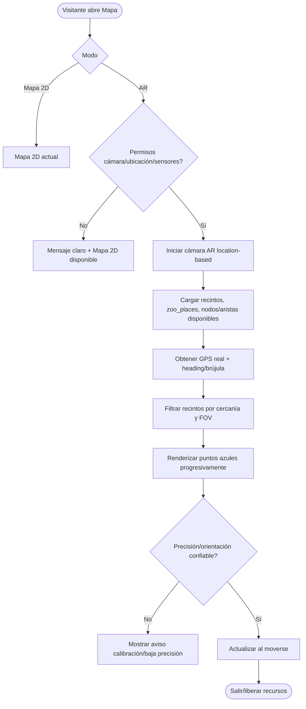

# 015 · Recorrido AR location-based con recintos, `zoo_places` y ruteo por nodos (`spatial-ar-tour`)

- App dueña: `mobile`
- Apps/paquetes afectados: `apps/mobile`, `apps/api` (exposición/contrato de datos geográficos), `@arca/api-client` (tipos/consumo si aplica), `docs/database/requests/` (DBR de aristas si aplica)
- Estado: Implementada
- Solicitada: 2026-11-20
- Aprobada: 2026-11-20
- Aprobación funcional: Aprobada

## Problema y contexto

La spec `009-ar-3d-map-guide` entrega un recorrido 3D/AR en `apps/mobile` que proyecta senderos, chevrons animados y bifurcaciones como overlay SVG sobre la cámara (`ThreeTourScene` + `arMath`), además de un modo escena 3D sin cámara. Esa solución se percibe superpuesta y no aprovecha coordenadas reales de recintos/lugares para mostrar puntos en la dirección real del usuario.

DBR-019 implementó en `arca_pruebas` las tablas `zoo_places` (lugares de servicio/operación) y `path_nodes` (nodos de ruta). DBR-008 agregó coordenadas a `enclosures`. Sin embargo, `path_edges` quedó diferido en DBR-019 (fase 2), por lo que aún no existe una red enrutable completa por BD.

Se aprueba evolucionar el modo AR a un enfoque **location-based** (cámara + GPS + brújula), mostrando puntos AR de recintos según coordenadas reales, simplificando la experiencia a Mapa 2D y AR, e integrando datos de `zoo_places`/`path_nodes`/`path_edges` para ruteo.

## Objetivos

- Simplificar la experiencia a **dos modos**: Mapa 2D y AR.
- En modo AR, eliminar la línea azul y las flechas/chevrons superpuestos del recorrido actual.
- Mostrar puntos azules AR de **recintos** (`enclosures`) cuando el usuario apunte la cámara y esté razonablemente cerca de sus coordenadas; no mostrar `path_nodes` como puntos AR.
- Usar calibración location-based: coordenadas de BD + GPS en tiempo real + brújula/orientación del dispositivo.
- Integrar `zoo_places` y `path_nodes` como datos del dominio; alimentar ruteo con `path_nodes` y `path_edges` cuando la red esté disponible.
- Mantener privacidad, offline definido, accesibilidad y fallback seguro.

## Fuera de alcance

- Cambios prioritarios al Mapa 2D; la línea/ruta azul punteada del Mapa 2D se mantiene por ahora.
- Mostrar `path_nodes` como puntos/markers AR.
- Modo escena 3D sin cámara (se elimina).
- Anclaje SLAM nativo ARCore/ARKit con detección de planos/anchors en esta fase (evolución futura).
- Captura, grabación, almacenamiento o envío de fotos/video.
- Implementar `path_edges` sin DBR aprobada y migración responsable de BD.
- Edición operativa de catálogos geográficos desde mobile.

## Actores y permisos

| Actor/rol | Necesidad | Permisos requeridos |
|---|---|---|
| Visitante | Ver recintos cercanos en AR y seguir orientación/ruta | `CAMERA` (primer plano), ubicación en primer plano, brújula/magnetómetro/sensores de movimiento |
| Visitante sin permisos/soporte | Usar alternativa segura | Sin cámara; Mapa 2D disponible |
| Responsable funcional (Backend) | Validar alcance, datos y comportamiento | N/A en app móvil |

## Historias de usuario

- **HU-01 (Dos modos):** Como visitante, quiero usar solo Mapa 2D o AR, para una experiencia simple.
- **HU-02 (Puntos de recintos en AR):** Como visitante, quiero que al apuntar la cámara aparezcan puntos azules de recintos cercanos según coordenadas reales, para identificar recintos a mi alrededor.
- **HU-03 (Sin overlay antiguo):** Como visitante, quiero que el modo AR no muestre la línea azul ni flechas superpuestas, para ver una guía más limpia.
- **HU-04 (Cerca de ti y llegada):** Como visitante, quiero ver recintos y lugares cercanos de forma dinámica y saber cuándo llegué, para explorar libremente sin un tour estático.
- **HU-05 (Ruteo por red de nodos):** Como visitante, quiero que las rutas usen la red de nodos/caminos del zoológico cuando exista red disponible, para seguir recorridos reales.
- **HU-06 (Privacidad):** Como visitante, quiero que la cámara solo se use en primer plano para AR, sin grabar ni enviar video.

## Criterios de aceptación

- **CA-01 (Solo dos modos):** Dado que el visitante está en la experiencia de mapa, cuando ve los controles de modo, entonces solo dispone de **Mapa 2D** y **AR**; el modo escena 3D sin cámara no se presenta.
- **CA-02 (AR sin línea/flechas antiguas):** Dado el modo AR activo, cuando se renderiza la vista de cámara, entonces no se muestra la línea azul ni las flechas/chevrons SVG del overlay anterior.
- **CA-03 (Puntos AR por location-based):** Dado que el modo AR está activo y existen recintos/`zoo_places` con coordenadas válidas, cuando el usuario apunta el teléfono y está razonablemente cerca, entonces aparece un punto azul para recintos y un punto color vino para `zoo_places`; los puntos se renderizan progresivamente por cercanía/campo de visión, no todos al mismo tiempo. `path_nodes` no se muestran como puntos AR. Valores iniciales (ajustables en plan/pruebas de campo): FOV horizontal 70° (±35° del heading), rango máximo 120 m, rango mínimo de ruido 3 m, máximo 8 puntos simultáneos, prioridad por cercanía y cercanía al centro del FOV; etiqueta con nombre visible cuando el recinto está a ≤50 m o es el más centrado.
- **CA-04 (Calibración location-based):** Dado coordenadas de BD y sensores del dispositivo, cuando se calcula la posición de un punto AR, entonces se usan `gps_lat/gps_lon` del recinto/lugar (fuente aprobada), GPS en tiempo real del usuario y brújula/orientación del dispositivo; si la precisión/orientación es baja, la UI muestra un estado claro de baja precisión/calibración.
- **CA-04b (Cerca de ti dinámico):** Dado el modo AR activo, cuando existen recintos/`zoo_places` cercanos con coordenadas válidas, entonces la UI muestra un panel dinámico "Cerca de ti" con esos puntos ordenados por cercanía (no por tour estático). Al tocar un punto, se muestra una tarjeta simple con nombre, tipo, distancia y estado de llegada/visitado; si es recinto, puede abrir la ficha de animales/recinto existente.
- **CA-04c (Llegada y visitados en sesión):** Dado que el usuario se acerca a <=20 m (ajustable) de un recinto o `zoo_place`, cuando se detecta la llegada, entonces la app muestra "Llegaste a X" con información relevante (recinto: componentes de animales/recinto existentes; `zoo_place`: nombre, tipo, descripción) y marca el lugar como visitado durante la sesión. No usa botones Anterior/Siguiente de tour estático.
- **CA-05 (Datos de `zoo_places` y `path_nodes`):** Dado que DBR-019 está implementada, cuando la app consume datos geográficos, entonces puede obtener `zoo_places` y `path_nodes` desde el contrato aprobado/API/caché definida; `zoo_places` se tratan como lugares distintos de recintos (cafetería, zonas comunes, servicios, etc.) y `path_nodes` como puntos de inicio/intersección de caminos para ruteo, no como markers AR.
- **CA-06 (Ruteo por `path_nodes`/`path_edges`):** Dado que existe una red de ruta válida, cuando se calcula una ruta, entonces el ruteo se alimenta por `path_nodes` y `path_edges` según el contrato aprobado; mientras `path_edges` no esté disponible, se aplica la transición/fallback definida en plan (sin rutas inventadas).
- **CA-07 (Fallback):** Dado falta de permisos, soporte o fallo AR, cuando el visitante intenta usar AR, entonces la app mantiene disponible Mapa 2D y muestra un mensaje claro; no bloquea la orientación básica.
- **CA-08 (Privacidad y recursos):** Dado el modo AR activo, cuando se usa o se desmonta, entonces la cámara se usa solo en primer plano, no se captura/graba/envía video, y se liberan cámara/sensores/listeners.
- **CA-09 (Offline):** Dado ausencia de conectividad, cuando hay caché local aprobada, entonces la app puede mostrar recintos, información básica de animales dentro de recintos, `zoo_places`, `path_nodes` y datos de ruta necesarios; si faltan datos, muestra estado claro.
- **CA-10 (Pruebas):** Dado el alcance implementado, cuando se entregue, entonces cada CA-xx tendrá al menos un test automatizado que lo nombre en el nivel viable, y las limitaciones de dispositivo real quedarán registradas.

## Reglas de negocio

- **RN-01 (Privacidad de cámara):** Cámara solo para AR en primer plano; prohibido capturar, grabar, persistir o transmitir frames/video.
- **RN-02 (Fuente de verdad):** `enclosures`, `zoo_places`, `path_nodes` y `path_edges` provienen de BD/API aprobada; mobile no inventa ni modifica datos de dominio fuera de caché temporal aprobada.
- **RN-03 (AR location-based):** La primera versión usa GPS + brújula + cámara. No se promete anclaje SLAM/planos ARCore/ARKit en esta fase.
- **RN-04 (Renderizado progresivo):** Recintos y zoo_places como puntos AR (colores diferenciados). No renderizar todos simultáneamente; priorizar por cercanía, campo de visión y rango razonable.
- **RN-05 (No puntos para nodos):** `path_nodes` se usan para ruteo/intersecciones/inicio de caminos, no como markers AR visibles.
- **RN-06 (Ruteo válido):** Sin `path_edges` válidos no se genera ruta inventada; aplicar fallback definido.
- **RN-07 (MVVM):** Lógica de GPS, brújula, FOV, ruteo y estado AR en utilidades/ViewModels/servicios; vistas solo presentan.
- **RN-08 (Fallback):** Mapa 2D permanece disponible; quitar modo 3D sin cámara no debe dejar al usuario sin alternativa.

## Datos, privacidad y auditoría

### Consulta previa de esquema vivo (, `arca_pruebas`, solo lectura)
- Existen `zoo_places` y `path_nodes`; **no existe `path_edges`**.
- Existe `enclosures` con coordenadas. Existe `animals` con relación a `enclosure_id` y `species_id`.
- Resultado: hace falta DBR para `path_edges` y contrato API para consumo mobile; no hay esquema de aristas listo.

### Campos relevantes (DBR/esquema vivo)

| Tabla | Campos relevantes | Fuente |
|---|---|---|
| `enclosures` | `id`, `name`, `gps_lat` DECIMAL(10,8), `gps_lon` DECIMAL(11,8), `map_x` DECIMAL(5,4), `map_y` DECIMAL(5,4), `is_active`, `updated_at`, `deleted_at` | DBR-008 / esquema vivo |
| `zoo_places` | `id`, `name`, `name_original`, `place_type` (catálogo cerrado: `servicios`, `operativo`, `comun`, `comercial`, `infraestructura`, `otro`), `gps_lat`, `gps_lon`, `map_x`, `map_y`, `is_visible`, `description`, `created_at`, `updated_at`, `deleted_at` | DBR-019 / esquema vivo |
| `path_nodes` | `id`, `name`, `node_type` (`inicio`, `interseccion`, `fin`, `paso`), `gps_lat`, `gps_lon`, `map_x`, `map_y`, `created_at`, `updated_at`, `deleted_at` | DBR-019 / esquema vivo |
| `path_edges` | **Pendiente DBR fase 2**. Mínimo esperado: origen/destino de nodos, bidireccionalidad, peso/distancia; definición final por responsable de BD. | DBR-019 (diferido) |
| `animals` | `id`, `name`, `tag_number`, `sex`, `birth_date`, `origin`, `characteristics`, `photo_path`, `enclosure_id`, `species_id`, `can_receive_visits`, `stay_status`, `updated_at`, `deleted_at` | Esquema vivo |
| `species` | `id`, `common_name`, `scientific_name`, `category`, `habitat`, `conservation_status`, `feeding`, `image_path`, `is_published`, `published_fields`, `deleted_at` | Esquema vivo |

### Offline mínimo (a detallar en plan)
- Recintos: id, nombre, coordenadas, estado visible/activo.
- Animales por recinto (básico): id, nombre, `enclosure_id`, `species_id`, `photo_path`/imagen utilizable, `can_receive_visits`, y datos básicos de especie publicada (`common_name`, `scientific_name`, `image_path`) según contrato aprobado.
- `zoo_places`: id, nombre, tipo, coordenadas, visibilidad.
- `path_nodes` y, cuando exista, `path_edges` para ruteo.

## Flujos y errores

## Dependencias, riesgos y preguntas

- **Dependencias:**
  - DBR-019 implementada; DBR-008 implementada.
  - **DBR nueva requerida para `path_edges`** (responsable de BD por asignar; bloquea ruteo completo CA-06).
  - Contrato API para exponer recintos/`zoo_places`/`path_nodes`/`path_edges` a mobile.
  - ADR/decisión técnica: location-based confirmado para esta fase; evaluar librerías/componentes compatibles con Expo.
- **Riesgos:**
  - Precisión GPS/brújula: deriva posible; mitigación con rango, FOV, aviso de baja precisión y renderizado progresivo.
  - `path_edges` ausente: ruteo completo bloqueado hasta DBR/contrato.
  - `map_x/map_y` nulos en `zoo_places/path_nodes`: no bloquea GPS, pero sí cualquier fallback basado en mapa SVG.
  - Consumo batería por cámara+GPS+sensores.

## Decisiones confirmadas

1. **AR location-based** confirmado (GPS + brújula + cámara), no ARCore/ARKit SLAM en esta fase.
2. **`path_nodes`** son coordenadas de inicio de camino/intersecciones/pasos/fines para ruteo; **no** se muestran como puntos AR.
3. **Puntos AR**: solo recintos (`enclosures`) cuando el usuario apunta y está razonablemente cerca.
4. **Modo 3D sin cámara** eliminado; solo Mapa 2D y AR.
5. **Mapa 2D** se mantiene como está por ahora.
6. **Offline** debe incluir recintos, info básica de animales dentro de recintos, `zoo_places`, `path_nodes` y datos de ruta necesarios.
7. **Ruteo mientras no exista `path_edges`**: fallback temporal manteniendo `zooPaths.ts` actual; no se inventan aristas. Cuando exista DBR/contrato de `path_edges`, se migra el ruteo a la red por BD.
8. **Aprobación funcional** confirmada (backend).
9. **Enmienda (confirmada por backend):** quitar botones Anterior/Siguiente recinto; quitar tour estático; agregar panel dinámico "Cerca de ti" con recintos/`zoo_places` cercanos; al tocar mostrar tarjeta simple; llegada <=20 m muestra "Llegaste a X" y marca visitado en sesión; mantener componentes de animales por recinto (`ArAnimalProximityCard`, `EnclosureDetailModal`).
10. **Enmienda (path_nodes):** `path_nodes` no se renderizan como puntos AR, pero sí pueden mostrarse como tarjeta contextual cercana (intersección/inicio/fin/paso) para orientar al visitante.

## Pendientes para plan

- Validar en campo los valores iniciales de FOV/rango definidos en CA-03 (FOV 70°, máx. 120 m, máx. 8 puntos, etiqueta ≤50 m) y ajustar.
- Definir contrato API y estrategia de caché offline (campos mínimos exactos, TTL/versionado).
- **Ruteo sin path_edges:** confirmado fallback temporal con zooPaths.ts mientras no exista DBR/contrato de path_edges. path_nodes se integran como datos, pero CA-06 completo por BD queda diferido hasta que exista red de aristas aprobada.
- Fuera de alcance de esta entrega: definir si `zoo_places` se muestran en alguna lista o UI no AR; en esta fase quedan como datos preparados.

## Revisión

- **Responsable funcional:** Backend.
- **Aprobación funcional:** Aprobada.
- **Evidencia/enlaces:**
  - `apps/mobile/specs/009-ar-3d-map-guide.md`
  - `docs/database/requests/DBR-008-enclosure-gps-coordinates.md`
  - `docs/database/requests/DBR-019-zoo-places-and-path-nodes.md`
  - `apps/mobile/src/components/map/ThreeTourScene.tsx`
  - `apps/mobile/src/utils/arMath.ts`
  - `apps/mobile/src/viewmodels/useArTourViewModel.ts`
  - `apps/mobile/src/utils/pathfinding.ts`
  - `apps/mobile/src/constants/zooPaths.ts`